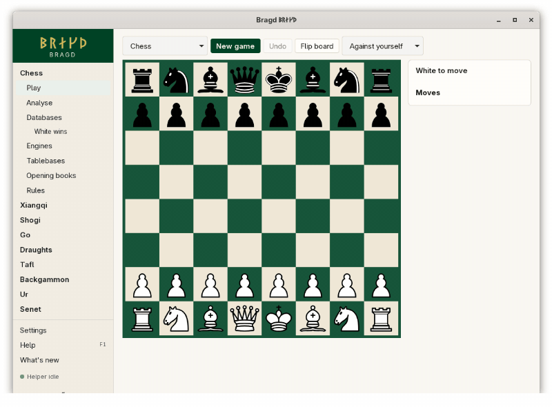
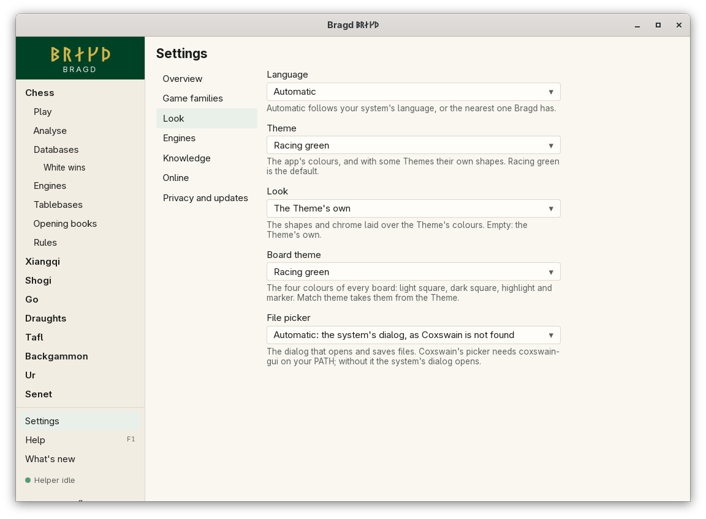

# Bragd ᛒᚱᛅᚴᚦ

*Bragð*, Old Norse for "a clever move". Bragd is a desktop app for playing, studying and keeping turn-based board games: chess and its old and fairy Variants, xiangqi and janggi, shogi, go, draughts, tafl, backgammon, ur and senet.

Status: in early development, with no release yet. See [the specification](docs/spec.md).

<picture>
  <source media="(prefers-reduced-motion: reduce)" srcset="docs/screenshots/play-chess-self.png">
  
</picture>

## Highlights

- **Nine Game families, 25 Variants.** Chess, Chess960, shatranj, chaturanga, King of the Hill, Racing Kings, Seirawan and Capablanca chess; xiangqi and janggi; shogi; go on three boards; four draughts rulesets; four tafl rulesets; backgammon, ur and senet. Each one plays against yourself, and every Family with an outside Engine plays against it. Turn off what you do not play.
- **Your games, where they are.** PGN, SCID, ChessBase, SGF, KIF, CSA and PDN files open in place. Imports go into a Library, Bragd's own SQLite store, where each Game appears once and remembers every Source it came from.
- **Sources on a schedule.** The Helper, a background process shared by every window, fetches TWIC and your own URLs, keeps only the Games your Strip rules allow, and holds what Bragd keeps on disk to your limits.
- **Engines without the setup.** Stockfish, Fairy-Stockfish, Pikafish, YaneuraOu, KataGo, GNU Go, Scan and GNU Backgammon are found when installed. Analyse shows their lines on any position, and a review marks the good and bad moves of a Game.
- **Chess extras.** Syzygy tablebases, with the Lichess tablebase as an opt-in fallback, and Polyglot opening books.
- **Thirty Themes and four Board themes.** Racing green is the default. The others come from old desktops and home computers, and a Board theme can match the Theme.
- **In your language.** 55 locales, right to left where the language is.
- **Nothing leaves the machine unless you ask.** The update check is the one exception, and it can be turned off.

## Install

Bragd has had no release yet, so the channels below are empty until the first one. The install scripts build it from source today. Every channel and file is in [Installing Bragd](docs/getting-started/install.md).

| System | Channel | How |
|---|---|---|
| FreeBSD and other BSDs | Desktop tarballs | Planned, not yet available |
| Linux | GitHub release | `.deb`, `.rpm` or AppImage, for x64 and arm64 |
| Linux | Flatpak | `flatpak install --user Bragd_X.Y.Z_x86_64.flatpak` (the bundle from the release) |
| Linux | Nix | `nix run github:mwo-dk/bragd` |
| Linux | Homebrew | `brew install --cask mwo-dk/bragd/bragd` |
| Any | Script | `./install/install.sh` (Linux, macOS) or `install\install.ps1` (Windows), from a clone |
| macOS | GitHub release | `.dmg` for Apple Silicon or Intel |
| macOS | Homebrew | `brew install --cask mwo-dk/bragd/bragd` |
| Windows | GitHub release | NSIS `.exe` or `.msi`, for x64 and arm64 |
| Windows | WinGet | `winget install mwo-dk.Bragd` |

Every installer has a `.sha256` beside it, and `SHA256SUMS` covers them all. Bragd never updates itself: it checks for a newer version and names your channel's upgrade command.

## First steps

1. Start Bragd. The [install wizard](docs/getting-started/first-start.md) asks for your language, Theme and Board theme, the Game families you play, and the downloads you want. Every step can be skipped.
2. Pick a Family in the [sidebar](docs/getting-started/sidebar.md) and choose *Play*. Click a piece, then its square: [Playing against yourself](docs/play/against-yourself.md).
3. Set *Opponent* to *Against an engine* to play an installed Engine: [Playing against an Engine](docs/play/against-an-engine.md).
4. Open a PGN file under *Databases*: [Foreign databases](docs/knowledge/foreign-databases.md).
5. Press **F1** for every feature and the questions people ask about it.

## Documentation

Every feature has its own page under [docs/](docs/README.md), grouped by area:

| Area | What it covers |
|---|---|
| [Getting started](docs/getting-started/README.md) | Installing, the install wizard, Game families, the sidebar, F1 and What's new |
| [Play](docs/play/README.md) | Playing against yourself or an Engine, and each Family's controls |
| [Knowledge](docs/knowledge/README.md) | Foreign databases, Libraries, Duplicates, Slices, Sources, Strip rules, Disk watch and the Helper |
| [Engines](docs/engines/README.md) | Engines, container images, Analyse, review, tablebases and opening books |
| [Look](docs/look/README.md) | Themes, Looks, Board themes and languages |
| [Online](docs/online/README.md) | Playing online: not yet available |
| [Reference](docs/reference/README.md) | `config.toml`, every setting, the command line, files on disk and privacy |
| [Rules](docs/rules/README.md) | The rules of every Game family and Variant |

Also: [the specification](docs/spec.md), [the glossary](GLOSSARY.md), [the decisions](docs/adr/) and [the credits](docs/CREDITS.md).

## Changelog

The last ten versions; every one is in [the changelog](docs/changelog.md).

| Version | Date | What's new |
|---|---|---|

Licence: MIT. Artwork licences are in [Credits](docs/CREDITS.md).
