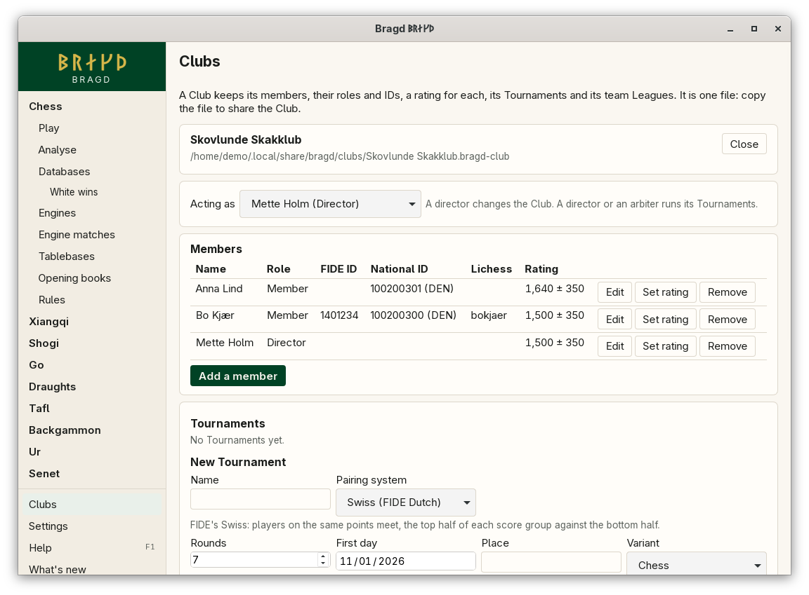
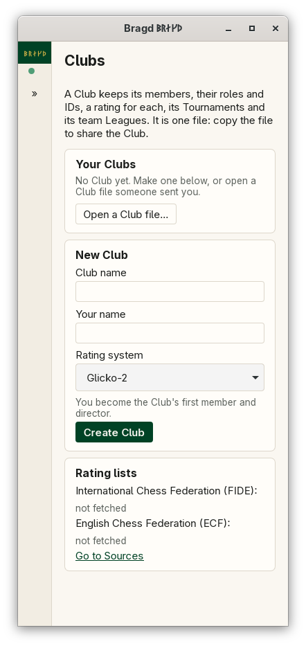

[← README](../../README.md) · [Docs index](../README.md) · [Clubs](README.md)

# Clubs

A Club keeps its members, each with a role and their FIDE, national and Lichess IDs, a rating the Club keeps for each of them, its [Tournaments](tournaments.md) and its team [Leagues](leagues.md). The rating is Glicko-2 or Elo, chosen per Club. Every rating a director sets by hand goes into an audit log: who, when, the old value, the new value and why. A Club is one file. Copy the file to share the Club. While a Club is open, a lock tells anyone else who opens the same file that someone is working on it. In F1 → Features this is the entry `clubs`.

*The Clubs page with a Club open.*

*At 390 px, before a Club is opened.*

## Contents

- [How to reach it](#how-to-reach-it)
- [Members, roles and IDs](#members-roles-and-ids)
- [Club ratings and the audit log](#club-ratings-and-the-audit-log)
- [The lock](#the-lock)
- [Finding players in rating lists](#finding-players-in-rating-lists)
- [What it needs](#what-it-needs)
- [Settings and config.toml](#settings-and-configtoml)
- [Questions](#questions)

## How to reach it

**Clubs** in the sidebar, above Settings. It is there whichever Game families are on.

| Action | What it does |
|---|---|
| **Create Club** | Makes a new Club file from its name, your name and the rating system. You become its first member and director |
| **Open a Club file…** | Opens a `.bragd-club` file from anywhere, such as one a club mate sent you or a shared folder |
| A Club's name | Opens a Club from the list of those you made or opened here |
| **Forget** | Takes a Club off the list. Its file stays where it is |
| **Close** | Closes the Club and lets go of its lock |

## Members, roles and IDs

Each member has a name, a role and up to three IDs.

| Field | What it holds |
|---|---|
| Role | Director, arbiter or member. Only a director changes the Club, and a Club always keeps at least one. A director or an arbiter runs its [Tournaments](tournaments.md) |
| FIDE ID | Digits only |
| National ID | The member's number at their federation, with the federation's three-letter code, such as `DEN` |
| Lichess | The Lichess username: 2 to 30 letters, digits, `_` or `-` |

Choose yourself under **Acting as** first: it lists the Club's directors and arbiters, and only a director changes members. Then **Add a member**, **Edit**, **Set rating** and **Remove** work. Bragd checks the role, not the person: anyone who has the file can choose a director's name, so the audit log is a record, not a guard.

## Club ratings and the audit log

The rating system is chosen when the Club is made, and a director can change it later. The ratings stay as they are when it changes.

| System | What it keeps | A new member starts at |
|---|---|---|
| Glicko-2 (the default) | A rating, its deviation (shown as ±) and its volatility | 1500 ± 350, or the rating from a rating list |
| Elo | A rating, with a K-factor of 20 | 1500, or the rating from a rating list |

Bragd's Glicko-2 is checked against the worked example in Mark Glickman's description of the system.

**Set rating** asks for the new rating and why. The audit log under the members keeps every change: when, who, the member, the old and new values and the reason. Changing the rating system and taking over the lock are logged too. Ratings from games will come with Tournaments.

## The lock

When you open a Club, Bragd writes `<file>.bragd-club.lock` beside it with your user name, your machine's name and the time. Closing the Club, or Bragd, removes it.

| Who has the lock | What you see |
|---|---|
| Nobody | The Club opens, and the lock is yours |
| You, on this machine | The Club opens. A lock left by a window that closed without letting go counts as yours |
| Someone else | The Club opens read-only, with who has it and since when. **Take over** takes the lock after you confirm, and the audit log says so |

The lock is a file of its own, so a copy of the Club file carries no lock.

## Finding players in rating lists

When you add a member, **Find in rating lists** searches the lists Bragd has fetched, by name or by ID. Words of a name can come in any order, each word can be just its start, and accents do not matter: `moller` finds Møller, and `carl mag` finds Carlsen, Magnus. Click a player to fill in the name, the IDs and, for a new member, the starting rating.

The lists are Sources: the International Chess Federation (FIDE), the Danish Chess Union (DSU), the English Chess Federation (ECF), the Chess Federation of Canada (CFC), the Finnish Chess Federation (SShL) and the New Zealand Chess Federation (NZCF). FIDE's list and your own federation's come first. Bragd finds your federation from its language and your system's region: Danish or Denmark gives the DSU, and `en_NZ` gives the NZCF. The other lists wait under **More lists**, and the Clubs page's *Rating lists* panel names only the first ones and any list you have fetched. Each is off until you tick it in the install wizard's Knowledge step or turn it on under chess's **Databases** → Sources. The Helper then fetches it once a month in the background. Its size shows before anything is downloaded. Where each list comes from, its terms, and why other federations' lists are missing: [Rating lists](../reference/rating-lists.md).

## What it needs

Nothing for Clubs. Finding players needs a rating list, which needs the [Helper](../knowledge/helper.md) and a download you agree to.

## Settings and config.toml

Clubs have no settings. The Club files you opened are remembered in `state.json` ([Files on disk](../reference/files.md)). The rating lists are Sources, with their options on the [Sources](../knowledge/sources.md) page.

## Questions

#### Where is a new Club kept?

In `clubs/` in Bragd's data folder ([Files on disk](../reference/files.md)), as `<name>.bragd-club`. The page shows the path when the Club is open. Move it anywhere and open it from there with **Open a Club file…**.

#### How do two directors share a Club?

Put the file in a folder both can reach, such as a shared drive, and open it from there. The lock stops you both changing it at once. Or send it: a copy is a Club of its own, and changes made in one copy do not reach the other.

#### Why are the buttons greyed out?

Choose a director under **Acting as** (an arbiter runs Tournaments but does not change members), or take over the lock if someone else has the Club open.

#### Why can't I remove the last director?

A Club without a director could never be changed again. Make someone else a director first.

#### Why does a member's rating show ±?

The Club uses Glicko-2, which keeps how sure it is of each rating. The number after ± shrinks as the member plays.

---
[← Previous: Clubs](README.md) · [Next: Tournaments →](tournaments.md)
