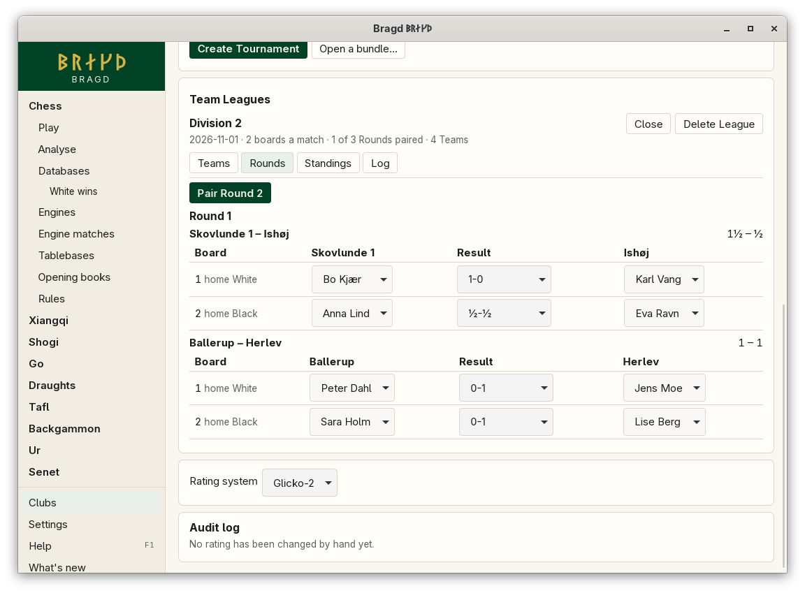
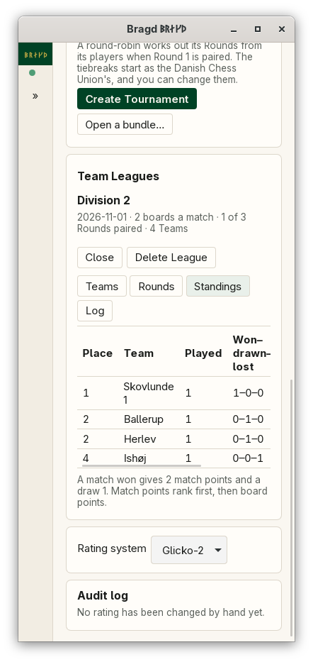

[← README](../../README.md) · [Docs index](../README.md) · [Clubs](README.md)

# Team Leagues

A Club runs team Leagues. Its Teams meet each other in a round-robin, once or twice, each match on the same number of boards. Each Team lines up its players in board order. You enter each board's result, and Bragd adds the boards up to the match's board points. A match won gives 2 match points and a draw 1. The standings rank by match points, then board points. A League is kept in its Club's file, like a Tournament. In F1 → Features this is the entry `leagues`.

*A League open on its Rounds tab.*

*The standings at 390 px.*

## Contents

- [How to reach it](#how-to-reach-it)
- [Setting up a League](#setting-up-a-league)
- [Rounds, line-ups and results](#rounds-line-ups-and-results)
- [Standings](#standings)
- [What it needs](#what-it-needs)
- [Settings and config.toml](#settings-and-configtoml)
- [Questions](#questions)

## How to reach it

**Clubs** in the sidebar, open a Club, then **Team Leagues** below its Tournaments. Choose who you are under **Acting as**: a director or an arbiter runs a League, and only a director deletes one.

| Action | What it does |
|---|---|
| **Create League** | Sets up a League from its name, boards per match, first day, and whether each pair of Teams meets twice |
| **Delete League** | Deletes it with its Rounds and results, after asking |

A League has four tabs: **Teams**, **Rounds**, **Standings** and **Log**.

## Setting up a League

| Field | What it does |
|---|---|
| League name | Up to 100 characters |
| Boards per match | 1 to 20 |
| Each pair of Teams meets twice, home and away | A double round-robin. The second meeting has home and away swapped |

On the **Teams** tab, **New Team** takes the Team's name and its players in board order: Club members from **Add a member…**, or guests by name. The arrows move a player up or down, and ✕ takes one off. **Add Team** adds it. Teams can be added until Round 1 is paired. The Teams are numbered in the order they were added, and that number places them in the Berger tables.

## Rounds, line-ups and results

**Pair Round** pairs the next Round by FIDE's Berger tables, once every result of the last Round is in. With an odd number of Teams, one Team sits each Round out and gets no points for it. Every Team sits out once in each cycle.

| Step | What you do |
|---|---|
| Line-up | Each match shows its boards. A Team plays its first players by default. Pick another player for a board, or – to leave it empty, before the match has a result. Players stay in board order |
| Colours | The home Team has White on boards 1, 3, 5 and so on, the away Team on boards 2, 4, 6. Each board says which |
| Results | Choose each board's result: 1-0, ½-½, 0-1 or a forfeit. A board with one player missing can only be won by forfeit by the player who is there. A board with both missing is a double forfeit |
| Corrections | Changing a result already entered asks why. The **Log** tab keeps the old and the new result with the reason |

The match's score shows beside its Teams as board points, home first.

## Standings

| Column | What it is |
|---|---|
| Place | Teams level on match points and board points share a place |
| Team | |
| Played | Matches with every board's result in |
| Won–drawn–lost | Matches |
| Match points | 2 for a match won, 1 for a draw |
| Board points | Every board won is 1, a draw ½ |

## What it needs

Nothing beyond an open Club.

## Settings and config.toml

Leagues have no settings. Each League's boards and its single or double round-robin are its own, kept in the Club file.

## Questions

#### Why are match points ranked before board points?

That is how most team championships, the Olympiad among them, rank Teams: a match is won or lost as a whole. Board points then separate Teams level on match points.

#### What does a Team that sits a Round out get?

Nothing. Every Team sits out once in each cycle of an odd League, so no Team gains from it.

#### Can a Team change its players once the League has started?

Its list is fixed once Round 1 is paired, but each match's line-up is chosen from it, and a board can be left empty.

#### Who may enter results?

A director or an arbiter. Only a director deletes a League.

---
[← Previous: Tournaments](tournaments.md) · [Next: Look →](../look/README.md)
