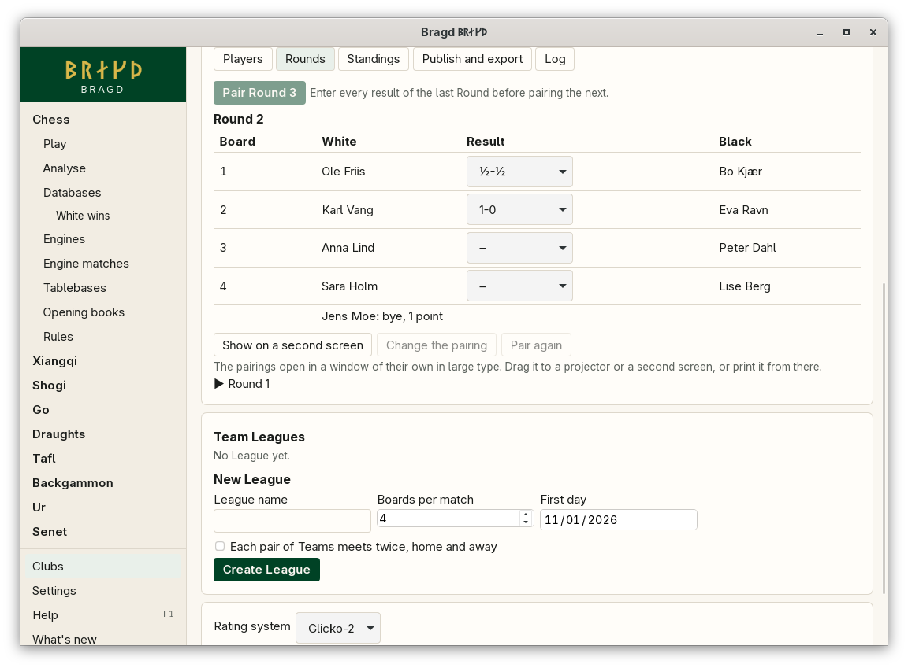
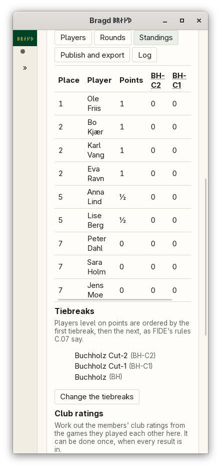
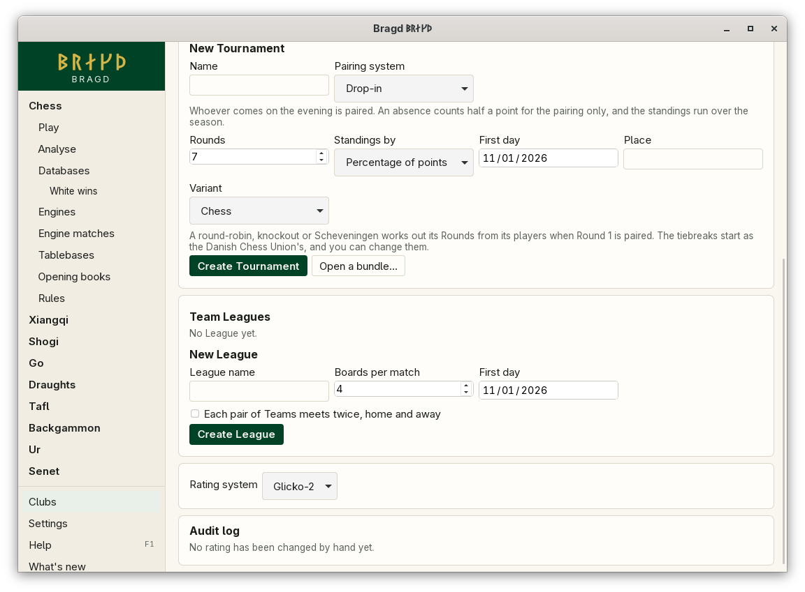
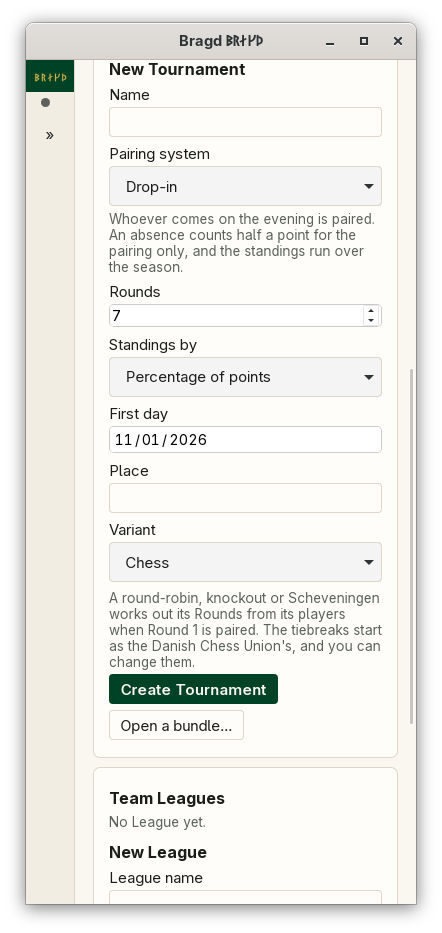

[← README](../../README.md) · [Docs index](../README.md) · [Clubs](README.md)

# Tournaments

A Club runs its own Tournaments, in any of nine pairing systems: a Swiss by FIDE's Dutch rules (with Baku acceleration if you like), Monrad, the Nordic Swiss, a Drop-in, a single or double round-robin, a knockout, or a single or double Scheveningen between two teams. On the night you check players in, pair the Round, show the pairings on a second screen, enter the results and publish the standings. A director can change any pairing. Bragd says which rules the change breaks and keeps it in the Tournament's log with the reason. Players level on points are ordered by FIDE's tiebreaks, in the order you choose. A Tournament is kept in its Club's file, so a copy of the Club carries its Tournaments. In F1 → Features this is the entry `tournaments`.

*A Tournament open on its Rounds tab.*

*The standings at 390 px.*

*Choosing a pairing system: each one says in a line what it does.*

*The same form at 390 px.*

## Contents

- [How to reach it](#how-to-reach-it)
- [Pairing systems](#pairing-systems)
- [Every Family](#every-family)
- [On the night](#on-the-night)
- [Changing a pairing](#changing-a-pairing)
- [Results and corrections](#results-and-corrections)
- [Tiebreaks](#tiebreaks)
- [Publishing and exports](#publishing-and-exports)
- [Club ratings](#club-ratings)
- [What it needs](#what-it-needs)
- [Settings and config.toml](#settings-and-configtoml)
- [Questions](#questions)

## How to reach it

**Clubs** in the sidebar, open a Club, then **Tournaments** below its members. Choose who you are under **Acting as**: a director or an arbiter runs a Tournament, and only a director deletes one, changes a pairing by hand or rates the members' games.

| Action | What it does |
|---|---|
| **Create Tournament** | Sets up a Tournament from its name, [pairing system](#pairing-systems), number of Rounds (for the Swiss systems), first day, place and Variant |
| **Open a bundle…** | Adds the Tournament in a `.bragd-tournament` bundle to the open Club |
| **Delete Tournament** | Deletes it with its Rounds and results, after asking |

A Tournament has five tabs: **Players**, **Rounds**, **Standings**, **Publish and export** and **Log**.

## Pairing systems

**Pairing system** on the New Tournament form lists them all, with a line below it on what the chosen one does. The pairing rules themselves are in the reference pages linked below.

| System | Who meets whom | Rounds | Bye |
|---|---|---|---|
| Swiss (FIDE Dutch) | Players on the same points, the top half of each score group against the bottom half ([Swiss pairing](../reference/swiss-pairing.md)). Players are numbered by rating | You set them | 1 point |
| Swiss with **Baku acceleration** | As the Swiss, but in the first half of the Rounds the top half of the field has extra points for the pairing only ([Accelerated rounds](../reference/swiss-pairing.md#accelerated-rounds)) | You set them | 1 point |
| Monrad (DSU) | Numbers are drawn by lot when Round 1 is paired. Each Round, from the top of the standings, each player meets the nearest one below not yet met ([Monrad](../reference/monrad.md)) | You set them | 1 point |
| Nordic Swiss (DSU) | The Danish Chess Union's *Dansk Schweizer*: in each score group the strong half meets the weak half, numbered by rating ([Nordic Swiss](../reference/monrad.md#nordic-swiss)) | You set them | 1 point |
| Drop-in | Whoever is checked in on the evening. An absence counts half a point for the pairing only ([Drop-in](../reference/drop-in.md)) | You set them: the evenings of the season | 1 point |
| Round-robin, double round-robin | Everyone meets everyone, once or twice, by FIDE's Berger tables ([Round-robin](../reference/round-robin-and-knockout.md)) | From the players | A free Round, no points |
| Knockout | The loser of each match is out. Seeds go by rating, and when the field is not 2, 4, 8, 16, … the top seeds go straight to Round 2 | From the players | Straight through |
| Scheveningen, double Scheveningen | Team 1 against team 2: every player meets every player of the other team, once or twice | From the players | None |

The Swiss systems take late entries and pair whoever is checked in. A round-robin, a knockout and a Scheveningen fix their players when Round 1 is paired and take no new ones after that.

**Monrad.** The draw is made when you press **Pair Round 1**. A late entry gets the next number.

**Knockout.** Each board is a match. When a match ends ½-½, or neither played, choose its **Play-off winner** beside the result once the play-off games are over. The next Round cannot be paired until every match has a winner. After that, a match's winner cannot change: a correction that would put someone else through is refused.

**Scheveningen.** The **Team** column on the Players tab puts each player in team 1 or team 2, until Round 1 is paired. The two teams need the same number of players. Within a team, players are ordered by rating. Players in no team do not play.

**Drop-in.** Choose **Standings by** when you set it up:

| Standings by | How players are ranked |
|---|---|
| Percentage of points (the default) | Points as a share of the most a player could have scored on the evenings they came. The Points column shows, for example, *3½ of 5 (70 %)*. A player who never came is last |
| Total points | All points scored |
| Best results | Only the best N results, where you set N |

An evening a player is away counts half a point for the pairing only: it never shows in the standings. So a Drop-in has no half-point byes.

## Every Family

A Tournament can be played in any Variant you have turned on. **Variant** shows on the form when more than one is on, and the Tournament names its Variant under its title. Two Families have options of their own:

| Family | Option | What it does |
|---|---|---|
| Go | **Handicap games** | The weaker player of each pair takes Black. Every 100 rating points between the two is one stone, as on the European Go Federation's list, less **Stones fewer**, and at most **Most stones** (9 at the most). A gap of one stone is played with no stones, Black first and komi 0.5. From two stones up, Black gets the stones and White komi 0.5. The board shows its handicap beside White's name. Games within 50 points of each other are even, with the colours the pairing gave |
| Backgammon | **Matches to (points)** | Each pairing is a match to that many points, from 1 to 99. Its result is the match's winner, so a draw cannot be entered |

The Variant and these options are set when the Tournament is created and cannot change once Round 1 is paired. The PGN export names the Variant and each game's handicap.

## On the night

| Step | Where | What you do |
|---|---|---|
| Register | Players | Pick a **Club member**, or find a **Guest from a rating list** by name or ID, or type a guest in. **Check them in at once** checks a player in as they are added |
| Check in | Players | Set each player's **Status**: *Checked in*, *Not here*, *Half-point bye next Round* or *Withdrawn*. **Check in everyone** checks in all who are *Not here* |
| Pair | Rounds | **Pair Round N**. It is greyed out, with the reason beside it, until every result of the last Round is in |
| Show | Rounds | **Show on a second screen** opens the pairings in large type in a window of their own. Drag it to a projector or print it from there |
| Enter results | Rounds | Choose each board's result: 1-0, ½-½, 0-1, a forfeit either way, or neither played |
| Publish | Publish and export | Save **Standings and crosstable (HTML)** and put it where the club can see it |

Only players who are checked in are paired. A player with a half-point bye gets half a point for the next Round and is checked in again after it. A player who is not here gets nothing for the Round. A player who withdraws keeps their results and is never paired again. A late entry starts with no points for the Rounds before; in a Swiss they are paired from the next Round. If someone arrives after the pairing, check them in and press **Pair again**, giving the reason.

A Swiss gives the player left over a bye worth a point. A round-robin fixes everyone's number when Round 1 is paired, by rating, and takes no new players after that. With an odd number of players, one sits out each Round with no points. The other systems are under [Pairing systems](#pairing-systems).

## Changing a pairing

**Change the pairing** lets a director choose White and Black on each board, and the bye, while no result of the Round is in. **Check against the rules** then says what the change breaks. Which warnings can come depends on the system:

| System | What the check compares |
|---|---|
| Swiss (FIDE Dutch) | Every criterion of the Dutch rules, as below |
| Monrad, Nordic Swiss, Drop-in | Players who meet again, a second bye, and players left out. In Monrad and the Nordic Swiss meeting again is never allowed; in a Drop-in it is allowed but put off |
| Round-robin | The Berger table's pairing for the Round |
| Knockout | The bracket's pairing for the Round |
| Scheveningen | The schedule's pairing for the Round |

The warnings:

| Warning | Meaning |
|---|---|
| Breaks an absolute rule | Two players meet again, someone gets a second bye, or the rest of the Round cannot be paired |
| The rules' pairing does better on … | Legal, but worse on one of the Dutch system's criteria, C5 to C21, named in words |
| The rules take another one first | As good on every criterion, but not the one the rules choose |
| Colours differ from the rules | The same pairs, with colours the other way on the boards named |
| Not the Berger table's pairing | In a round-robin, the boards differ from the table |
| Not the knockout bracket's pairing | In a knockout, the boards differ from the bracket |
| Not the Scheveningen schedule's pairing | In a Scheveningen, the boards differ from the schedule |
| These players have met before | In Monrad, the Nordic Swiss or a Drop-in, the pairs named have played each other already |
| … has had a bye already | In Monrad, the Nordic Swiss or a Drop-in, the bye goes to a player who had one |
| … is checked in but not paired | Someone who is here has no board |

You can keep a pairing with warnings. **Keep this pairing** needs a reason, and the log keeps the old pairing, the new one, the warnings and the reason.

## Results and corrections

A result entered for the first time is not logged. Changing a result that is already there asks why, and the log keeps the old and new result with the reason. Earlier Rounds are under the current one, folded; open one to correct it.

## Tiebreaks

The **Standings** tab ranks players by points, then by the first tiebreak, then the next, as FIDE's Tie-Break Regulations (C.07, from 1 March 2026) say. Players level on everything share a place. **Change the tiebreaks** reorders, adds and removes them.

| Code | Tiebreak |
|---|---|
| DE | Direct encounter |
| WIN | Wins, with or without playing |
| WON | Games won over the board |
| BPG | Games with Black |
| BWG | Wins with Black |
| PS | Progressive score |
| BH | Buchholz |
| BH-C1, BH-C2 | Buchholz without the lowest one or two opponents |
| BH-M1, BH-M2 | Buchholz without the lowest and highest one or two |
| AOB | Average of opponents' Buchholz |
| SB, SB-C1 | Sonneborn-Berger, and without the lowest |
| KS | Koya |
| ARO, ARO-C1 | Average rating of opponents, and without the lowest |
| TPR | Performance rating |
| RTNG | The player's own rating |

A new Tournament starts with the Danish Chess Union's defaults (EMT rules, §24): a Swiss, Monrad and the Nordic Swiss use *almindelig korrektion*, which is BH-C2, then BH-C1, then BH; a round-robin uses SB. A Scheveningen uses SB too, since everyone in a team meets the same opponents and Buchholz cannot tell them apart. A knockout and a Drop-in start with none: a knockout ranks by how far a player went, and a Drop-in by its own standings.

In a Swiss, Monrad, Nordic Swiss or Drop-in, rounds a player did not play count as C.07 Article 16 says. For an opponent's Buchholz, a player's byes or absences that are followed only by more of them count as draws. For a player's own Buchholz, each unplayed Round counts as a game against an opponent with the player's own score, but at most a draw a Round, or the scheduled opponent's score for a forfeit. Cutting the lowest value cuts a Round the player chose not to play first. In a round-robin, forfeits count as games. The rating tiebreaks leave unrated opponents out.

## Publishing and exports

| Export | What it holds |
|---|---|
| **Standings and crosstable (HTML)** | One page with the standings and every tiebreak, the crosstable and every Round's pairings and results. It needs no Bragd to read |
| **FIDE report (TRF)** | FIDE's Tournament Report File (TRF-2026), with the tiebreaks in its `202` line and the system in its `192` line. Pairing programs and FIDE rating reports read it |
| **Games (PGN)** | Every game played over the board, with the players, ratings, FIDE IDs, Round, board and result, but no moves |
| **Bragd Tournament bundle** | The whole Tournament with its log, plus the three files above, in one `.bragd-tournament` file. **Open a bundle…** reads it into a Club |

The `192` line uses FIDE's code table: `FIDE_DUTCH` or `FIDE_DUTCH_BAKU`, `FIDE_ROUNDROBIN` or `FIDE_DOUBLEROUNDROBIN`, and for the systems FIDE does not define `CUSTOM_SWISS` (Monrad, Nordic Swiss, Drop-in), `CUSTOM_KNOCKOUT` and `CUSTOM_SCHEVENINGEN`. FIDE has not yet fixed a Scheveningen schedule, so Bragd's own is a custom one.

The Danish Chess Union publishes no file format for rating reports. Results are typed into its web system, turnering.skak.dk, which takes the games as PGN, so there is no DSU export beyond the PGN.

## Club ratings

When every result is in, **Rate the members' games** works out the club ratings of the members from the games they played each other, as one rating period. Guests and forfeits do not count. It can be done once per Tournament, and the Club's audit log names the Tournament.

## What it needs

Nothing beyond an open Club. Guests from a rating list need the list, which needs the [Helper](../knowledge/helper.md) and a download you agree to.

## Settings and config.toml

Tournaments have no settings. Each Tournament's system, Rounds and tiebreaks are its own, kept in the Club file.

## Questions

#### Why does a go player rated 1850 get two stones against 2000?

The gap is 150 points, and Bragd rounds it to the nearest 100: two stones. Set **Stones fewer** to 1 if your club plays one stone fewer than the full difference.

#### Why is Pair Round greyed out?

The reason shows beside it: a result of the last Round is missing, a drawn knockout match has no play-off winner, every Round has been paired, or fewer than two players are checked in. A Scheveningen also needs two teams of the same size.

#### How do I take in someone who came after the pairing?

Register and check them in, then **Pair again** before any result is entered. Bragd pairs the Round again from who is here now and logs it with your reason.

#### Can an arbiter change a pairing?

No. An arbiter registers, checks in, pairs, pairs again and enters results. Changing a pairing by hand, deleting a Tournament and rating the games are for a director.

#### Which system should a club evening use?

For a season of evenings where different people come each time, a Drop-in: nobody is penalised for missing an evening. For a tournament where everyone plays every Round, a Swiss or Monrad. Monrad is what most Danish clubs use; the FIDE Dutch is what FIDE-rated events must use.

#### Why does my Nordic Swiss differ from DSU's own program?

Bragd follows the Danish Chess Union's written rules (Skakhåndbogen 4.9.3 and the arbiter guide 4.9.4) and matches every worked example in them. DSU's own program often pairs later rounds another way. See [Nordic Swiss](../reference/monrad.md#nordic-swiss).

#### Why does Buchholz differ from another program's?

Since March 2026, C.07 caps the score that counts for a player's own unplayed Rounds. A program that still follows the 2024 rules counts a half-point bye at the player's full score.

#### Where are the pairings for the second screen kept?

In Bragd's cache folder, as `pairings.html`, written each time you press **Show on a second screen**. The window shows that page and nothing else.

---
[← Previous: Clubs](clubs.md) · [Next: Team Leagues →](leagues.md)
