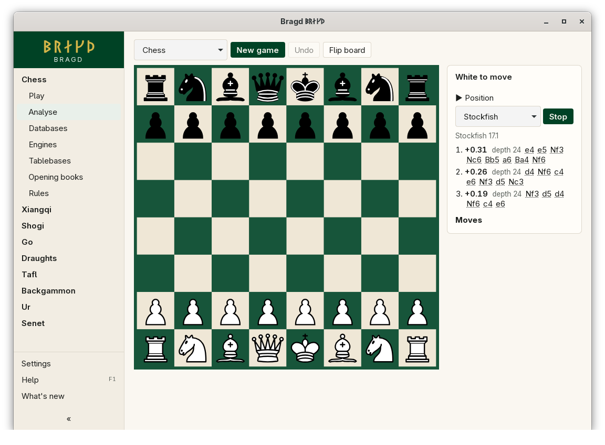
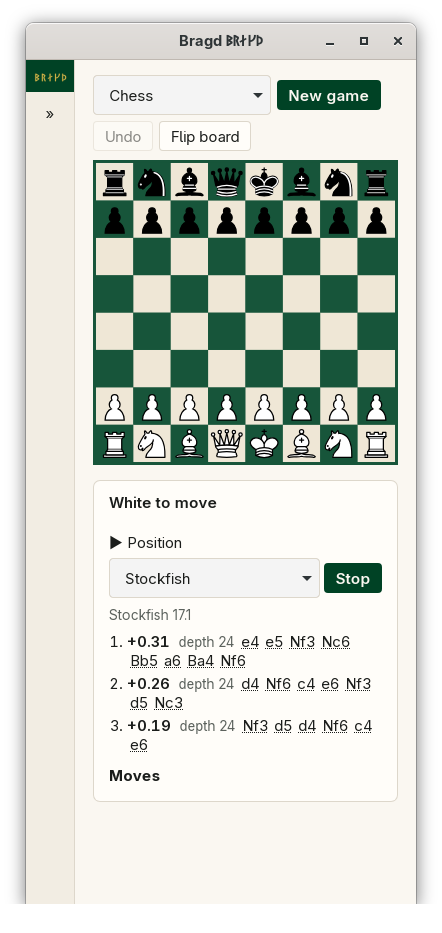

[← README](../../README.md) · [Docs index](../README.md) · [Engines](README.md)

# Analyse

Analyse runs an Engine on any position and shows its three best lines as they come. Each line has its score, its depth and up to ten moves in the Variant's notation. Click a move to play the line up to it. In F1 → Features this is the entry `analyse`.

*Analyse with three lines from the Engine.*

*At 390 px the panel moves under the board.*

## How to reach it

| Where | What to do |
|---|---|
| Sidebar | A Family with an Engine → **Analyse** |
| On the page | **Analyse** starts the Engine, **Stop** stops it |
| Position | *Position* → paste a FEN, SFEN, PDN or a go picture, then **Set up**. **Start position** goes back, **From the current game** takes the Game last played in Play |

Analyse is the Play board with an analysis panel. You move on the board as in Play, and the Engine follows the position while it is on. Scores are from the first Side's view: `+0.35` is good for White, `#3` is mate in three. For chess the panel also shows the opening's name, book moves ([Opening books](opening-books.md)) and what the [tablebases](tablebases.md) say.

Analyse reads the [Position store](../knowledge/position-store.md) first. When the chosen Engine has judged the position before, its line shows at once, with the depth it reached then. The Engine's own line takes over once it is as deep. When the Engine stops, its deepest line is kept in the store, with its second line, which gives `!` and `!!` in a [review](review.md#marks). When the store has an Annotation for the move that led here, it shows under the lines, such as *14. Bxf7?? Blunder. It leaves a piece hanging.*

## What it needs

- An Engine for the Variant that is ready ([The Engines page](engines.md)). The Engine list offers only ready ones; **Get more engines…** under it opens the Engines page. Tafl, Ur and Senet have none, so they have no Analyse item.
- For **Review the game**, at least one move. See [Game review](review.md).

## Settings and config.toml

| Setting | `config.toml` key | Default | What it does |
|---|---|---|---|
| Engine for each variant | `engines.default` | automatic | The Engine Analyse starts with. The list on the page changes it for this session |
| Ask Lichess for tablebase positions | `tablebases.online` | `true` | The tablebase answer for chess endings not covered locally |

## Questions

#### Why does a line show at depth 30 at once?

The Engine judged the position before, in Analyse or in a review, and the [Position store](../knowledge/position-store.md) kept it. The same position reached by another move order shows it too.

#### How long does the Engine think?

Until you press **Stop**, or for at most 60 s on one position. Each move you make starts it again on the new position.

#### Why are the scores the same sign when Black is to move?

Scores are always from the first Side's view, so `+1.0` is good for White whoever is to move. In xiangqi that is Red, in shogi Sente.

#### Which positions can I paste?

The Variant's own notation: FEN for chess and xiangqi, SFEN for shogi, PDN for draughts, and a go picture for go. Bragd checks it by replaying it, and says why when it is refused.

#### Why can I not analyse a go position I set up?

GTP, the go Engines' protocol, has no command for a set-up position here. Analyse refuses it. A go Game from the start position works.

#### Why is Analyse locked?

Analyse, reviews, book moves and tablebases are locked while a rated online Game against a person is being played. Online play is not available yet, so this never happens today.

#### Can I analyse a Game from a Library?

Not straight from the Library yet. Play it on the Play board, then use **From the current game**.

---
[← Previous: Engine container images](container-images.md) · [Next: Game review →](review.md)
