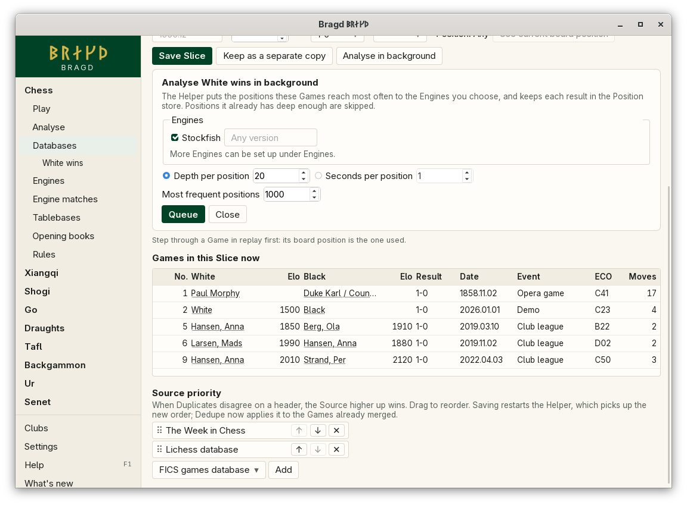
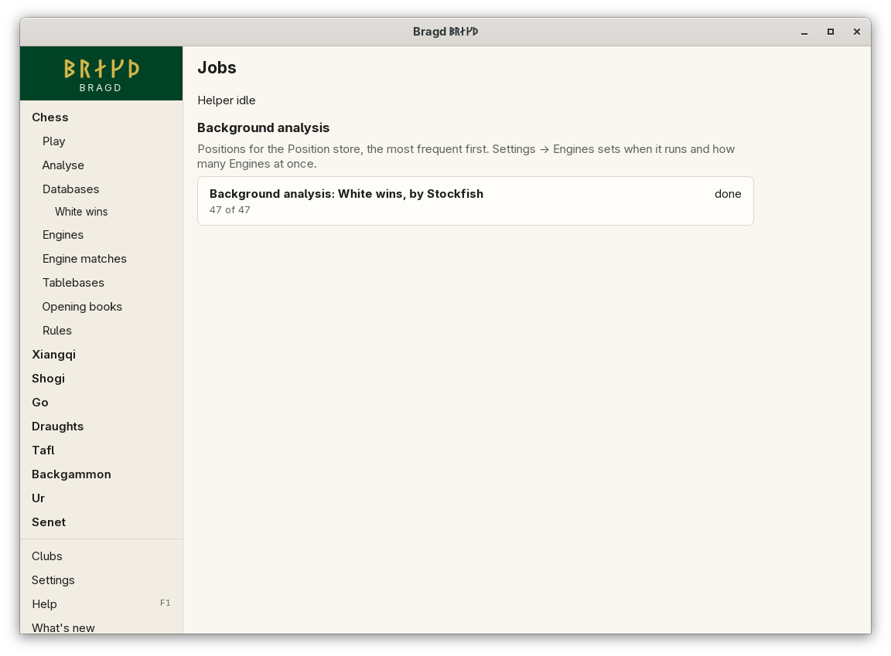

[← README](../../README.md) · [Docs index](../README.md) · [Engines](README.md)

# Background analysis

The [Helper](../knowledge/helper.md) puts positions to an Engine while you do other things, and keeps each result in the Position store, the one file per machine where Bragd keeps its Evaluations of positions, for every Library. In F1 → Features this is the entry `background`.

*Databases → Libraries → a saved Slice → Analyse in background.*

## How to reach it

| Where | What to do |
|---|---|
| Databases → Libraries → a saved Slice | **Analyse in background** below the Slice's fields |
| Settings → Engines | The limits: when it runs, how many Engines at once, on the battery or not |
| The Helper's line at the foot of the sidebar → Jobs | Each job's progress and the time left, under *Background analysis* |
| F1 → Features | **Background analysis** |

The action is there for chess Slices. Save the Slice first: a job names the Slice it came from.

## What goes into the queue

| From | How | Priority |
|---|---|---|
| A Slice you mark *Analyse in background* | Its most frequent positions, as many as you ask for, one job per Engine you tick | First |
| A chess Game you open from a Library or a Foreign database | Each of its positions once, by the Engine its Variant is analysed with, to the depth in Settings | After the Slices. Only the newest 20 wait; older ones give way |

Whole Libraries are never queued. Within a job the positions that occur most often go first, counted over the Slice's Games.

## Setting up a Slice job

| Field | What it does |
|---|---|
| Engines | Tick one or more. Only Engines that are there to run are offered |
| Oldest version | Per Engine, the oldest version that may answer, such as `Stockfish 17.1`. Empty: any. An older Engine stops the job with a message |
| Depth per position, or Seconds per position | How long each position is thought about |
| Most frequent positions | How many of the Slice's positions go into the job, the most frequent first. At most 100,000 |

A position the store already holds from a new enough Edition, at least as deep as asked, is skipped. A job stopped by a restart, a cancel or the limits goes on where it was.

## Limits on this machine

| Setting | `config.toml` key | Default | What it does |
|---|---|---|---|
| Analyse Games I open in the background | `analysis.open_games` | on | Queue each chess Game you open |
| Depth for Games I open | `analysis.depth` | `18` | Half-moves deep for an opened Game's positions |
| Engines at once in background analysis | `analysis.threads` | `1` | Engines running side by side, each on one thread. At most the machine's threads |
| Background analysis runs from hour | `analysis.from_hour` | `0` | Local time, 0 to 23 |
| Background analysis runs until hour | `analysis.until_hour` | `24` | 1 to 24. Smaller than the from hour runs across midnight, such as 22 to 7. The same hour as the from hour is any hour |
| Run background analysis on the battery too | `analysis.on_battery` | off | Off: it waits until the machine is plugged in |

While it waits for its hours or for the mains, the Jobs page says so.

*The Jobs page, opened from the Helper's line at the foot of the sidebar.*

## What it needs

- The [Helper](../knowledge/helper.md), which runs the queue on a worker of its own, beside imports and [Engine matches](matches.md).
- A chess Engine that is there to run ([The Engines page](engines.md)).

## Questions

#### Will it slow my machine down?

It runs one Engine on one thread unless you allow more, only in the hours you set, and not on the battery unless you allow it. Raise `analysis.threads` on a machine that is otherwise idle.

#### Does it analyse whole Libraries?

No. Only Slices you mark, and Games you open. A Slice job holds at most the number of positions you ask for.

#### Why does a new Engine version not analyse everything again?

A new Edition never queues anything by itself. Queue the Slice again, with the new version as the oldest that may answer: positions the older Edition answered are analysed again, the rest are skipped.

#### Where do the results go, and how do I free the space?

Into the Position store. [Disk watch](../knowledge/disk-watch.md#the-position-store) shows what each Engine and Edition takes there, and deletes older Editions or Engines you removed.

#### Why only chess?

Only chess Games are kept in moves Bragd can replay to each position. The other Families with an Engine follow.

---
[← Previous: Engine matches](matches.md) · [Next: Clubs →](../clubs/README.md)
