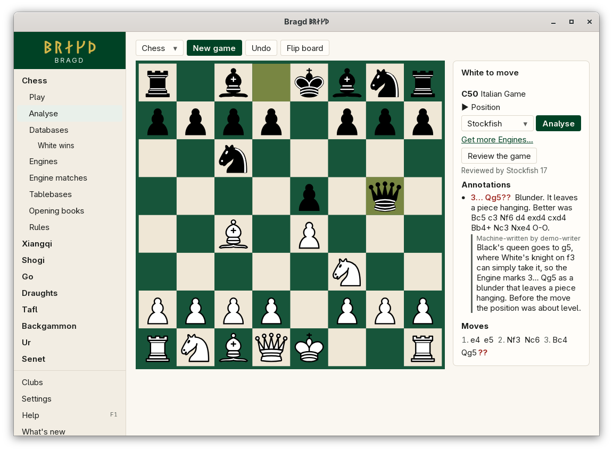
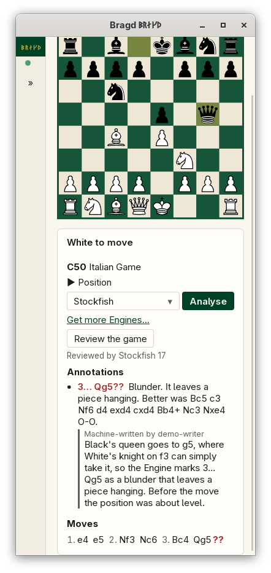

[← README](../../README.md) · [Docs index](../README.md) · [Engines](README.md)

# Commentary

Commentary is a few sentences about a move, written in your language by the [language model](../knowledge/language-model.md). It explains what the Engine found: the [Evaluation](../knowledge/position-store.md) before and after the move, the Engine's best and second lines, and the move's [Annotation](review.md). It is labelled *Machine-written by* and the model's name, and it is kept apart from the Annotation. In F1 this is the `commentary` entry.

*Analyse, with Commentary on a reviewed move.*

## Contents

- [How to reach it](#how-to-reach-it)
- [What the model is told](#what-the-model-is-told)
- [Where it is kept](#where-it-is-kept)
- [Questions](#questions)

## How to reach it

Commentary needs a language model: one set in *Settings → Language model*, or a [Peer](../peers/sharing.md) that has one. It also needs the Engine to have judged the move first. Bragd never writes it for every move by itself.

| Where | What to do |
|---|---|
| Analyse | Play or set up the move, run the Engine or review the Game, then press **Commentary** under the panel. It is about the last move on the board |
| Analyse → **Review the game** | Press **Commentary** beside a move in the Annotations list |

While the button cannot be used, the text beside it says why: the move is not analysed yet, or no language model is ready. A Commentary already kept in your language shows at once, without the button.

Commentary goes through the [Helper](../knowledge/helper.md)'s queue, on the same worker as translations. With a model on this machine, it is written here. With none, a paired machine with a model writes it, and it comes back here. Bragd waits up to two minutes for it.

## What the model is told

Bragd gathers the facts from the Position store and gives the model only those:

| Fact | Example |
|---|---|
| The Game family and Variant | chess, chess |
| The position before the move, in the Variant's notation | a FEN |
| The move, and who played it | 3… Qg5, by Black |
| The Engine and its depth | Stockfish 17.1 (depth 22) |
| The Evaluation before the move, with the best line | +0.35, Nc3 Nf6 |
| The Engine's second choice and its line | −0.40, d4 exd4 |
| The Evaluation after the move, with the best reply | +4.80, Nxg5 |
| The Annotation, in your words | Blunder. It leaves a piece hanging. |

The model is asked for two or three sentences in your language that explain these facts, and to add no moves, plans or history of its own. Scores are from the view of the side that moved first. A model can still get things wrong, which is why Commentary is always labelled machine-written.

## Where it is kept

Commentary is kept in the [Position store](../knowledge/position-store.md), in a table of its own, by position, move, language and model. A Game opened again, in any Library, shows the Commentary kept for its moves. Another language needs its own Commentary.

Paired machines swap Commentary with the rest of the Position store ([Sharing between Peers](../peers/sharing.md)). When two machines hold Commentary by the same model about the same move in the same language, the later one wins, so every machine ends with the same.

## Questions

#### Why is the Commentary button greyed out?

Either the Engine has not judged this move yet, or no language model is ready. Run the Engine in Analyse, or press **Review the game**, and set a model in *Settings → Language model*. The text beside the button says which.

#### Does my position leave the machine?

Only to the model you chose. A model on this machine keeps everything here. A cloud model needs your consent first, and then the facts above go to it ([Language model](../knowledge/language-model.md#questions)).

#### Can I get new Commentary for a move?

No. Once a move has Commentary in your language, it is shown instead of the button. When a Peer's model writes about the same move too, the latest one shows.

#### Why does it not write about a whole Game at once?

A model takes several seconds a move, and most moves need no prose. Commentary is written only for the moves you ask about.

---
[← Previous: Game review](review.md) · [Next: Tablebases →](tablebases.md)
