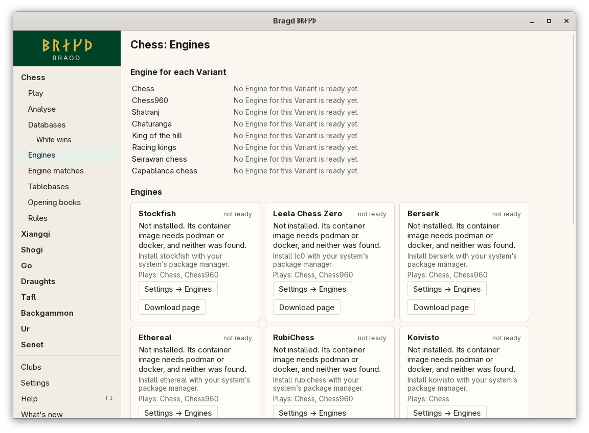
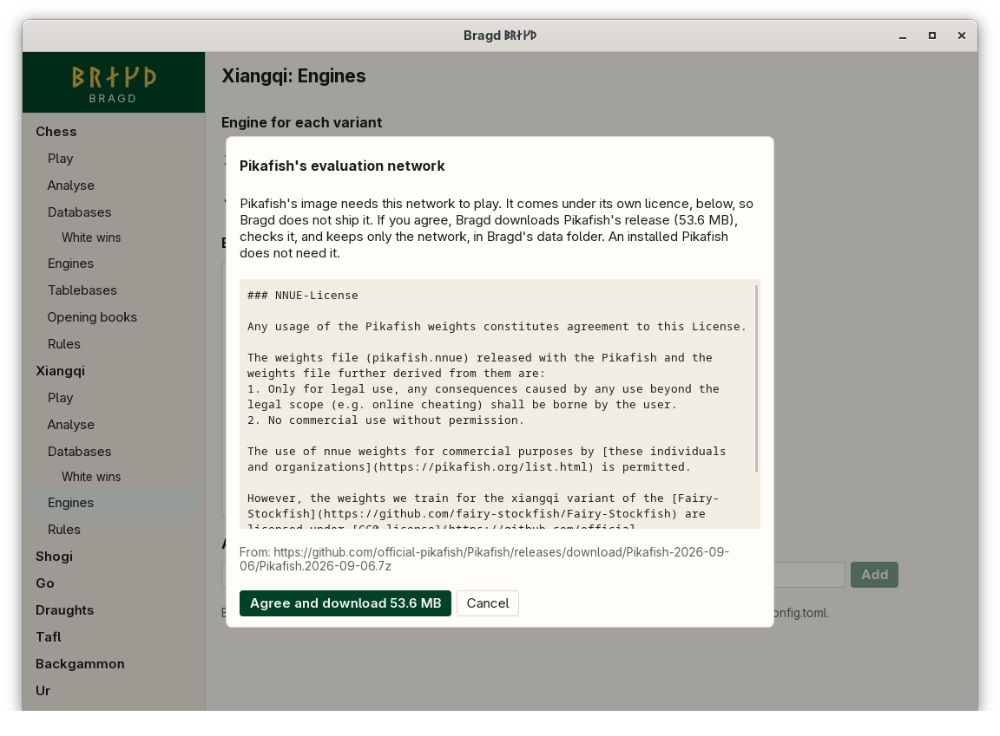

[← README](../../README.md) · [Docs index](../README.md) · [Engines](README.md)

# Engine container images

When an Engine is not installed, Bragd can run it from a sealed container image with podman or docker. The images are Bragd's own, at `ghcr.io/mwo-dk/bragd-<engine>`, and each is pinned by its digest.

**Not yet available.** No image is published yet, so no image is ever pulled. Each Engine that is not installed says *Not installed, and Bragd's image of it is not yet published*, with the program to install and its download page. Until the images come, install the Engine yourself.

*A card on the Engines page says where the Engine stands.*

## How to reach it

| Where | What to do |
|---|---|
| Sidebar | A Family → **Engines**. *Download image* shows on a card when an image can be pulled |
| Settings | *Settings → Engines*: *Pull an Engine that is not installed* and *Container runtime* |

## What it needs

- podman or docker on the machine. *Automatic* tries podman first, then docker.
- The image, pulled once. It shows its size before it downloads.

## How an image runs

| What | How |
|---|---|
| Which image | Only the one pinned by digest (`name:tag@sha256:…`). A tag alone is never pulled |
| Network | None (`--network=none`). A run never pulls (`--pull=never`) |
| Files | A read-only root, a 256 MB `/tmp` in memory, the tablebase folder read-only at `/syzygy`, and Pikafish's network read-only at `/network.nnue` |
| Rights | No capabilities, no new privileges, user `65534:65534` (nobody) |
| Bounds | 3 GB of memory and 256 processes, unless a rootless podman cannot keep them |
| Pulls | Progress shows on the card. A passing network or registry fault is tried again after 5 s, 30 s and 2 min |
| Updates | A new Bragd brings new pins. The new copy is pulled and only Bragd's old copy is removed |
| Pruning | An image no Engine used for 90 days is removed |

The update and pruning rounds are written but the app does not run them yet: they start once images are published.

## Settings and config.toml

| Setting | `config.toml` key | Default | What it does |
|---|---|---|---|
| Pull an Engine that is not installed | `engines.containers` | `true` | Run an Engine from its image when it is not installed |
| Container runtime | `engines.runtime` | `"auto"` | `auto` (podman, else docker), `podman` or `docker` |

## Questions

#### Does Bragd ever use an image when the Engine is installed?

No. An installed Engine is always used first. The image is only for an Engine that is not installed.

#### Can an Engine in a container reach the network or my files?

No. It runs with no network, a read-only filesystem, no capabilities and an unprivileged user. The only folder it sees is the tablebase folder, read-only, and Pikafish sees its network file, read-only.

#### Why does the Pikafish image need a download of its own?

Pikafish's evaluation network comes under its own licence: legal use only, and no commercial use without permission. So Bragd's Pikafish image holds only the program. Its card on the xiangqi Engines page says the network is missing, with **Read the network's licence…**. That shows the licence as Pikafish's release has it, the size and where it comes from. **Agree and download** downloads Pikafish's own release archive, about 53.6 MB, from GitHub. Bragd checks the archive against its SHA-256, takes `pikafish.nnue` out of it, checks that too, and keeps only the network, in `<data>/bragd/networks/pikafish/`. The image then gets it read-only, and Bragd sets its `EvalFile` option to it. Nothing is downloaded until you agree, and `BRAGD_OFFLINE` stops it. An installed Pikafish brings its own network and needs none of this.

#### Will Bragd remove my other images?

No. Bragd removes only its own copies, by their id or old pin. It never runs `image prune`, which would take your other untagged images too.

#### What happens when a pull fails?

A passing fault, such as a dropped connection or a busy registry, is tried again after 5 s, 30 s and 2 min. After that the card says "no network" or "the registry is busy". A lasting fault, such as a full disk, is not tried again.

#### Why does my card say neither podman nor docker is there?

The image is published but no runtime was found on your `PATH`. Install podman or docker, or install the Engine itself.

#### How much disk do the images take?

Disk watch counts each pulled image ([Disk watch](../knowledge/disk-watch.md)). Today that list is empty, as no image is published.

---
[← Previous: The Engines page](engines.md) · [Next: Analyse →](analyse.md)
