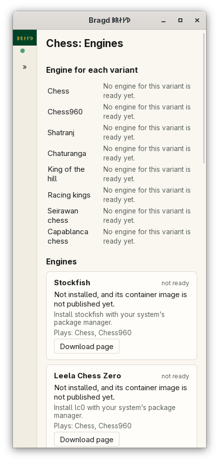

[← README](../../README.md) · [Docs index](../README.md) · [Engines](README.md)

# The Engines page

Each Game family with an Engine has an Engines page. It lists the Engines Bragd knows for the Family, says where each one stands on this machine, and chooses the Engine each Variant is played and analysed with. You can add an Engine by its path and change its options. In F1 → Features this is the entry `engines`.

*The Engines page of chess at 1100 px.*

*At 390 px the cards stack.*

## How to reach it

| Where | What to do |
|---|---|
| Sidebar | A Family → **Engines** (chess, xiangqi, shogi, go, draughts and backgammon) |
| Settings | *Settings → Engines* holds the container settings ([Engine container images](container-images.md)) |
| Keys | **Tab** moves through the page; **F1** shows the `engines` entry |

The page has four parts:

1. **Engine for each variant.** One list per Variant. *Automatic* names the Engine it picks now. Choosing one writes `engines.default`.
2. **Engines.** One card per Engine: *ready* or *not installed*, where it is installed, and which Variants it plays. A card that is not ready says why and names the program to install and its download page.
3. **Options.** *Options* on a ready Engine starts it and lists the options it offers: switches, lists, numbers and text. ↺ puts one back to the Engine's default, and *Reset all* puts them all back.
4. **Add an engine.** Type the path to a program and press *Add*.

## What it needs

- An Engine installed on this machine, found on your `PATH` by its usual program name (`stockfish`, `fairy-stockfish`, `pikafish`, `YaneuraOu`, `katago`, `gnugo`, `scan`, `gnubg`), or a path you give.
- Bragd's own images are not published yet, so today an Engine runs only when it is installed. See [Engine container images](container-images.md).

## Settings and config.toml

| Setting | `config.toml` key | Default | What it does |
|---|---|---|---|
| Engine for each variant | `engines.default` | empty: automatic | Variant key → Engine key, such as `chess = "stockfish"` |
| Program of an Engine | `engines.paths` | empty | Engine key → the program to run instead of the one found |
| Engines added by path | `engines.added` | empty | Name → the Game family it plays; its program is in `engines.paths` |

Engine options are not in `config.toml`. They are kept per Engine in `engine-options.toml` in Bragd's config folder ([Files on disk](../reference/files.md)).

## Questions

#### Which Engine does *Automatic* choose?

The one chosen for the Variant, if it still plays it. Otherwise the first Engine that is installed or pulled, in the order the page lists them. If none is there, the first one Bragd knows, which then says why it cannot start.

#### How do I add an Engine Bragd does not know?

Type its path under *Add an engine* and press *Add*. Bragd starts the program once and checks that it speaks one of the Family's protocols. A program that names itself as an Engine Bragd knows, such as Stockfish, becomes that Engine's program in `engines.paths`. Any other is added under its own name in `engines.added`, and is offered for every Variant of the Family.

#### Why does my added chess Engine refuse a Variant?

A chess Variant other than chess and Chess960 needs the UCI option `UCI_Variant`, and janggi needs it too. Shogi needs USI. An added Engine without them is refused when it starts for that Variant.

#### Where is the path I gave kept, and how do I take it away?

In `config.toml`, under `engines.paths`, and for a new Engine also `engines.added`. *Remove* on its card takes both out, and any `engines.default` that named it. The comments in the file stay.

#### Why does an Engine say "Its program at … is gone"?

The program at the path you gave is no longer there. Install it again, or remove the card and add the new path.

#### Why does English checkers have no Engine?

Scan, the draughts Engine Bragd knows, plays international draughts only. English, Brazilian and Russian draughts have none for now. Tafl, Ur and Senet will get built-in Bots.

#### Are Engine options shared between Variants?

Yes. Options are kept per Engine, not per Variant. *Options* starts the Engine for the first Variant on the page that it plays, to list what it offers.

---
[← Previous: Engines](README.md) · [Next: Engine container images →](container-images.md)
