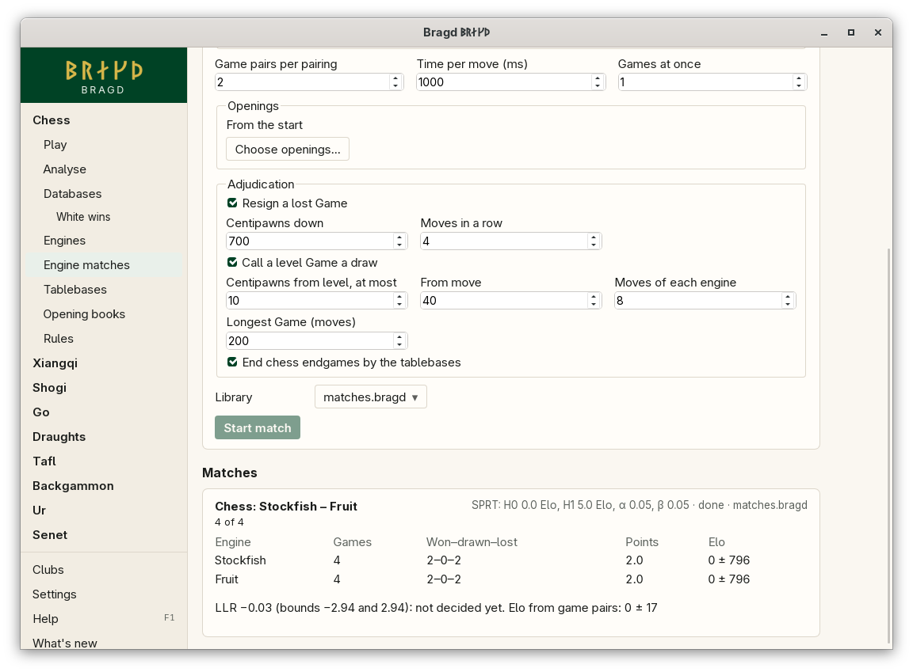

[← README](../../README.md) · [Docs index](../README.md) · [Engines](README.md)

# Engine matches

Engines play each other in the [Helper](../knowledge/helper.md), so a match goes on while Bragd is closed. A match is a round robin, a gauntlet, or two Engines played until the SPRT decides which is stronger. Openings can come from a book, Games can be adjudicated, several Games can run at once, and every Game goes into a [Library](../knowledge/libraries.md). In F1 → Features this is the entry `matches`.

*The Engine matches page of chess.*

## How to reach it

| Where | What to do |
|---|---|
| Sidebar | A Family with an Engine → **Engine matches** |
| F1 → Features | **Engine matches** |

Every Family with an outside Engine has the page: chess, xiangqi, shogi, go, draughts and backgammon. Only Engines that are there to run are offered. Get the others on the [Engines page](engines.md) first.

## Setting up a match

| Field | What it does |
|---|---|
| Variant | The Variant the Games are played in. Only the Variants you have on are offered |
| Engines | Tick two or more. In a gauntlet or an SPRT, the first one ticked is the one tested |
| Kind | Round robin, gauntlet or SPRT (below) |
| Game pairs per pairing | How often each pairing meets. A pair is two Games from the same opening, each Engine taking each Side once. For an SPRT: the most game pairs it plays before it stops undecided |
| Time per move (ms) | How long an Engine may think about each move |
| Games at once | How many Games run side by side, each with its own two Engines. At most one per processor |
| Openings | From the start, a Polyglot book (chess) or a file of opening lines |
| Book moves | How deep a Polyglot book is followed |
| Adjudication | When a Game is ended before its rules end it (below) |
| Library | Where the Games go: `matches.bragd` in your Library folder unless you choose another |

**Start match** hands the match to the Helper. The page then shows its progress, and its line under **Matches** lets you cancel it.

### The three kinds

| Kind | Who plays whom |
|---|---|
| Round robin | Every Engine against every other, in the order of the FIDE Berger tables |
| Gauntlet | The first Engine against each of the others; the others never meet |
| SPRT | The first Engine against the second, until the sequential probability ratio test accepts H0 or H1, or the most game pairs are played |

An SPRT has four numbers:

| Number | Meaning |
|---|---|
| H0: Elo difference | The difference you want to rule out, often 0 |
| H1: Elo difference | The difference you hope to show, often 2 to 5 |
| α | The chance of accepting H1 when H0 is the truth |
| β | The chance of accepting H0 when H1 is the truth |

### Openings

| File | What Bragd does with it |
|---|---|
| None | Every Game starts from the Variant's start. Chess960 starts each game pair from another of its 960 arrays |
| A Polyglot book (`.bin`, chess) | Each game pair follows the book for **Book moves** moves, each move chosen by its weight |
| A file of opening lines (`.txt`, `.epd`, …) | One opening a line, taken in turn: a set-up position (FEN, SFEN, or an EPD line) or moves from the start, such as `1. e4 e5 2. Nf3` or `e2e4 e7e5`. Empty lines and lines starting with `#` are left out |

Bragd checks every line before the match starts. A line that is not an opening of the Variant stops the match from starting, and the message names the line.

### Adjudication

| Rule | What it does |
|---|---|
| Resign | An Engine whose own score is this many centipawns down for this many of its moves in a row loses |
| Draw | From this move on, a Game whose scores stay within this many centipawns of level for this many moves of each Engine is a draw |
| Longest Game | A Game this many moves long, counted after its opening, is a draw |
| Tablebases (chess) | An endgame your [tablebase folder](tablebases.md) holds ends at once with its result. Positions the folder does not hold go to the Lichess tablebase, but only when you have turned it on |

Go and backgammon Engines do not score in centipawns, so their Games end by their rules or by the longest Game. An Engine that names no move, an illegal move or none in time loses the Game.

## What the page shows

| Column | What it is |
|---|---|
| Engine | Each Engine, the most points first |
| Games | The Games it has played |
| Won–drawn–lost | Its results |
| Points | A win is 1, a draw ½ |
| Elo | Its Elo difference against the Engines it met, ± the 95 % margin |

An SPRT match also shows its log-likelihood ratio (LLR) between its two bounds, whether H0 or H1 is accepted, and the first Engine's Elo from its game pairs.

## Questions

#### How is the LLR worked out?

As fishtest works it out: the generalised SPRT with the expected score as its statistic, in logistic Elo, over game pairs. With α and β of 0.05 the bounds are −2.94 and 2.94.

#### Can I close Bragd while a match runs?

Yes. The match runs in the Helper. When the Helper stops, the match goes on where it was the next time the Helper starts. A Game that was under way is played again.

#### Does a match hold up my Sources?

No. Matches run beside the Helper's other jobs, one match at a time.

#### Why does my Library have fewer Games than the match played?

Two Games with the same moves from the same start are one Game in a Library ([Duplicates](../knowledge/duplicates.md)). Engines that think to a fixed depth can play the same Game twice. Its Sources show both.

#### Where do I see the Games?

Open the Library under **Databases**. Each Game has the Engines' names as White and Black, its round, the result, and why it ended.

---
[← Previous: Opening books](opening-books.md) · [Next: Clubs →](../clubs/README.md)
