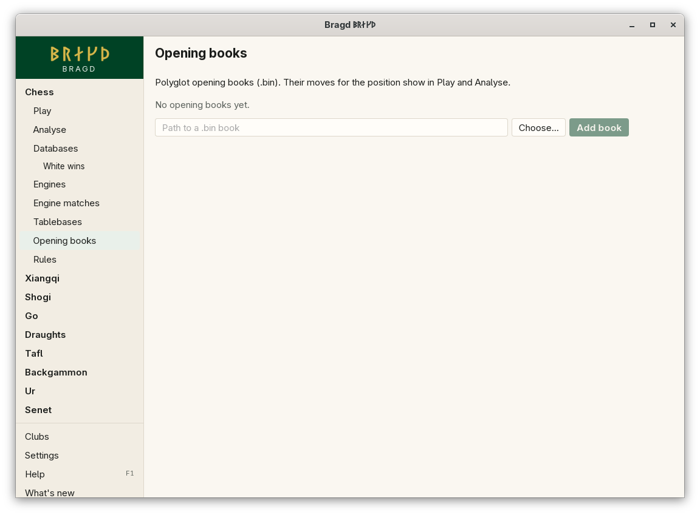

[← README](../../README.md) · [Docs index](../README.md) · [Engines](README.md)

# Opening books

An opening book lists good moves for known positions. Bragd reads Polyglot books (`.bin`). Their moves for the position on the board show under it in Play and Analyse, each with its share, and a click plays one. For a chess Game from the start, the opening's ECO code and name show there too.


*The Opening books page.*

## How to reach it

| Where | What to do |
|---|---|
| Sidebar | Chess → **Opening books** |
| On the page | Type the path to a `.bin` book, then **Add book**. **Remove** takes one away |
| Play and Analyse | *Book:* under the board lists the moves, with the book's name on hover |

Each book's card shows how many positions it holds and its first moves from the start position, so you can see it reads well.

## What it needs

- A Polyglot book on your disk. Bragd ships none.
- A standard chess Game. Other Variants show no book moves.

## Settings and config.toml

| Setting | `config.toml` key | Default | What it does |
|---|---|---|---|
| Opening books | `engines.books` | `[]` | The paths of the Polyglot books, in order |

```toml
[engines]
books = ["/home/me/books/gm2001.bin", "/home/me/books/komodo.bin"]
```

## Questions

#### Where does the opening's name come from?

From a list of openings with their ECO codes built into Bragd. It is matched by the moves played, so it shows only for Games from the start position, not for a set-up position.

#### Why does Bragd refuse my file?

It is not a Polyglot book. Bragd checks the file before it adds it, and says *… is not a Polyglot opening book*.

#### What does the percentage beside a book move mean?

The move's share of the book's weight for that position. With several books, each move is listed with its own book.

#### Does the Engine use the books?

No. The books are for you: their moves show under the board. An Engine plays from its own search.

#### Why are there no book moves during an online Game?

Book moves, like Analyse, are locked while a rated online Game against a person is live. Online play is not available yet.

#### What if I move or delete a book file?

Its card shows the error in place of its moves. **Remove** takes it out of `engines.books`.

---
[← Previous: Tablebases](tablebases.md) · [Next: Engine matches →](matches.md)
