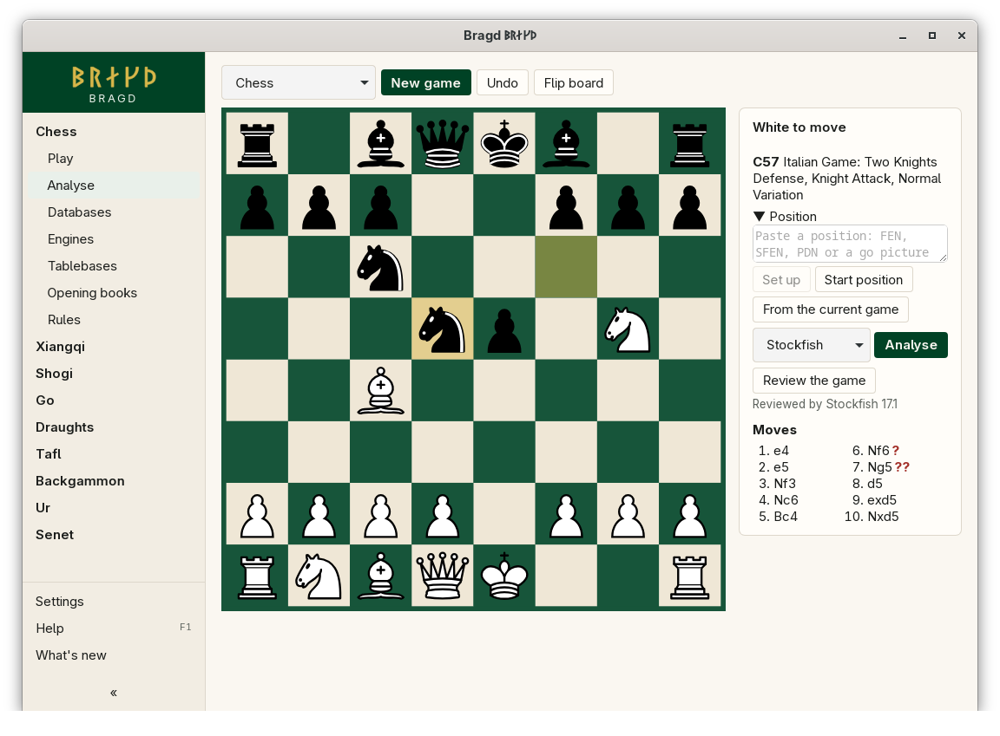

[← README](../../README.md) · [Docs index](../README.md) · [Engines](README.md)

# Game review

A review runs an Engine over every position of a Game in the background. It marks the moves that lose ground, and the marks show after each move in the move list.

*A reviewed Game: marks after the moves that lost ground.*

## How to reach it

| Where | What to do |
|---|---|
| Sidebar | A Family with an Engine → **Analyse** |
| On the page | Play or set up the Game, then **Review the game**. The line beside it counts *Reviewing: 12 of 40 moves*, then says *Reviewed by* the Engine |

The Engine is the one chosen in Analyse's list, or the Variant's default.

## The marks

| Mark | Means | When |
|---|---|---|
| `?!` | Inaccuracy | The move lost at least 0.50 pawns (50 centipawns) |
| `?` | Mistake | It lost at least 1.00 pawn |
| `??` | Blunder | It lost at least 3.00 pawns |
| `!?` | The only move | The Engine's best move, played, where its second choice was 3.00 pawns worse, in a position not already won |

Evaluations count only up to a mate score either way, so a move in a won position is not a blunder for winning a little less.

## What it needs

- An Engine for the Variant ([The Engines page](engines.md)).
- At least one move in the Game.

## Settings and config.toml

| Setting | `config.toml` key | Default | What it does |
|---|---|---|---|
| Engine for each variant | `engines.default` | automatic | The Engine a review uses unless Analyse's list names another |

Each review is kept in Bragd's cache folder, under `bragd/reviews` ([Files on disk](../reference/files.md)).

## Questions

#### How long does a review take?

About 300 ms a position, so a 40-move Game (80 positions) takes about half a minute.

#### Why do go Games get no marks?

Marks need scores in centipawns. Chess, xiangqi, shogi and draughts Engines give them. Go Engines give a winning share instead, so a go review shows evaluations without marks.

#### Why can I not review a backgammon Game?

GNU Backgammon is not set up for reviews in Bragd yet. The button is not shown for backgammon.

#### Does reviewing the same Game twice take as long?

No. A review is kept by the Engine, its settings and the moves. The same Game reviewed with the same Engine and options comes from the cache at once.

#### How much room does the cache take?

The newest 1,000 reviews are kept, a few KB each. Older ones are removed.

#### Where is the evaluation graph?

The evaluation profile shows on the Databases page, beside a Game whose file carries one ([Foreign databases](../knowledge/foreign-databases.md)). Analyse shows the marks in the move list.

---
[← Previous: Analyse](analyse.md) · [Next: Tablebases →](tablebases.md)
