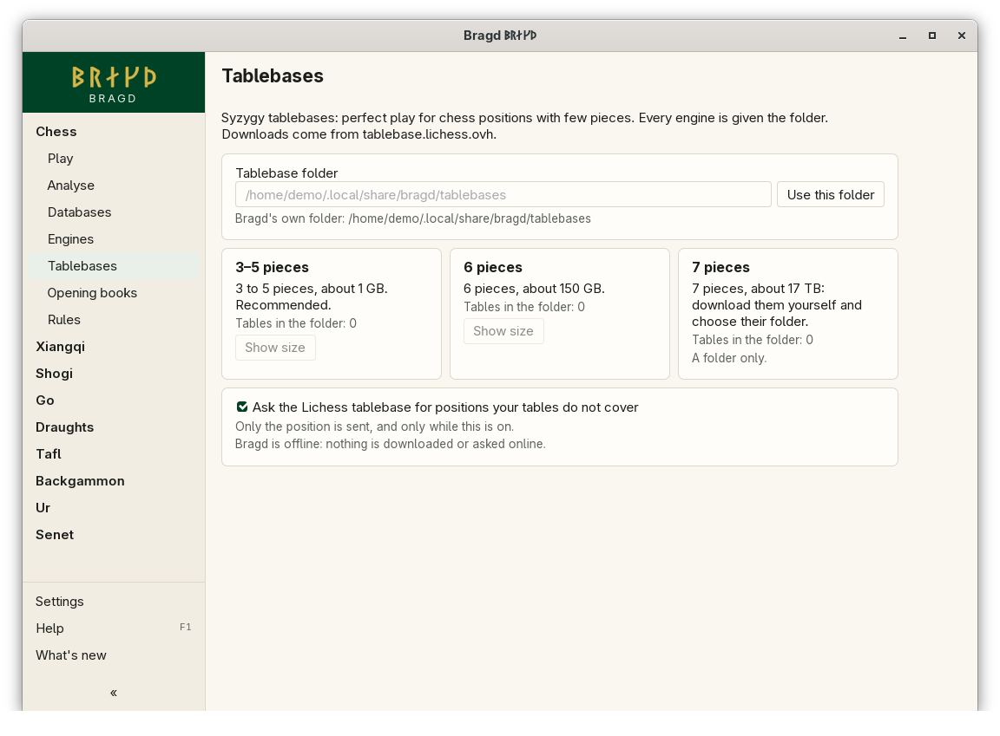

[← README](../../README.md) · [Docs index](../README.md) · [Engines](README.md)

# Tablebases

A Tablebase holds perfect play for chess positions with few pieces. Bragd uses Syzygy tables. The page sets their folder, downloads a set, and turns the Lichess fallback on or off. Every Engine is given the folder. In F1 → Features this is the entry `tablebases`.

*The Tablebases page.*

## How to reach it

| Where | What to do |
|---|---|
| Sidebar | Chess → **Tablebases** |
| Install wizard | Step 4, Knowledge: *Syzygy 3–5 pieces* is ticked ([The install wizard](../getting-started/first-start.md)) |
| Settings | *Settings → Knowledge* → *Tablebase folder*; *Settings → Online* → *Ask Lichess for tablebase positions* |

## The sets

| Set | Size | How |
|---|---|---|
| 3–5 pieces | about 1 GB | Download. Recommended |
| 6 pieces | about 150 GB | Download, or point the folder at your own copy |
| 7 pieces | about 17 TB | A folder only: download them yourself and choose their folder |

**Show size** asks the mirror for the exact size (one small file). Nothing is downloaded until you press **Download**. Progress shows below the cards, with **Stop**. The files come from `tablebase.lichess.ovh`.

In Analyse, a chess position of seven pieces or fewer shows a *Tablebase* box. When your tables cover it, the box says so and the Engine reads them. When they do not, the Lichess tablebase answers with the verdict, the distances (DTZ, DTM) and the best moves, if the fallback is on.

## What it needs

- Free disk space for the set.
- For the fallback: a network, and `tablebases.online` on.

## Settings and config.toml

| Setting | `config.toml` key | Default | What it does |
|---|---|---|---|
| Tablebase folder | `tablebases.path` | empty: `tablebases` in Bragd's data folder | Where the Syzygy files are. Bragd reads it and downloads into it |
| Ask Lichess for tablebase positions | `tablebases.online` | `true` | Send a position your tables do not cover to the Lichess tablebase API |

## Questions

#### Does Bragd read the tables itself?

No. Bragd passes the folder to every Engine that reads Syzygy (`SyzygyPath`), and the Engine reads them. Bragd only counts how many pieces a position has and whether the folder covers it.

#### What is sent to Lichess?

Only the position, as a FEN, and only when your tables do not cover it and the switch is on. Turn it off under *Settings → Online*.

#### Which Variants use the Tablebases?

Standard chess and Chess960. Other Variants are not looked up.

#### Can I use tables I already have?

Yes. Type their folder and press **Use this folder**. Bragd only reads it and downloads into it. Disk watch shows a folder outside Bragd's data folder as external and never touches it.

#### Is a download checked?

Yes. Each file's size is checked against the mirror's list, and its BLAKE3 checksum against the one that comes with Bragd. The tables never change, so Bragd carries the sum of every table of up to 6 pieces. A file whose checksum is wrong is not kept, and the download stops and says which file. A file already in the folder is checked the same way before it is kept, so a damaged one is downloaded again.

#### Why are the buttons greyed out?

Bragd is running offline (`BRAGD_OFFLINE`), so nothing is downloaded or asked online. The page says so under the switch.

---
[← Previous: Game review](review.md) · [Next: Opening books →](opening-books.md)
