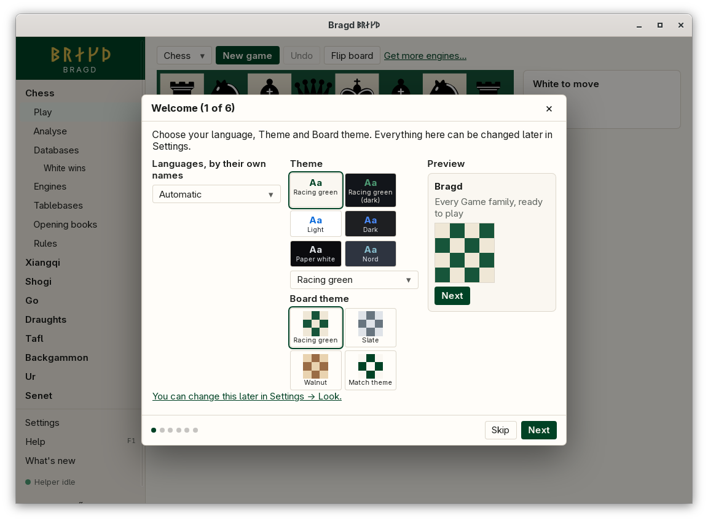
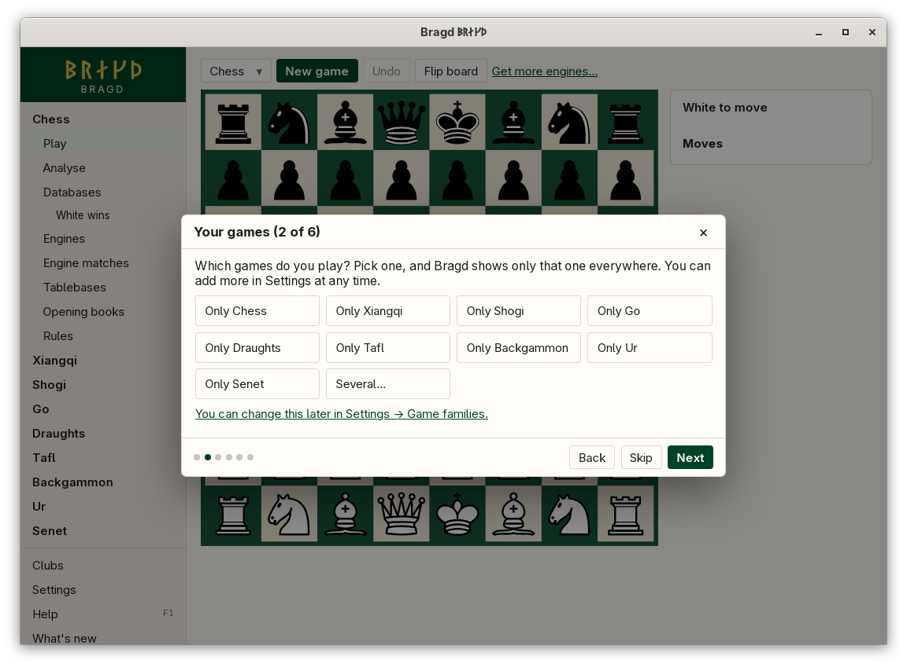
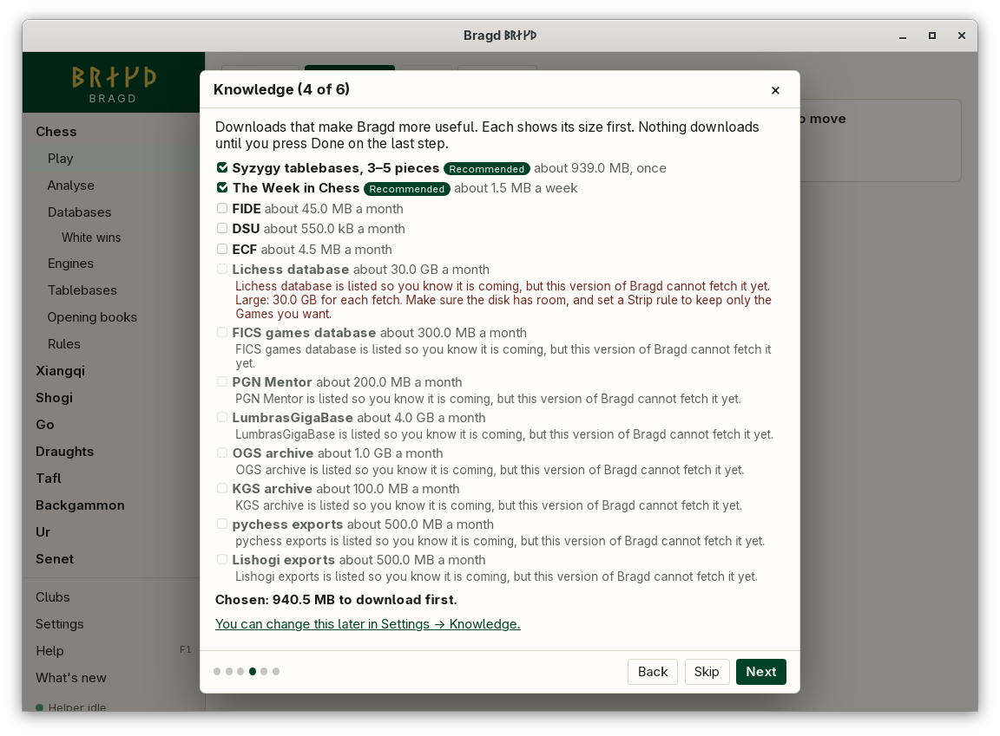

[← README](../../README.md) · [Docs index](../README.md) · [Getting started](README.md)

# The install wizard

On the first start Bragd opens the install wizard: six short steps in a frame over the window. Every step can be skipped, and each one names the Settings area that holds the same choices. Closing the wizard in any way (**Done**, **×** or **Esc**) counts as having seen it, and it does not open by itself again.

*Step 1, Welcome: language, Theme and Board theme, with a preview.*

*Step 2, Your games: one click picks a single Family.*

| Step | What you choose | Settings area |
|---|---|---|
| 1 Welcome | Language (each by its own name), Theme and Board theme, with a preview | Look |
| 2 Your games | *Which games do you play?* One click on *Only Chess* (or any other Family) keeps that one and turns the rest off. *Several…* shows a switch for every Family and Variant | Game families |
| 3 Engines | Nothing: it shows the Engines found on this machine for each Family that is on | Engines |
| 4 Knowledge | Downloads: TWIC every week and Syzygy 3–5 pieces (about 1 GB) are ticked; the others, the FIDE, DSU and ECF rating lists among them, are listed with their sizes | Knowledge |
| 5 Online | Nothing yet: signing in to servers comes in a later version | Online |
| 6 Helper | *Start with my session* | Knowledge |

Choices in steps 1, 2 and 6 are saved at once, as in Settings. Nothing is downloaded until you press **Done** on the last step, which lists what will happen. Then Bragd turns the chosen Sources on in the Helper, starting the Helper if none runs, and starts the Syzygy download. **Skip** on step 4 unticks every download. The wizard adds up the sizes and warns when the downloads would leave less than 5 GB free on the disk that holds Bragd's data. A single Source of 10 GB or more carries its own warning.

*Step 4, Knowledge: each download with its size, and the total.*

*Step 6, Helper: Start with my session, and what Done does.*

## How to reach it

- It opens by itself on the first start, when Bragd finds no record that you have seen it.
- *Settings → Overview → Run the install wizard again* opens it once more.
- In the wizard: **Next** and **Back** move between steps, **Skip** goes on without the step's choices, **Done** on the last step finishes, and **×** or **Esc** closes it.
- Each step's *You can change this later in Settings → …* link closes the wizard and opens that area.

## What it needs

Nothing. The Engines step looks for Engines the way Play does: the path given on a Family's Engines page (`engines.paths`) first, then the programs on the PATH. It lists those it does not find with a *Where to get it* link. The Knowledge step asks the Helper for its Sources and the system for the free space on the data disk.

## Settings and config.toml

The wizard writes the same keys as Settings.

| Setting | `config.toml` key | Default | What it does |
|---|---|---|---|
| Language | `language` | `"auto"` | Step 1 |
| Theme | `look.theme` | `"racing-green"` | Step 1 |
| Board theme | `look.board_theme` | `"racing"` | Step 1 |
| Game families and Variants | `families.family`, `families.variant` | all on | Step 2 |
| Start with my session | `helper.start_with_session` | `false` | Step 6 |

That the wizard has been seen is kept in `state.json` in Bragd's data folder ([Files on disk](../reference/files.md)), not in `config.toml`.

## Questions

#### Does the wizard download anything before I press Done?

No. Steps 1 to 6 only save settings. The downloads you ticked start when you press **Done** on the last step.

#### Why is a Source greyed out?

This version lists it so you know it is coming, but cannot fetch it yet. The Lichess database, LumbrasGigaBase, PGN Mentor, FICS, OGS, KGS, pychess and Lishogi are listed this way.

#### Which Themes are on the Welcome step?

Six as swatches: Racing green, Racing green (dark), Light, Dark, Paper white and Nord. The list under them holds all 30 and your own ([Themes](../look/themes.md)).

#### I closed the wizard by mistake. How do I get it back?

*Settings → Overview → Run the install wizard again*. What you chose before is kept. The Knowledge step starts again with the recommended downloads ticked.

#### Why does the Engines step show "No sealed image is published yet"?

Igel and YaneuraOu have no image of Bragd's: install them on the machine. Every other Engine shows *A sealed image can be pulled with podman or docker* ([Engine container images](../engines/container-images.md)).

#### I picked Only Chess. How do I add go?

Tick it in *Settings → Game families*, or run the wizard again and choose *Several…*. Nothing of go was deleted while it was off.

#### Where did the Syzygy download go?

Into the folder in *Settings → Knowledge → Tablebase folder*, or `tablebases` in Bragd's data folder when that is empty. The wizard's download does not show its progress yet. The [Tablebases](../engines/tablebases.md) page can download the same sets with progress and **Stop**.

---
[← Previous: Installing Bragd](install.md) · [Next: Game families and Variants →](game-families.md)
