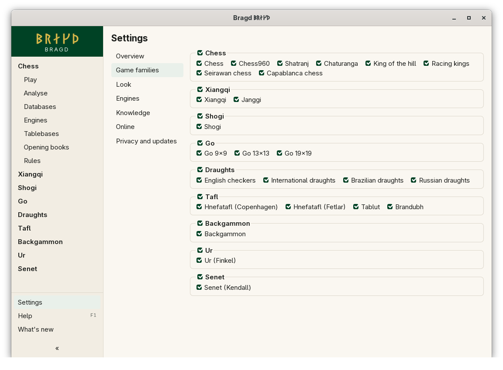

[← README](../../README.md) · [Docs index](../README.md) · [Getting started](README.md)

# Game families and Variants

Bragd knows nine Game families with 25 Variants between them, and all are on at first. Turn off what you do not play, and it leaves the sidebar, New game, the install wizard and engine setup. Nothing is deleted: turn it on again and everything is where it was. In F1 this is the `families` entry.


*Settings → Game families: a switch per Family, and one per Variant.*

| Game family | Variants |
|---|---|
| Chess | Chess, Chess960, Shatranj, Chaturanga, King of the hill, Racing kings, Seirawan chess, Capablanca chess |
| Xiangqi | Xiangqi, Janggi |
| Shogi | Shogi |
| Go | Go 9×9, Go 13×13, Go 19×19 |
| Draughts | English checkers, International draughts, Brazilian draughts, Russian draughts |
| Tafl | Hnefatafl (Copenhagen), Hnefatafl (Fetlar), Tablut, Brandubh |
| Backgammon | Backgammon |
| Ur | Ur (Finkel) |
| Senet | Senet (Kendall) |

The rules of each are in [Rules](../rules/README.md).

## How to reach it

- *Settings → Game families*: tick or untick a Family, or a Variant inside it. A Variant's switch is greyed out while its Family is off.
- Step 2 of the [install wizard](first-start.md) shows the same switches.

Each change is saved at once, and the sidebar follows it straight away. A page of a Family you just turned off goes back to Settings.

## What it needs

Nothing.

## Settings and config.toml

Only what is turned off is written down; a Family or Variant missing from the file is on.

| Setting | `config.toml` key | Default | What it does |
|---|---|---|---|
| A Family's switch (`family_<key>`, such as `family_chess`) | `families.family` | all on | `[families.family]` with `go = false` turns go off |
| A Variant's switch (`variant_<key>`, such as `variant_chess960`) | `families.variant` | all on | `[families.variant]` with `chess960 = false` turns Chess960 off |

```toml
[families.family]
backgammon = false

[families.variant]
chess960 = false
go-19 = false
```

The Family keys are `chess`, `xiangqi`, `shogi`, `go`, `draughts`, `tafl`, `backgammon`, `ur` and `senet`. The Variant keys are in the table in [Rules](../rules/README.md#the-variants). Families and Variants are separate tables because `chess` names both a Family and a Variant.

## Questions

#### What happens to my games of a Family I turn off?

Nothing is deleted: its Libraries, Slices, Sources and engine settings stay as they are. Its sidebar items go, so its pages cannot be opened until you turn it on again. A banner on its files offering to turn it back on is planned, but not built yet.

#### What if I turn off every Variant of a Family?

The Family leaves the sidebar too, as if it were off itself.

#### What if I turn off every Family?

The sidebar keeps only Settings, Help and What's new, and Bragd opens on Settings.

#### Why does the sidebar look different with one Family on?

With two or more Families on, each Family is an outer item that folds open. With one, its items (Play, Analyse, Databases …) stand at the top on their own. See [The sidebar](sidebar.md).

#### Does turning a Variant off stop its Sources?

No. The [Helper](../knowledge/helper.md) keeps fetching every Source you turned on. The install wizard leaves out the Sources of Families that are off.

---
[← Previous: The install wizard](first-start.md) · [Next: The sidebar →](sidebar.md)
