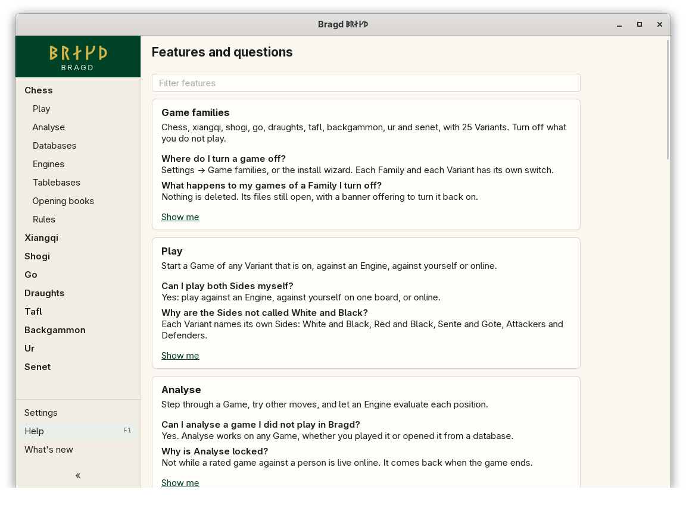
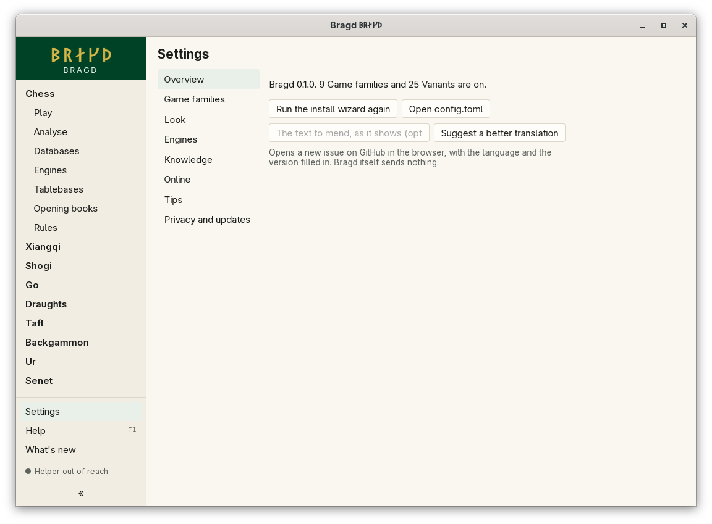

[← README](../../README.md) · [Docs index](../README.md) · [Getting started](README.md)

# Help (F1) and notices

**F1**, or *Help* in the sidebar, lists every feature: what it does and the questions people ask, with *Show me* opening its page in these docs. The filter finds every word you type, whatever its case or accents: `grunfeld` finds *Grünfeld*.

Notices and hints show in a small area in the bottom corner of the window, one at a time: notices first, then hints, then a Tip. Closing one shows the next. A notice (a mistake in `config.toml`, a newer version) shows until you close it. A hint shows on three starts, then no more; one hint comes at a start, and the next one only after you close it.

*Help (F1): every feature with its questions.*

## How to reach it

- **F1** anywhere in the window, or *Help* in the sidebar.
- Type in the filter to narrow the list. Every word must appear in a feature's title, line, questions or answers.
- *Show me* opens the feature's page on GitHub in your browser. Nothing is fetched until you press it.
- A notice's **×** closes it, and a closed notice stays closed. A notice that names a Settings area has a link that opens it.

The F1 entries and the pages *Show me* opens:

| Id | Title | Page |
|---|---|---|
| `wizard` | Install wizard and What's new | [The install wizard](first-start.md) |
| `families` | Game families | [Game families and Variants](game-families.md) |
| `play` | Play | [Playing against yourself](../play/against-yourself.md) |
| `databases` | Databases | [Foreign databases](../knowledge/foreign-databases.md) |
| `players` | Player summary | [Player summary](../knowledge/players.md) |
| `parquet` | Export to Parquet | [Export to Parquet](../knowledge/parquet-export.md) |
| `disk` | Disk watch | [Disk watch](../knowledge/disk-watch.md) |
| `helper` | The Helper | [The Helper](../knowledge/helper.md) |
| `engines` | Engines | [The Engines page](../engines/engines.md) |
| `analyse` | Analyse | [Analyse](../engines/analyse.md) |
| `matches` | Engine matches | [Engine matches](../engines/matches.md) |
| `tablebases` | Tablebases | [Tablebases](../engines/tablebases.md) |
| `themes` | Themes | [Themes](../look/themes.md) |
| `update` | Update checks | [Privacy](../reference/privacy.md) |

The hints:

| Hint | Text |
|---|---|
| `sidebar` | Click a Game family to see its items. The arrow at the bottom folds the sidebar away. |
| `features` | F1 lists every feature, with the questions people ask about it. |
| `wizard` | Settings → Overview runs the install wizard again. |

## Settings → Overview

The Overview area of Settings names the version and how many Families and Variants are on, and has three buttons:

| Button | What it does |
|---|---|
| Run the install wizard again | Opens the [install wizard](first-start.md) |
| Open config.toml | Opens `config.toml` in your system's editor, making it empty first when there is none |
| Suggest a better translation | Opens a new GitHub issue in the browser with your language and version. Type the text to mend first, and its key is filled in too. Bragd itself sends nothing |

*Settings → Overview.*

## What it needs

Nothing. *Show me* and *Suggest a better translation* need a browser and the network.

## Settings and config.toml

| Setting | `config.toml` key | Default | What it does |
|---|---|---|---|
| Check for a new version | `updates.check` | `true` | Turns the update notice on or off ([Privacy](../reference/privacy.md)) |

Which notices you closed and how often each hint showed are kept in `state.json`, not in `config.toml`.

## Questions

#### Why do the notices not show while the wizard is open?

The wizard and the What's new cards come first. Notices and hints show once they are closed.

#### Why do I see only one notice at a time?

So they never cover the board. Close the one shown, and the next one waits behind it. A notice that something failed comes before a hint, and a Tip comes last.

#### How do I copy the upgrade command?

The update notice shows the command for the channel you installed from, with a *Copy* button beside it. Run it in a terminal; Bragd never installs an update itself.

#### What does a config.toml notice mean?

An area of `config.toml` has a mistake Bragd cannot read, such as a word where a number belongs. That area keeps its defaults, the rest of the file still counts, and the notice says what is wrong until you mend it.

#### Does the filter search the docs pages?

No. It searches the F1 texts in your language: titles, lines, questions and answers.

#### Can I see a hint again?

Not from the app. Hints count their showings in `state.json`; a hint that has shown three times stays away.

---
[← Previous: The sidebar](sidebar.md) · [Next: What's new →](whats-new.md)
