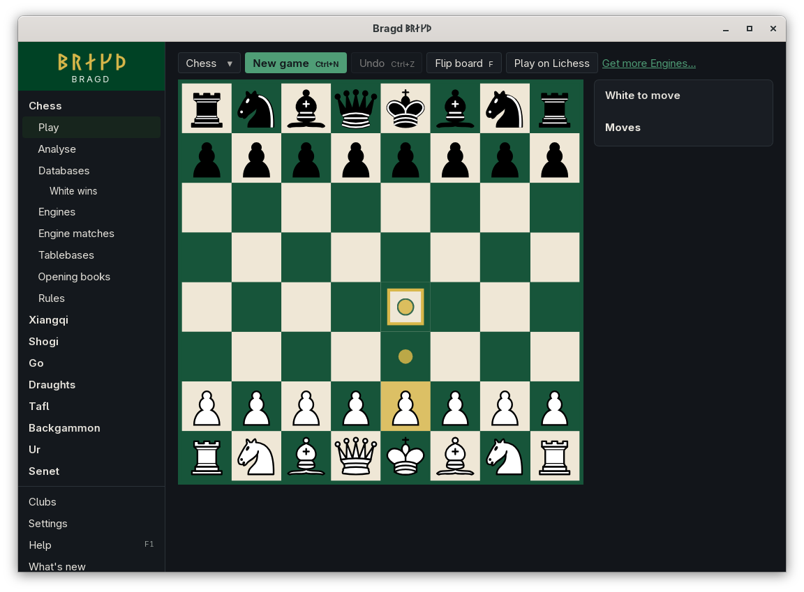
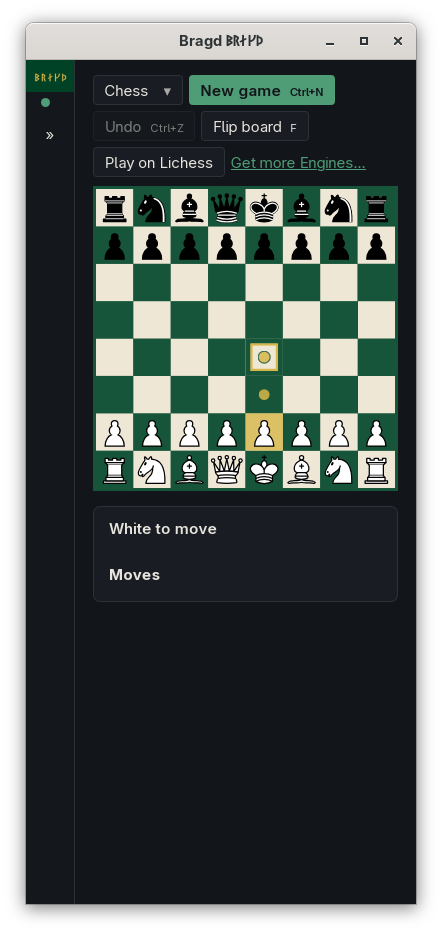

[← README](../../README.md) · [Docs index](../README.md) · [Getting started](README.md)

# Keyboard

Every board can be played from the keyboard, and Play's buttons have keys of their own. Each key is shown on its button, and F1 → Features → *Keyboard* lists them.

*The ring on e4 after the arrows and Enter picked the pawn on e2, at 1100 px.*

*At 390 px the keys stay on their buttons.*

## How to reach it

| Where | What |
|---|---|
| Any board on Play, Analyse or Play online | **Tab** until the ring shows on a square, then the keys below |
| Play and Analyse | The keys on the buttons above and beside the board |

## Keys on a board

The board is one stop for **Tab**. The ring starts on the piece you selected, or where it was last.

| Key | What it does |
|---|---|
| **←** **→** **↑** **↓** | Moves the ring to the next square that way on the screen. Draughts skips the light squares; backgammon goes from point to point, and on to the bar and the tray |
| **Home**, **End** | The first or the last square |
| **Enter** or **Space** | Picks the square, as a click does: the piece first, then the square it goes to |

Which squares a piece can go to is Bragd's rules, as with the mouse: a key never makes a move a click could not.

## Keys on Play

| Key | Button | When |
|---|---|---|
| **Ctrl+N** (**⌘N** on macOS) | New game | Always |
| **Ctrl+Z** (**⌘Z** on macOS) | Undo | When there is a move to take back |
| **F** | Flip board | Always |
| **T** | Throw | Backgammon, Ur and senet, when it is your throw |
| **P** | Pass | When passing is legal, as in go |

A key does nothing while you type in a field, while a list is open, or while the wizard or a dialog is open.

## Questions

#### Why does T do nothing?

Throw is there only when the Side to move throws. In a Game against an Engine, the Engine throws for itself.

#### Can I change the keys?

No. They are the same in every language, and shown on their buttons.

#### Why does the arrow key not step through the moves?

On Play the arrows move the ring on the board. Replaying a Game from a Library, ← and → step through its moves.

---
[← Previous: Going back](navigation.md) · [Next: Help (F1) and notices →](help.md)
