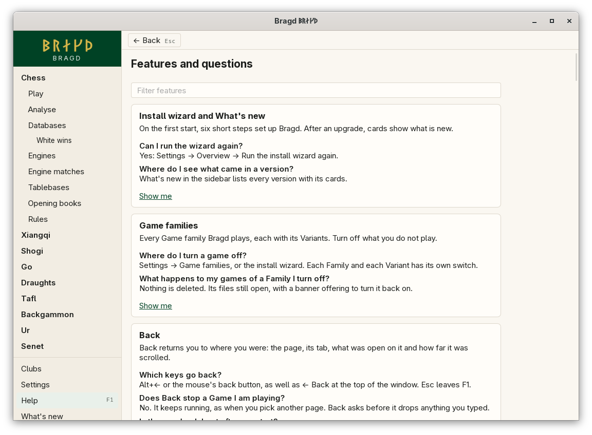
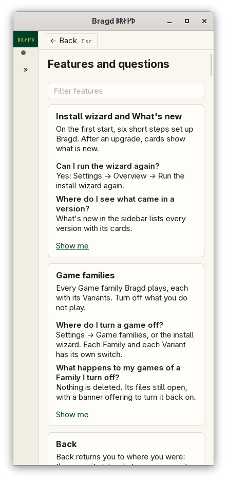

[← README](../../README.md) · [Docs index](../README.md) · [Getting started](README.md)

# Going back

**← Back**, at the top of the window, takes you back to where you were: the same page, the same tab, the same open item and the same scroll. After F1, Settings, a Tournament or a player's summary, one press returns you to the page you came from.

*Back above F1, at 1100 px.*

*At 390 px Back sits above the page, beside the folded sidebar.*

## How to reach it

Back shows only when there is somewhere to go back to. Each way does the same:

| Key or button | What it does |
|---|---|
| **← Back** | Back to the place before this one |
| **Alt+←** | The same, unless you are typing in a field |
| The mouse's back button | The same |
| **Esc** on F1 | Leaves F1 for where you were. In the filter, the first Esc clears it |

A place is what the window shows:

| Part | Examples |
|---|---|
| The page | Play, Databases, Clubs, Settings, F1 |
| Its tab | A Settings area, a Databases tab, a Tournament's or League's tab |
| What is open on it | A Library, a Slice, a Game in a Library, a player's summary, a Tournament, a League |
| The scroll | How far down the page was |

Going somewhere new after Back starts a new way back from there: the place you left by Back is not kept. Bragd remembers the last 50 places of each window, and forgets them when the window closes.

## What it needs

Nothing. Back has no setting and no `config.toml` key.

## Questions

#### Does Back stop a Game I am playing?

No. A Game under way keeps running, as it does when you pick another page in the sidebar. Go back to Play to take it up again.

#### Will Back throw away what I typed?

Not without asking. If you have typed into a field on the page, such as a new member or a Tournament's setup, Back asks first. Search boxes do not count.

#### Why does Esc not go back on other pages?

On a board, a list or a dialog Esc already means something: it closes the dialog or leaves the field. On F1 it means *done reading*, so there it goes back. The wizard and tour cards keep their own steps and keys.

#### Is the way back kept when I restart Bragd?

No. It lives as long as the window. Bragd opens on Play for the first Family that is on.

---
[← Previous: The sidebar](sidebar.md) · [Next: Help (F1) and notices →](help.md)
