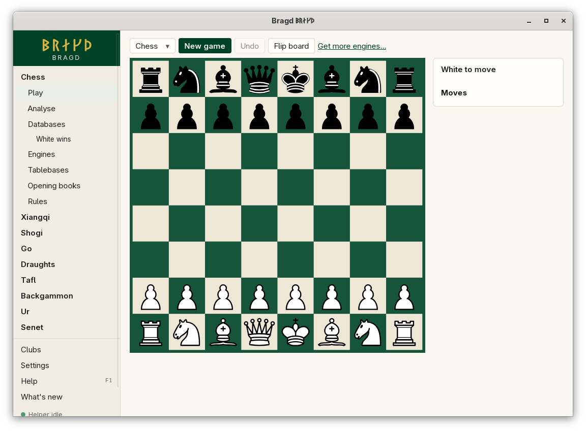
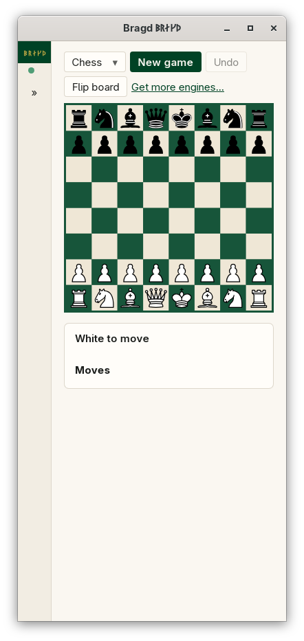

[← README](../../README.md) · [Docs index](../README.md) · [Getting started](README.md)

# The sidebar

The sidebar is how you reach everything in Bragd. It lists the Game families that are on, each with its items, and below them Clubs, Settings, Help and What's new, which are always there. At the bottom, a line shows what the [Helper](../knowledge/helper.md) is doing. It sits on the left, and on the right in Hebrew and Persian.

*The sidebar at 1100 px, with Chess folded open.*

*At 390 px the sidebar starts folded away.*

## How to reach it

It is always on screen. What it holds:

| Part | What it does |
|---|---|
| The wordmark | ᛒᚱᛅᚴᚦ and *Bragd*, Bragd's name in Younger Futhark |
| A Family (with two or more on) | Click it to fold its items open or shut. The Family of the page you are on stays open |
| Its items | Play, Analyse, Databases, Engines and Rules. Chess also has Tablebases and Opening books. Tafl, Ur and Senet have only Play, Databases and Rules, as they have no outside Engine |
| Slices | Each [Slice](../knowledge/slices.md) of the Family shows under Databases. A Slice with no Family shows under every Family |
| Clubs | Your Clubs, their members and ratings ([Clubs](../clubs/clubs.md)) |
| Settings | Every setting, by area ([Every setting](../reference/settings.md)) |
| Help **F1** | [Help (F1) and notices](help.md) |
| What's new | [What's new](whats-new.md) |
| The Helper line | Idle, how many jobs run, paused on battery, or out of reach, with the running job's progress. Click it to open the Jobs page |
| **«** / **»** | Folds the sidebar to a narrow strip, and shows it again |

With one Family on, its items stand at the top on their own, with no Family heading. With none on, only Clubs, Settings, Help and What's new are left.

Bragd opens on Play for the first Family that is on.

## What it needs

Nothing. The Helper line needs `bragd-helper` beside the app ([Installing Bragd](install.md)).

## Settings and config.toml

The sidebar follows these keys; it has none of its own.

| Setting | `config.toml` key | Default | What it does |
|---|---|---|---|
| Game families and Variants | `families.family`, `families.variant` | all on | Which Families show ([Game families and Variants](game-families.md)) |
| Language | `language` | `"auto"` | Hebrew and Persian put the sidebar on the right ([Languages](../look/languages.md)) |

## Questions

#### Why is the sidebar folded when Bragd starts?

The window is narrower than 760 px. Below that width the sidebar starts folded, and folds again after you pick a page, so the page has the room. Press **»** to show it.

#### Why does tafl have no Analyse or Engines?

Tafl, Ur and Senet have no outside Engine to run. Their built-in Bots are planned, and until then they have Play, Databases and Rules.

#### What does the dot on the Helper line mean?

It is lit while the Helper answers, shows when jobs are running, and warns when Disk watch has a notice. The line asks the Helper every 5 seconds, and every 1.5 seconds while a job runs.

#### Why is the wordmark a picture and not text?

WebKitGTK, which draws Bragd's window on Linux, draws runes in text with no width, whatever the font. The wordmark is therefore the outline of each rune, taken from the bundled Noto Sans Runic. Screen readers call it *Bragd*.

#### Can I change the order of the Families?

No. They follow the catalogue: chess, xiangqi, shogi, go, draughts, tafl, backgammon, ur, senet. Turning off the ones you do not play is the way to shorten the list.

#### Why does the Helper line say it is out of reach?

The window could not find or start `bragd-helper` beside its own program. It asks again after 30 seconds, or at once with *Try again* on the Jobs page.

---
[← Previous: Game families and Variants](game-families.md) · [Next: Help (F1) and notices →](help.md)
