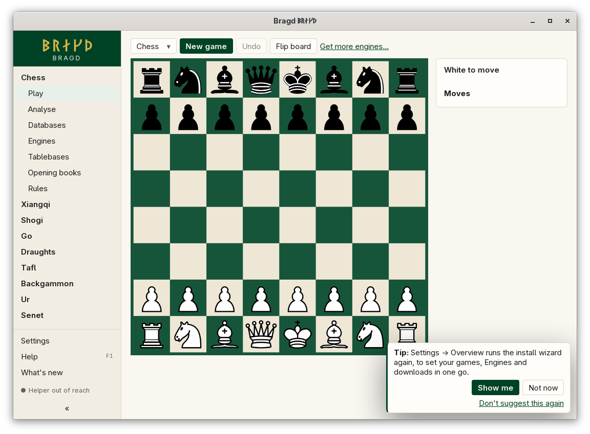
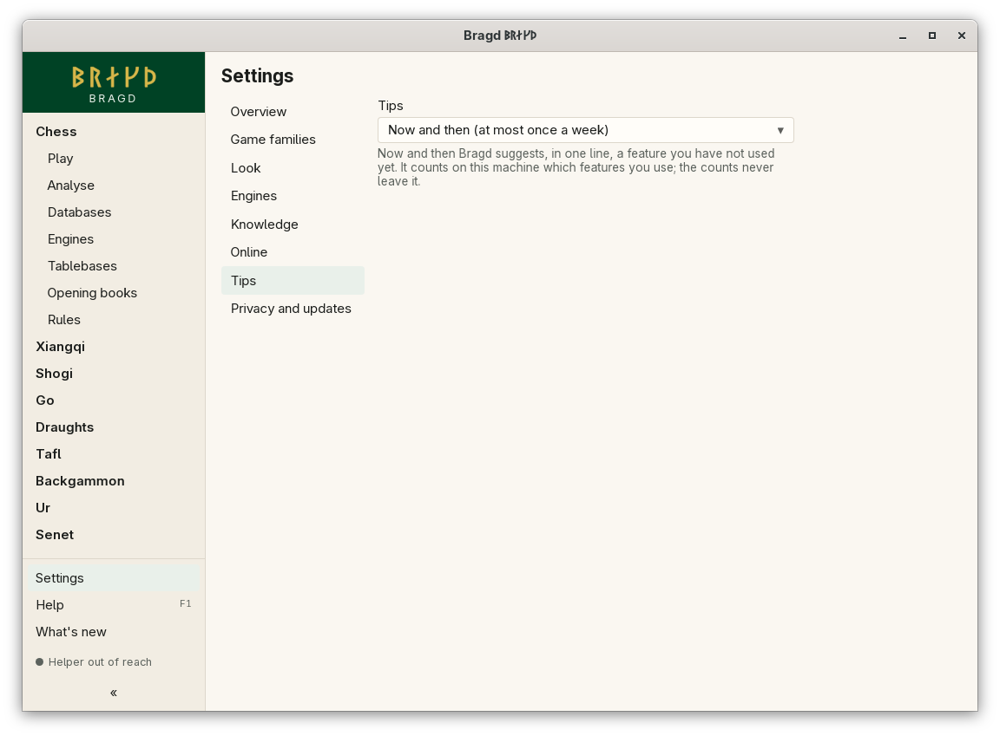

[← README](../../README.md) · [Docs index](../README.md) · [Getting started](README.md)

# Tips

Now and then Bragd suggests, in one line, a feature you have not used yet. The Tip shows in the notice area at the bottom corner, with three buttons. In F1 this is the `tips` entry.


*A Tip, with Show me, Not now and Don't suggest this again.*

| Button | What it does |
|---|---|
| **Show me** | Opens the feature: its page in the sidebar, or its area of Settings |
| **Not now** | Closes the Tip. Next time another feature's Tip comes first |
| **Don't suggest this again** | This Tip never shows again. The others still do |

## When a Tip shows

- At start, or when Bragd has had no key press or click for two minutes.
- At most once a day (*Often*) or once a week (*Now and then*, the default).
- Never while a Game is under way on the Play page, and never over the install wizard or the tour cards.
- Never for a feature you have already used, and never for a feature of a Game family you have turned off. The Tablebases Tip, for one, concerns chess only.
- After an upgrade the tour cards of [What's new](whats-new.md) come first. A new feature you have not tried a week later then gets its Tip, before the older ones.

Bragd learns which features you use by counting each use on this machine: starting a Game, changing the Theme, opening a database and so on. The counts are kept in `state.json` in Bragd's data folder ([Files on disk](../reference/files.md)), and they never leave the machine.

## How to reach it

- Tips come by themselves.
- *Settings → Tips* sets how often, or turns them off.
- F1 → Features lists every feature at any time, Tip or not ([Help](help.md)).


*Settings → Tips.*

## What it needs

Nothing.

## Settings and config.toml

| Setting | `config.toml` key | Default | What it does |
|---|---|---|---|
| Tips (`tips`) | `tips.frequency` | `"sometimes"` | `often`: at most one Tip a day. `sometimes`: at most one a week. `off`: none |

```toml
[tips]
frequency = "often"
```

## Questions

#### Does Bragd send what I use anywhere?

No. The counts stay in `state.json` on this machine. Nothing about them is sent, not even with the update check.

#### I pressed Don't suggest this again by mistake. How do I get the Tip back?

The feature is still in F1 → Features with its questions. To see its Tip again, remove its id from `tips_silenced` in `state.json` while Bragd is closed.

#### Why did I never get a Tip for Tablebases?

Tablebases are for chess. With chess turned off in *Settings → Game families*, Bragd keeps its chess Tips to itself.

#### Is a Tip a notice or a hint?

Neither. A notice says once that something is off or new. A hint explains something where it applies, a few times. A Tip suggests a feature you have not used ([Help (F1) and notices](help.md)).

---
[← Previous: What's new](whats-new.md) · [Next: Play →](../play/README.md)
