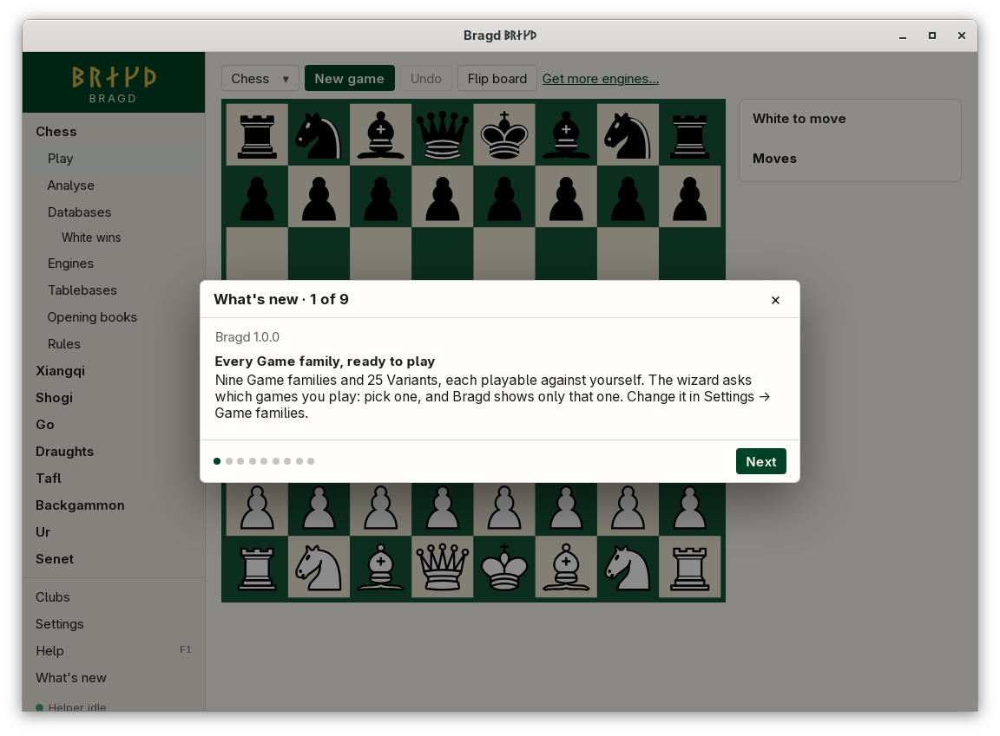
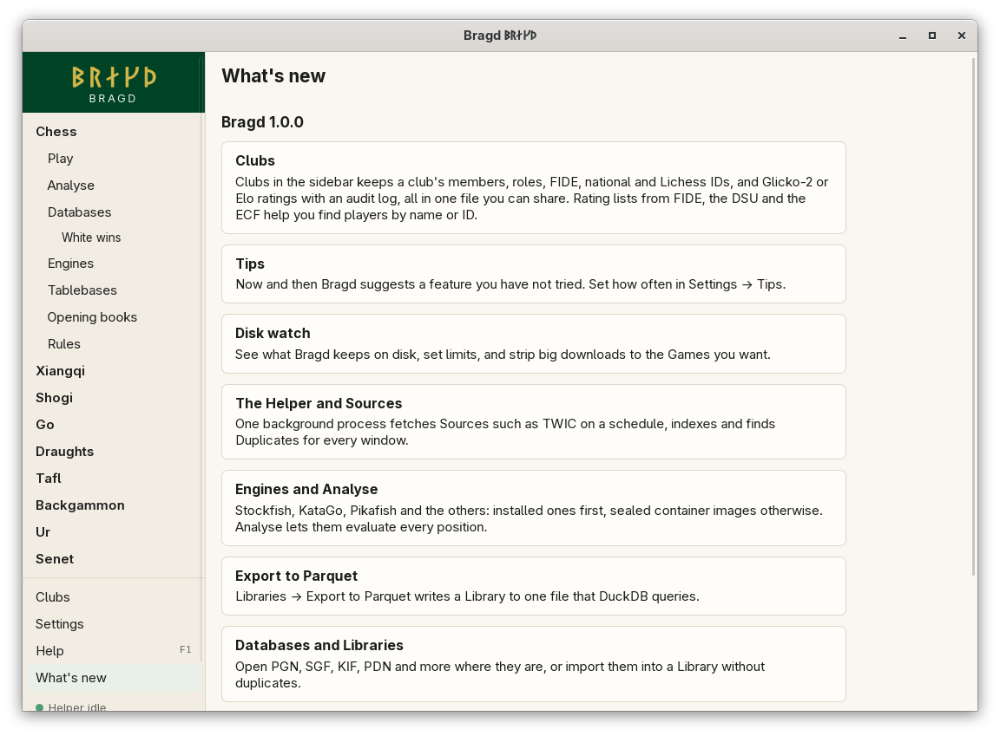

[← README](../../README.md) · [Docs index](../README.md) · [Getting started](README.md)

# What's new

After an upgrade, Bragd shows a tour card for each feature that came since the version you last saw. The cards open in the same frame as the install wizard, one at a time. Closing them marks them seen, so each shows once. *What's new* in the sidebar lists every version with its cards, newest first, whenever you want them again.

*A tour card after an upgrade.*

*What's new in the sidebar: every version with its cards.*

The cards of the coming version, 1.0.0:

| Card | Title |
|---|---|
| `families` | Every Game family, ready to play |
| `themes` | Themes and Board themes |
| `databases` | Databases and Libraries |
| `parquet` | Export to Parquet |
| `engines` | Engines and Analyse |
| `helper` | The Helper and Sources |
| `disk` | Disk watch |
| `tips` | Tips |
| `clubs` | Clubs |

A card shows only to someone who plays a Game family it concerns. Most concern everyone; one about tablebases, say, would name chess and skip a user with chess turned off, both after the upgrade and in the list.

## How to reach it

- The cards open by themselves on the first start after an upgrade. **Next** and **Back** move between them, **Done** on the last one closes them, and **×** or **Esc** closes them at any card.
- *What's new* in the sidebar opens the list of every version.
- The [changelog](../changelog.md) has a line for every change, release by release.

## What it needs

Nothing. The cards are part of the app, not fetched.

## Settings and config.toml

None. The newest version whose cards you saw is kept as `seen_version` in `state.json` ([Files on disk](../reference/files.md)).

## Questions

#### Why did no cards show on my first start?

A first start gets the install wizard instead. It counts every card up to this version as seen, as there is nothing new to tell yet.

#### Why do the cards say 1.0.0?

Nothing is released before 1.0.0, so every card made until then belongs to it. Someone who first installs 1.0.0 never reads of a version that was not published.

#### How do I see the cards again?

*What's new* in the sidebar lists every version with its cards.

#### I skipped a few versions. Which cards do I get?

Every card newer than the version you last saw, from all the versions in between, oldest first.

#### Do the cards show in my language?

Yes, like every text in Bragd. A card that is not translated yet shows in English.

---
[← Previous: Help (F1) and notices](help.md) · [Next: Tips →](tips.md)
