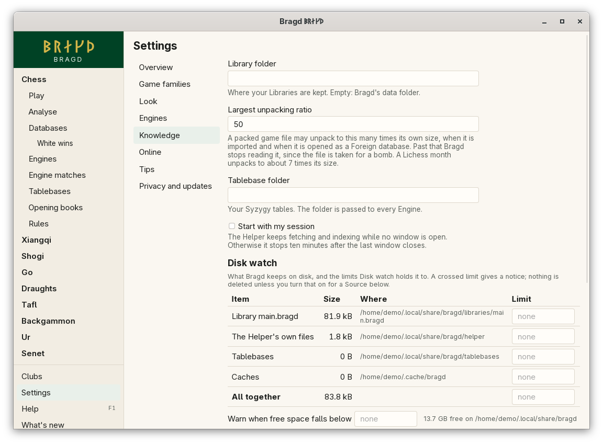

[← README](../../README.md) · [Docs index](../README.md) · [Knowledge](README.md)

# Disk watch

Disk watch shows what Bragd keeps on disk and holds it to limits you set: for all of it together, for each item, and for the free space left. A crossed limit gives a notice. Nothing is deleted unless you turn that on for a Source. In F1 this is the `disk` entry.


*Settings → Knowledge → Disk watch.*

## How to reach it

- *Settings → Knowledge*: Disk watch follows the area's settings. It concerns every Game family, so it has one place, not a tab on each Family's Databases page.
- *Show me* on the `disk` entry in F1 opens it.

On the page:

1. Type a limit beside an item, beside *All together*, and beside *Warn when free space falls below*. Type sizes as `500 MB` or `5 GB`; leave a field empty for no limit.
2. Press **Save limits**. The next check uses them; no restart is needed.
3. Under *Prune the Library*, **Preview** counts what the Strip rules of the Sources' Routes to the main Library would take from it. **Prune now** takes it.
4. Under *What Disk watch may do by itself*, tick what may happen for each Source when a limit it counts against is crossed.

## What it counts

| Item | Id in `disk.items` | What it is |
|---|---|---|
| Library *name* | `library:main.bragd` | Each `.bragd` file in the Library folder, with its `-wal` and `-shm` files |
| Downloads of *Source* | `downloads:twic` | A Source's downloads |
| The Helper's own files | `helper` | The Helper's folder, without the downloads |
| Tablebases | `tablebases` | The tablebase folder |
| Engine image *name* | `image:<name>` | A pulled engine image, kept by the container runtime |
| Caches | `cache` | `<cache>/bragd` |

A tablebase folder you chose outside Bragd's data folder is marked *outside Bragd*: it is shown, counts toward no total, and is never touched. Free space is checked for the disk of `<data>/bragd`, and also for the Library folder's disk when it is elsewhere. Sizes are in powers of 1000.

## When a limit is crossed

The Helper checks after every job and once an hour.

- An item's own limit counts against its Source.
- The total and the free space count against every Source.
- Each window shows the notice in its own language.

What happens next is up to you, per Source. All three are off until you turn them on:

| Action | What it does |
|---|---|
| Apply its Strip rule | Runs the Source's [Strip rule](strip-rules.md) on its downloads and the Library, at most once a day |
| Delete its oldest downloads | Removes downloads, oldest first, until the Source is within its limit |
| Stop fetching it | The Source is skipped until a check finds the disk within the limits again |

## What it needs

The [Helper](helper.md), which does the checks. Image sizes come from the container runtime: each image Bragd pulled is listed.

## Settings and config.toml

| Setting | `config.toml` key | Default | What it does |
|---|---|---|---|
| Disk limit for all Bragd keeps | `disk.total` | `0`: none | The most everything Bragd keeps may take together, in bytes |
| Warn below this much free space | `disk.free_below` | `0`: none | Warn when a disk Bragd keeps things on has less free than this, in bytes |
| Each item's limit | `disk.items` | empty | A table of item id to bytes, such as `"downloads:twic" = 2000000000` |

```toml
[disk]
total = 50000000000
free_below = 10000000000

[disk.items]
"library:main.bragd" = 20000000000
"downloads:twic" = 2000000000
```

## Questions

#### Does Bragd delete anything by itself?

Only when you turn that on for a Source. Otherwise Disk watch only warns you.

#### Why is my limit refused?

It must be a size Bragd can read, such as `500 MB` or `5 GB`. In `config.toml` the limits are plain numbers of bytes.

#### What does Prune now remove?

The Games that every one of their Sources' Routes to this Library strips. A Game brought by a Source whose Route here has no rule, or keeps it, stays. Press **Preview** first: it counts what would go and changes nothing.

#### Why is a Source not fetched any more?

*Stop fetching it* is on for it and the disk is over a limit it counts against. Its line on the Sources tab says so. It is fetched again once a check finds the disk within the limits.

#### Why does pruning need free space?

A Library made before Disk watch existed is compacted whole after a prune, which needs about as much free space as the Library for a while.

#### Are engine images counted?

Yes, once images are published. Each pulled image is an item, kept by the container runtime, so Disk watch counts it but never deletes it.

---
[← Previous: Strip rules](strip-rules.md) · [Next: The Helper →](helper.md)
