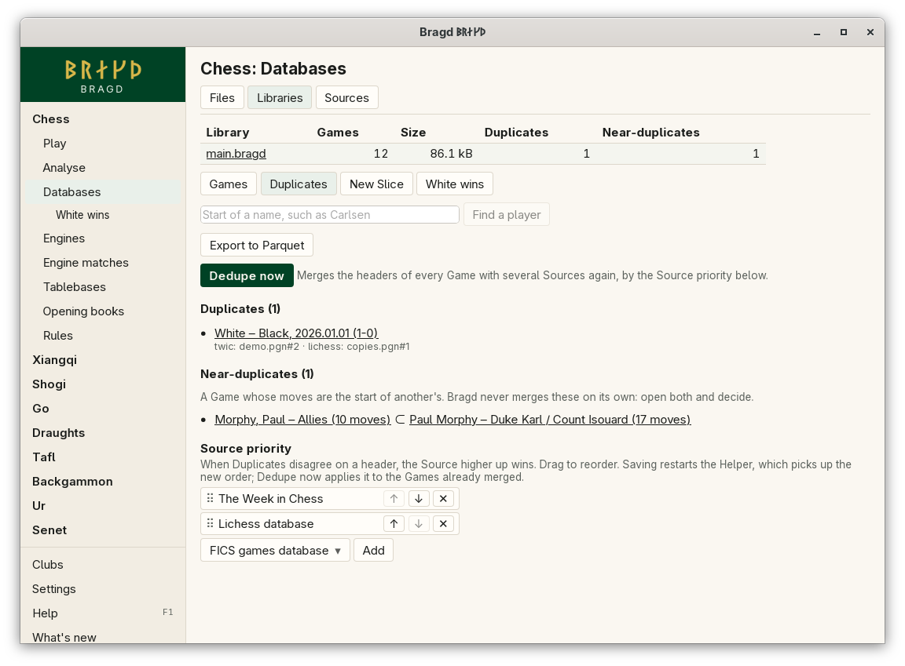

[← README](../../README.md) · [Docs index](../README.md) · [Knowledge](README.md)

# Duplicates

Two Games are Duplicates when they have the same moves from the same starting position, whatever their headers say. A Library keeps such a Game once and records every Source that brought it. A Game whose moves are the start of another Game's moves, such as a copy cut off early, is a **Near-duplicate**. It is flagged for review and never merged on its own.

*Databases → Libraries → a Library → Duplicates.*

## How to reach it

1. In the sidebar, open a Family and choose **Databases**, then **Libraries**.
2. Click a Library's name, then its **Duplicates** tab.
3. The tab lists the Games merged from several Sources, with their Sources, and each Near-duplicate pair. Click a Game to open it in the Games tab.
4. **Dedupe now** merges the headers of every Game with several Sources again, by the Source priority.
5. The Source priority list is at the bottom of the Libraries tab. Drag a Source, or use **↑** and **↓**, to reorder it; **✕** removes it; type an id and press **Add** to add one.

## How a Duplicate is found

Each Game gets a key made from its Family, its Variant, its starting position and the position after every move. Two Games with the same key are the same Game.

- Chess positions use the Polyglot Zobrist key. Draughts, xiangqi and shogi use a hash of the position's FEN or SFEN.
- Go has only a key of the move sequence for now.
- Headers play no part: different spellings of the players, events or dates do not stop a match.

When a Duplicate arrives, the Game already stored is kept and the new Source is recorded on it. Where the headers disagree, the Source higher in the priority wins each header.

## What it needs

Nothing. Duplicates are found as Games are imported, by the [Helper](helper.md).

## Settings and config.toml

| Setting | `config.toml` key | Default | What it does |
|---|---|---|---|
| Source priority | `knowledge.source_priority` | `["twic", "lichess"]` | A header conflict goes the way of the Source listed first |

## Questions

#### Does Bragd ever merge two Games with different moves?

No. Only Games with exactly the same moves from the same start are merged. A Game that is a prefix of another is a Near-duplicate, and Bragd leaves both as they are.

#### How do I deal with a Near-duplicate?

Open both from the Duplicates tab and decide. There is no merge for Near-duplicates yet, so the review only lists and opens them.

#### I changed the Source priority. Why have old Games kept their headers?

A new priority applies to later merges. Saving it restarts the Helper, which reads it as it starts. Press **Dedupe now** to merge the headers of the Games already stored again under the new order.

#### Why does saving the priority stop a job?

Saving restarts the Helper. A job that was running starts again from its beginning, which is safe because imports can be repeated.

#### Why are there at most 500 Duplicates in the list?

The review shows at most 500 Duplicates and 500 Near-duplicate pairs, so the page stays quick on a large Library. The counts in the Libraries table and in the review headings are the whole totals.

#### What names go in the priority list?

Source ids, such as `twic`, `lichess`, `file` for a file you imported, or `custom:<name>` for a custom URL. See [Sources](sources.md).

---
[← Previous: Libraries](libraries.md) · [Next: Slices →](slices.md)
