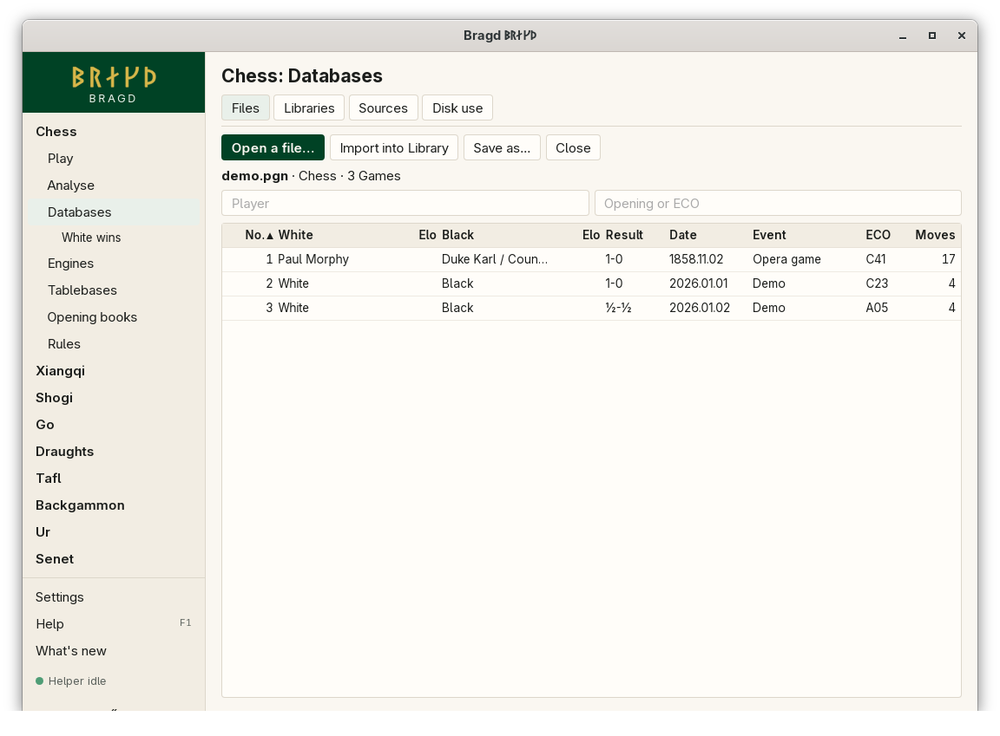
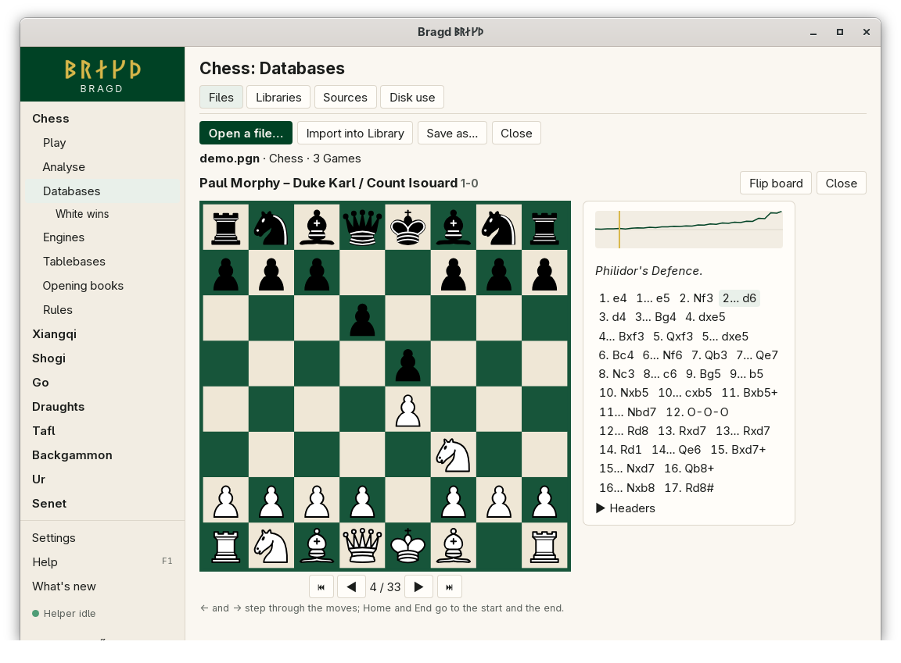
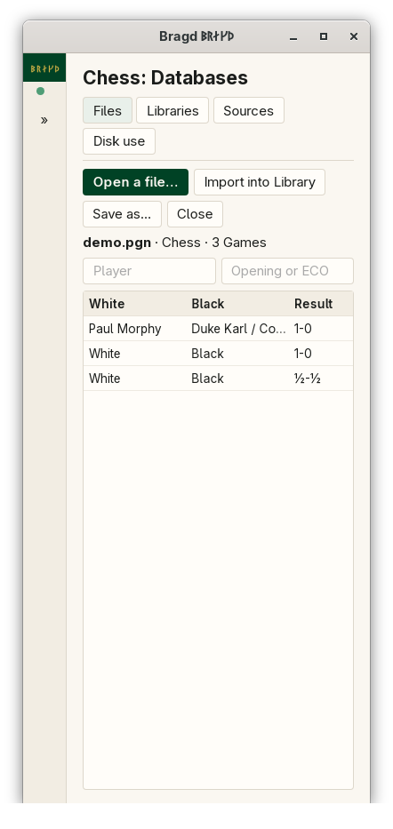

[← README](../../README.md) · [Docs index](../README.md) · [Knowledge](README.md)

# Foreign databases

A Foreign database is a game file in someone else's format. Bragd opens it where it is and reads it in place: it does not copy it, convert it or change it. You can list its Games, filter and sort them, step through one, import the file into a Library, or save a copy. In F1 this is the `databases` entry.

*Databases → Files, with a PGN file open.*

*A Game in replay, with its evaluation profile.*

*The Files tab at 390 px wide.*

## How to reach it

1. In the sidebar, open a Family and choose **Databases**. The *Files* tab is the first.
2. Press **Open a file…** and choose a file. The dialog shows the game files Bragd reads.
3. Click a row, or move to it with **Tab** and press **Enter** or **Space**, to open the Game.
4. In replay, **←** and **→** step through the moves, **Home** and **End** go to the start and the end.

| Button | What it does |
|---|---|
| **Open a file…** | Opens a game file. One file is open at a time |
| **Import into Library** | Starts a Helper job that imports the file into the default Library, with the Source `file` |
| **Save as…** | Writes a copy of the file somewhere else |
| **Close** | Closes the file |

The file stays open while the window runs, so you can leave the page and come back to it.

## What it needs

Only the file. These formats open:

| Format | Files |
|---|---|
| PGN (chess and its Variants, xiangqi PGN) | `.pgn`, `.pgn.gz`, `.pgn.zst`, `.pgn.bz2` |
| SCID 4 and 5 | `.si4`, `.si5` |
| ChessBase | `.cbh`, `.cbv` |
| SGF (go) | `.sgf` |
| KIF and CSA (shogi) | `.kif`, `.kifu`, `.csa` |
| PDN (draughts) | `.pdn` |

A large file is listed while it is read, with the count so far. A very large file is listed up to a cap, and a line says so. A packed file (`.pgn.zst`, `.pgn.bz2`, `.pgn.gz`) is unpacked only as far as an import may unpack it ([Largest unpacking ratio](#why-does-a-packed-file-stop-saying-it-unpacks-too-far)), so a Lichess month opens whole. Only the rows in sight are asked of Rust, so scrolling stays quick.

Replay draws a board for chess (and Chess960, from the `Variant` header) and shogi. Draughts and xiangqi Games list their moves without a board for now, because their readers give no position per move. Go Games show their headers.

## Settings and config.toml

Foreign databases share these settings with importing:

| Setting | `config.toml` key | Default | What it does |
|---|---|---|---|
| Library folder | `knowledge.library` | empty: `<data>/bragd/libraries` | Where the Library that imports land in is kept |
| Largest unpacking ratio | `knowledge.max_unpack_ratio` | `50` | How many times its own size a packed game file may unpack to before reading it stops, whether it is opened or imported |

## Questions

#### Does opening a file change it?

No. Bragd reads it in place and writes nothing to it. It is only written when you choose **Save as…** and pick the same file, and then Bragd asks first if the file was downloaded.

#### What counts as downloaded?

A file in a Source's download folder (inside the Helper's folder), or in your `~/Downloads` folder. Writing over one is allowed but discouraged: the next fetch may replace it, and its Games in the Library still name it.

#### How do I filter the list?

Type part of a name in *Player*, or an opening or ECO code in *Opening or ECO*. Click a column heading to sort by it. A go file is filtered by player only and is not sorted.

#### Why does a Game list its moves without a board?

Its reader gives no position for each move yet. That is so for draughts and xiangqi files. Chess and shogi Games show a board.

#### What is the line under the moves?

The evaluation profile, when the file carries one (ChessBase's `[%evp]` comment). White's advantage is up, Black's down, capped at ten pawns. A mark shows where you are in the Game.

#### Why does a Game stop part way?

The file has a move that cannot be played from the position before it. Bragd shows the moves up to that one and names it.

#### How does Bragd read a chess game's FEN tag?

It is forgiving, as files need. Missing move counters are filled in. An en passant square that no pawn can take on is dropped, and then castling rights that no rook backs. Chess960 castling may be written either way: `KQkq` names the outermost rooks, and `HAha` names each rook's file. A FEN that is no position a game could reach, for example one where the side not to move is in check, is not read: the Game starts from the usual position.

#### Why does a packed file stop, saying it unpacks too far?

Opening a packed file keeps the same rule as importing one ([Sources](sources.md#why-did-an-import-stop-saying-the-file-unpacks-too-far)). Once the file has unpacked to more than *Largest unpacking ratio* times its packed size, 50 unless you change it, reading stops and the Games read so far stay listed. The first 64 MB unpacked always pass. A real file stays far below: a Lichess month unpacks to about 7 times its size. If a file you trust stops, raise the ratio in *Settings → Knowledge* and open it again.

#### Can I open EPD files or Polyglot books here?

Not from this page yet. Polyglot books are added on the [Opening books](../engines/opening-books.md) page.

---
[← Previous: Knowledge](README.md) · [Next: Libraries →](libraries.md)
