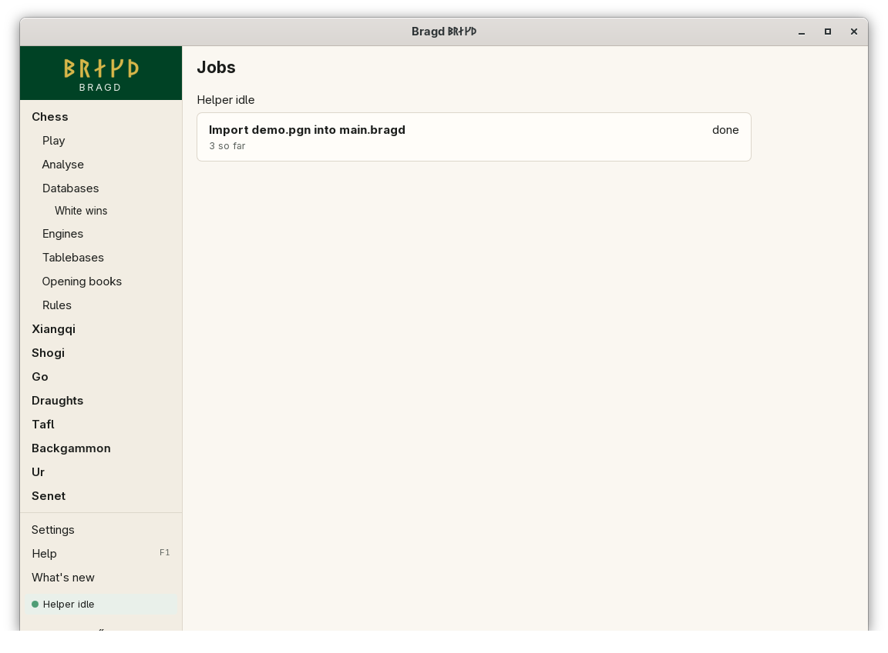
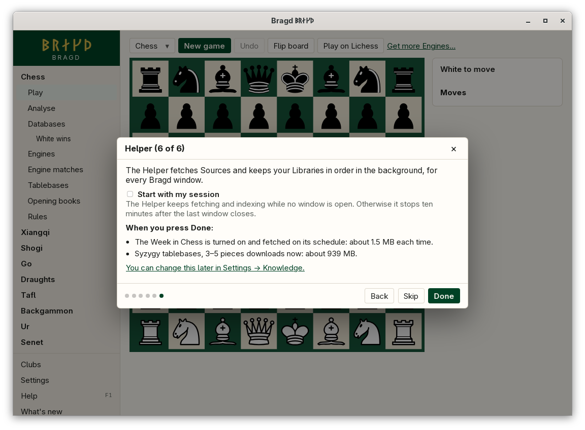

[← README](../../README.md) · [Docs index](../README.md) · [Knowledge](README.md)

# The Helper

The Helper is a background process, `bragd-helper`, shared by every Bragd window. It fetches Sources, imports files into Libraries, finds Duplicates, applies Strip rules and runs Disk watch, so the windows stay quick. One Helper serves all windows of one user. In F1 this is the `helper` entry.

*The Jobs page, opened from the Helper line in the sidebar.*

*The last step of the install wizard.*

## How to reach it

- The sidebar's footer shows the Helper: *Helper idle*, *N jobs* with the running job's progress, *Paused on battery*, or *Helper out of reach*. Click it to open the **Jobs** page.
- The Jobs page lists every job, its progress and status (queued, running, done, failed, cancelled). **Cancel** stops one. **Try again** dials a Helper that could not be reached.
- *Start with my session* is in *Settings → Knowledge* and in the install wizard's last step.

You never start the Helper yourself. A window that finds none starts the `bragd-helper` beside its own program.

## How long it runs

- It stays ten minutes after the last window closes, then leaves.
- With *Start with my session* on, a Helper started by a window stays until you log out.
- It does not leave while a job runs, unless the job is paused on battery.
- To have the session start it at login, run `bragd-helper --service on` once. That writes a systemd user unit on Linux, an XDG autostart entry on the BSDs and in the Flatpak, a LaunchAgent on macOS, or a Run entry on Windows. `bragd-helper --service off` takes it away, and `bragd-helper --service` prints `on` or `off`. See [Command line](../reference/command-line.md).

Jobs run one at a time, in the order asked. While the machine runs on its battery, downloads, imports and merges pause until it is plugged in again. The BSDs and illumos always count as on mains.

## Versions

Windows and the Helper speak protocol version 1, one line of JSON per request and per reply.

- A window of a newer version makes the Helper leave, and starts its own.
- An older window that speaks the same protocol is served. One that does not is refused, and says to restart Bragd.
- A newer Helper never steps down for an older window.

So the Helper survives an upgrade until a window of the new version opens.

## What it needs

The `bragd-helper` program beside `bragd-gui`. Every installer puts it there. Nothing else.

## Settings and config.toml

| Setting | `config.toml` key | Default | What it does |
|---|---|---|---|
| Start with my session | `helper.start_with_session` | `false` | The Helper keeps running while no window is open, instead of leaving after ten minutes |
| Library folder | `knowledge.library` | empty: `<data>/bragd/libraries` | Where Sources and imports land |
| Source priority | `knowledge.source_priority` | `["twic", "lichess"]` | Read when the Helper starts; saving it restarts the Helper |

## Its folder

Everything the Helper keeps is in `<data>/bragd/helper/`:

| File | What it is |
|---|---|
| `helper.lock` | Held while a Helper runs, so a second one leaves at once |
| `helper.addr` | The address and a token; only you can read it |
| `helper.log` | What it did and what went wrong, with times in UTC |
| `state.json` | Its jobs, the Sources' options and Strip rules, and what each fetch remembered |
| `sources/` | The Sources' downloads |

Windows reach it over a Unix socket in this folder. On Windows it is a loopback TCP port, guarded by the token.

## Questions

#### What does the Helper do?

It fetches Sources, imports into your Libraries and finds Duplicates, so the windows stay quick. It also applies Strip rules and checks the disk against your limits.

#### When does it stop?

Ten minutes after the last window closes, unless *Start with my session* is on.

#### Does turning on *Start with my session* start it at login?

Not by itself in this version. It keeps a running Helper from leaving. Run `bragd-helper --service on` once to have your session start it at login.

#### What happens to a job if the Helper stops in the middle?

It starts again from its beginning when the next Helper starts. That is safe, because importing a Game already there merges it into itself. A job whose file has gone fails and says so.

#### Why does the sidebar say *Helper out of reach*?

The window could not start or dial a Helper. It asks again after 30 seconds, or at once with **Try again** on the Jobs page. `helper.log` says why.

#### Does the Helper use the network?

Only to fetch the Sources you turned on, and never on a metered connection for a Source set to avoid one. It listens only on a socket in its own folder, or on loopback on Windows.

#### Can two users on one machine share a Helper?

No. Each user has their own, in their own data folder.

---
[← Previous: Disk watch](disk-watch.md) · [Next: Engines →](../engines/README.md)
