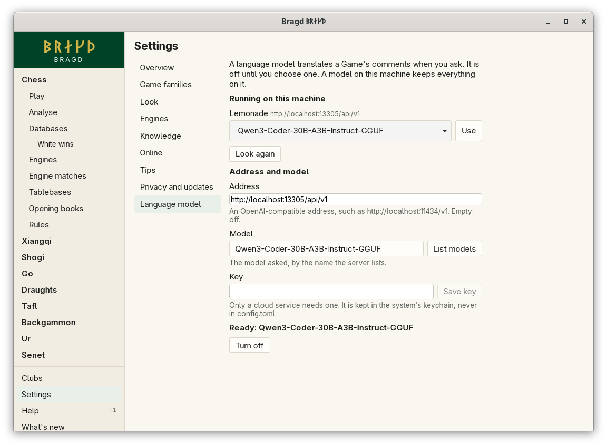
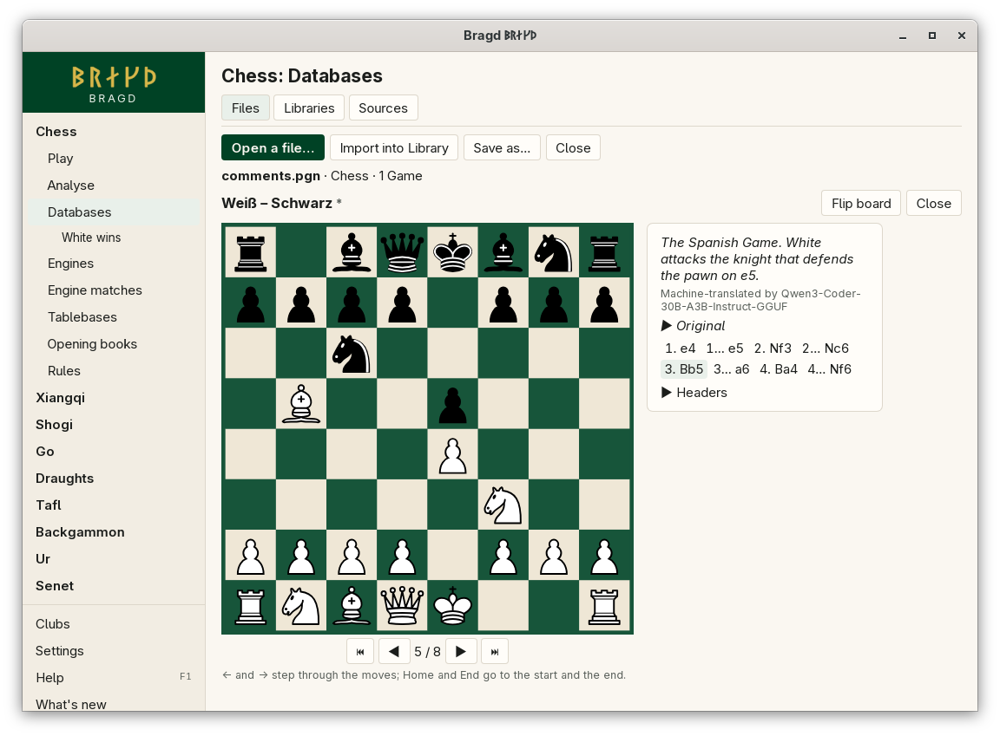

[← README](../../README.md) · [Docs index](../README.md) · [Knowledge](README.md)

# Language model

A language model translates a Game's comments into your language when you ask. Bragd talks to any server with an OpenAI-compatible address: Ollama, Lemonade or LM Studio on this machine, or a cloud service. It is off until you choose one. In F1 this is the `model` entry.

*Settings → Language model.*

## How to reach it

Open *Settings → Language model*. Bragd looks for a model server running on this machine and lists each one it finds, with its models:

| Server | Address Bragd tries |
|---|---|
| Ollama | `http://localhost:11434/v1` |
| Lemonade | `http://localhost:13305/api/v1`, then `http://localhost:8000/api/v1` |
| LM Studio | `http://localhost:1234/v1` |

Pick a model and press **Use**. That is all a model on this machine needs. **Look again** looks once more, for a server you started after opening the page.

For another server, type its address under *Address and model*, then a model's name, or press **List models** and pick one.

| Button | What it does |
|---|---|
| **Use** | Sets the server found and the model picked |
| **Look again** | Looks for Ollama, Lemonade and LM Studio on this machine again |
| **List models** | Asks the server at the address for its models |
| **Save key** | Keeps the key you typed in the system's keychain |
| **Remove key** | Takes the key for this address out of the keychain |
| **I agree** | Agrees that comments and positions go to an address off this machine |
| **Turn off** | Clears the address. Nothing is asked of any model until you set one again |

## Translating a comment

*A comment translated in replay.*

When you replay a Game from a Foreign database or a Library, a comment that is not in your language has **Translate** under it. Press it, and the comment is shown in your language, labelled *Machine-translated by* and the model's name. **Original** under it opens the comment as it was written.

- Each comment is translated only when you press **Translate**. Nothing is translated when you import or open a file.
- Bragd guesses each comment's language on this machine. A comment it is sure is in your language has no **Translate** button.
- A translation is kept per language. The same comment, in this Game or any other, then shows its translation at once, without asking the model again.
- A Library keeps a Game's comments from 0.5.0. A Game imported before that has none: import its file again to bring them in ([Libraries](libraries.md#why-does-a-game-from-my-library-have-no-comments)).

## A model off this machine

An address that is not this machine (`localhost`, `127.0.0.1` or `::1`) is treated as a cloud service, even one on your home network. Before Bragd sends it anything but a request for its model list, it says plainly that the comments you translate go there, and so will positions when Bragd writes Commentary. Nothing goes until you press **I agree**. You agree once per address: a new address asks again.

A cloud service needs a key. Type it under *Key* and press **Save key**. Bragd keeps it in the system's keychain only: the Secret Service on Linux and the BSDs, the Keychain on macOS, and the Credential Manager on Windows. It is never written to `config.toml` or to any file of Bragd's.

## What it needs

A model server. On this machine, Ollama, Lemonade or LM Studio with a model downloaded in it. In the cloud, an address and a key from the service.

Translations are kept in `translations.sqlite` in Bragd's data folder ([Files on disk](../reference/files.md)). The file is made by the first translation.

## Settings and config.toml

| Setting | `config.toml` key | Default | What it does |
|---|---|---|---|
| Address (`model_url`) | `model.url` | empty: off | The server's OpenAI-compatible address, ending before `/models` and `/chat/completions` |
| Model (`model_name`) | `model.name` | empty | The model asked, by the name the server lists |
| Agreed to (`model_consent`) | `model.consent` | empty | The address you agreed may receive comments and positions. Set by **I agree** |

The key is not a setting: it lives in the keychain. With `BRAGD_OFFLINE` set, Bragd asks only a model on this machine.

## Questions

#### Does anything leave my machine?

Not with Ollama, Lemonade or LM Studio on this machine. An address off this machine gets the comments you press **Translate** on, and only after you agree to it.

#### Why is there no Translate button on a comment?

Either no language model is set up and ready, or Bragd is sure the comment is already in your language. A short comment such as `!?` or a single word always has the button, since its language cannot be told.

#### Where is my key kept?

In the system's keychain only, under the name `bragd-model` and the address. Remove it with **Remove key**, or in your system's keychain manager.

#### Why are translations not shared with my other machines?

A translation is kept by the machine that asked for it. Peers share the Position store, which holds what is known about positions; a comment belongs to a Game, not to a position.

#### Can I correct a translation?

Not yet. The original is always one click away under **Original**.

---
[← Previous: Position store](position-store.md) · [Next: The Helper →](helper.md)
