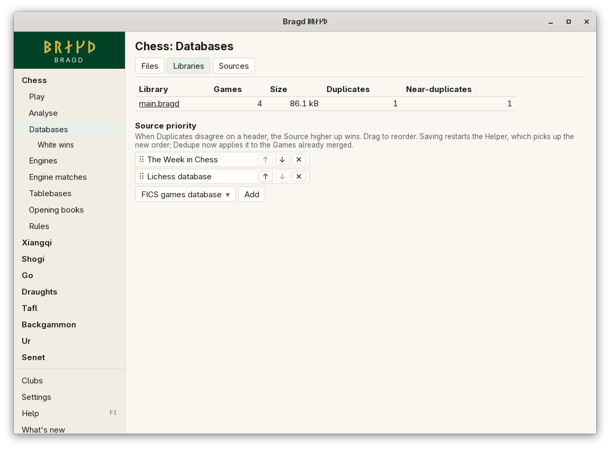

[← README](../../README.md) · [Docs index](../README.md) · [Knowledge](README.md)

# Libraries

A Library is Bragd's own store of Games: one SQLite file ending in `.bragd`. Imports land in it, and each Game appears once, however many Sources brought it. Every Game remembers its Sources. The default Library is `main.bragd`.

*Databases → Libraries.*

## How to reach it

1. In the sidebar, open a Family and choose **Databases**, then the **Libraries** tab.
2. The table lists every `.bragd` file in the Library folder, with its Games, size, Duplicates and Near-duplicates. Click a name to open it.
3. An open Library has its own tabs: **Games**, **Duplicates**, **New Slice**, and one button per saved Slice (a kept copy is marked ⧉). **Export to Parquet** sits under them ([Export to Parquet](parquet-export.md)).
4. **Games** lists the Library's Games of the Family whose page you are on: chess Games on the chess page, go Games on the go page.
5. Click a Game to step through it, as in a Foreign database: **←**, **→**, **Home** and **End**.

Games get into a Library in three ways:

- **Import into Library** on the *Files* tab, for the file that is open ([Foreign databases](foreign-databases.md)).
- A [Source](sources.md) that is on, when the Helper fetches it.
- *Keep as a separate copy* on a [Slice](slices.md), which makes a new Library beside the first.

Imports are jobs of the [Helper](helper.md). They show in the sidebar's Helper line and on the Jobs page.

## What it needs

Nothing to install. The Helper does the imports, and a window starts it when none runs. A chess Game from a Library replays with a board, because it is written out as PGN and read back. Games of the other Families list their moves.

## Settings and config.toml

| Setting | `config.toml` key | Default | What it does |
|---|---|---|---|
| Library folder | `knowledge.library` | empty: `<data>/bragd/libraries` | Where Libraries are kept. Sources and imports go into `main.bragd` there |
| Source priority | `knowledge.source_priority` | `["twic", "lichess"]` | When Duplicates disagree on a header, the Source listed first wins ([Duplicates](duplicates.md)) |
| Largest unpacking ratio | `knowledge.max_unpack_ratio` | `50` | How far a packed game file may unpack before its import stops ([Sources](sources.md#why-did-an-import-stop-saying-the-file-unpacks-too-far)) |

`<data>` is your system's data folder: `~/.local/share` on Linux and the BSDs, `~/Library/Application Support` on macOS and `%APPDATA%` on Windows. See [Files on disk](../reference/files.md).

## Questions

#### Is a Library a database server?

No. It is one SQLite file you can copy, back up or move like any other file. Nothing listens on the network.

#### Why is my Library empty?

Nothing has been imported yet. Open a file and press **Import into Library**, or turn on a Source. The first import makes `main.bragd`.

#### Can I have more than one Library?

Yes. Every `.bragd` file in the Library folder is listed. Sources and **Import into Library** always use `main.bragd`; a Slice kept as a separate copy becomes a Library of its own.

#### Does importing the same file twice double its Games?

No. A Game already in the Library is recognised by its moves and kept once. Its Source is recorded again only if it is a new one. Imports are safe to repeat, which is why a job cut short starts again from the start.

#### What does a Library do with very large files?

A PGN or PDN file, packed or not, and every zip is read as a stream, one Game at a time. Nothing is unpacked to disk, and memory stays small whatever the file's size.

#### Does the Games list show only the Family I came from?

Yes. On the chess page the Games tab lists the Library's chess Games, on the go page its go Games, and so on, filtered further by the player you type. The Libraries table counts every Game, whatever its Family. A Slice can be limited to one Variant of the Family as well.

#### Which Variant ids does a Library store?

The ids of Bragd's own Variants, the same as in *Settings → Game families* and `config.toml`: `chess`, `chess960`, `kingofthehill`, `draughts` (international), `checkers`, `draughts-russian`, `draughts-brazilian`, `xiangqi`, `shogi`, `go-9`, `go-13` and `go-19`. A PGN `Variant` tag of `Standard` or `From Position` is `chess`. A Variant Bragd does not play keeps its own name in lower case, without spaces: `threecheck`, `go-7`, `gametype-22`.

---
[← Previous: Foreign databases](foreign-databases.md) · [Next: Duplicates →](duplicates.md)
