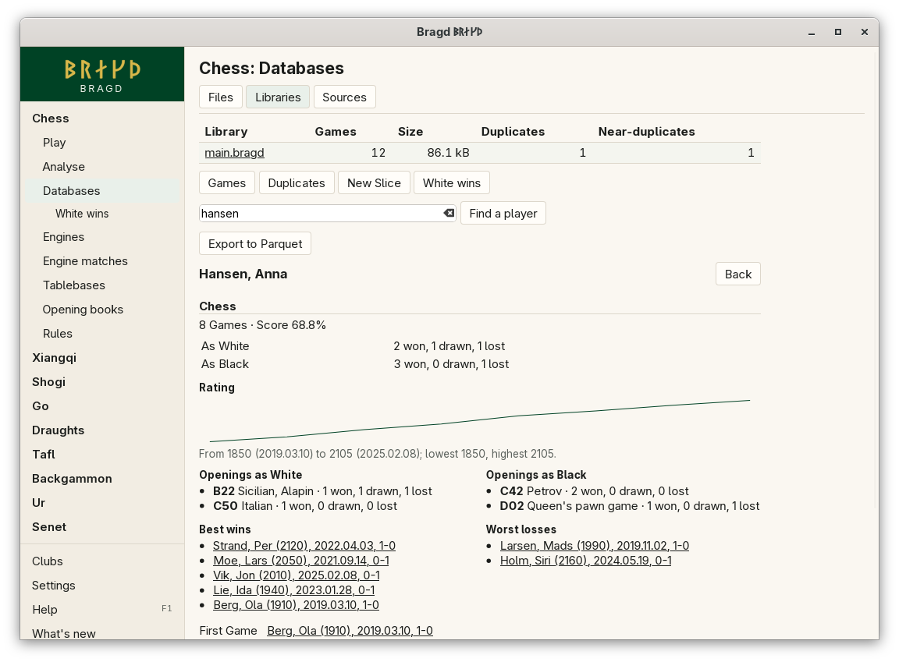

[← README](../../README.md) · [Docs index](../README.md) · [Knowledge](README.md)

# Player summary

A player's summary shows what one player did in a Library: their Games, their results with each side, their score, their rating over time, the openings they played most, their best wins and worst losses, and their first and last Game. It is read from the Games' headers, so it needs no import of its own and follows the Library as it grows. In F1 this is the `players` entry.

*Databases → Libraries → a Library → a player's name.*

## How to reach it

1. In the sidebar, open a Family and choose **Databases**, then **Libraries**.
2. Click a Library's name.
3. Either click a player's name in the Games list (the Games tab, or a Slice's Games), or type the start of a name in **Find a player** and press Enter.
4. When more than one name starts that way, pick one from the list.
5. Click a Game in the summary to open it in replay. **Back** returns to where you came from.

## What it shows

Each Game family the player has Games in gets a section of its own, and only the parts its Games give show.

| Part | What it says | Shown for |
|---|---|---|
| Games, score | How many Games, and the points of the finished ones in percent (a win 1, a draw ½) | Every Family |
| As White, as Black | Wins, draws and losses with each side, and unfinished Games. The sides take the Family's names: Red and Black in xiangqi, Sente and Gote in shogi | Every Family |
| Rating | The player's rating by date, as a line, from first to last, with the lowest and highest | Games whose headers give a rating (`WhiteElo`, `BlackElo`) and a year |
| Openings as each side | The five ECO codes played most, with the opening's name and the results | Chess |
| Best wins, worst losses | The five wins against the highest rated opponents, and the five losses against the lowest rated | Games whose opponent has a rating |
| First Game, last Game | The oldest and newest Game of a known year | Games with a year |

## What it needs

A Library with Games. A Family that is off in *Settings → Game families* is left out of the summary, but its Games stay in the Library.

## Settings and config.toml

None. The summary is read from the Library each time it is opened.

## Questions

#### Why does Find a player not find a name I know is there?

It matches the start of the name as the Games write it, such as `Kasparov` for `Kasparov, Garry`. The first letter may be typed small, but a part from the middle of a name, such as `Garry`, does not match. The Games list's *Player* filter matches any part.

#### Why are there no openings or ratings?

Openings come from ECO codes, which only chess Games have. A rating shows only where the Games' headers give one, and go ranks such as `5d` are not ratings.

#### Is the same player under two spellings counted once?

No. `Carlsen, M` and `Carlsen, Magnus` are two players to the summary. Pick each from the list to see both.

#### Does it read the whole Library?

No. It reads only the player's Games, through the indexes on White and Black that Slices use, so a summary takes as long in a large Library as in a small one.

---
[← Previous: Slices](slices.md) · [Next: Export to Parquet →](parquet-export.md)
