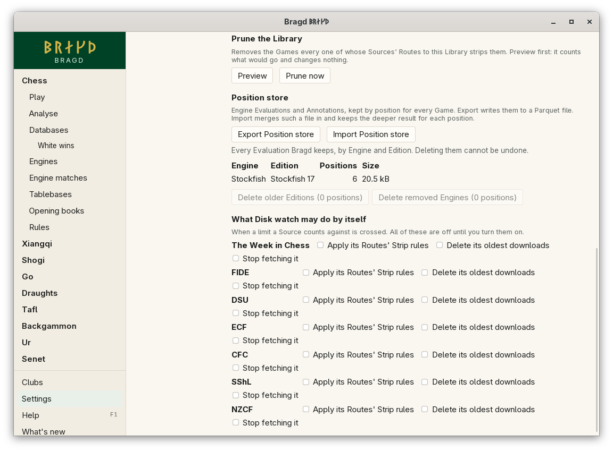

[← README](../../README.md) · [Docs index](../README.md) · [Knowledge](README.md)

# Position store

The Position store keeps what Engines have found, by position: each Evaluation and each Annotation. It is one file per machine, shared by every Library, Foreign database and Game played. A position judged once shows at once in [Analyse](../engines/analyse.md) and in every [Game review](../engines/review.md) of a Game that reaches it, whichever move order got there. In F1 this is the `positions` entry.

*Settings → Knowledge → Disk watch → Position store.*

## How to reach it

The store fills by itself as you analyse and review. Export and Import are in *Settings → Knowledge*, under Disk watch:

| Button | What it does |
|---|---|
| **Export Position store** | Asks where to save, then writes every Evaluation and Annotation to one Parquet file, such as `positions.parquet`. It says how many rows it wrote |
| **Import Position store** | Asks for a Parquet file written by Export, and merges it in. It says how many rows it read, and how many were new or deeper than the store's |

*Show me* on the `positions` entry in F1 opens the page.

## What it keeps

| Row | Kept for | What it holds |
|---|---|---|
| Evaluation | A position and an Edition | The score, the depth, the Engine's best line, and its second choice with its score when the Engine gave one |
| Annotation | A move from a position, and an Edition | The mark, the better line and the named motifs ([Game review](../engines/review.md#annotations)) |

An Edition is one exact build of an Engine: its version, its network, and its image when it runs in a container. Every Edition is kept. Bragd shows the newest Edition's row, and the deepest of those.

Only the deepest row for a position and an Edition is kept. An import keeps the deeper of the store's row and the file's, so importing a file twice changes nothing.

## The Parquet file

One row per Evaluation or Annotation, compressed with Snappy:

| Column | What it holds |
|---|---|
| `family`, `variant`, `key` | The position: its Game family, Variant and position key |
| `edition`, `engine`, `version`, `network`, `image` | The Edition |
| `kind` | `cp`, `mate`, `winrate` or `equity` for an Evaluation, `annotation` for an Annotation |
| `score`, `lead` | The score, and go's lead in points (0 for an Annotation) |
| `depth`, `time` | How deep, and when, in seconds since 1970 |
| `line` | The best line, or an Annotation's better line |
| `move`, `mark`, `motifs` | An Annotation's move, mark and motifs (empty for an Evaluation) |
| `kind2`, `score2`, `lead2`, `line2` | The Engine's second choice: its kind (empty when there is none), score, go's lead and line (empty for an Annotation). A file written before these columns imports without a second choice |

## What it needs

Nothing to set up. It lives in Bragd's data folder as `positions.sqlite` ([Files on disk](../reference/files.md)).

## Settings and config.toml

The Position store has no settings of its own.

## Questions

#### Does deleting a Library lose its analysis?

No. The Position store is a file of its own, and deleting a Library does not touch it.

#### How do I move my analysis to another machine?

Press **Export Position store** on one machine, copy the file, and press **Import Position store** on the other. The import merges: what the other machine already has stays, unless the file's row is deeper.

#### Can I read the file in DuckDB?

Yes. `SELECT * FROM 'positions.parquet' WHERE kind = 'annotation'` lists the Annotations, for example.

#### Is a position analysed again with a newer Engine?

Not by itself. A newer Edition analyses a position when you open it in Analyse or review a Game with it. The older Edition's rows are kept.

#### What happened to reviews made before the Position store?

Reviews were once kept per Game in the cache folder. They were not carried over: review the Game again, and the store keeps it.

---
[← Previous: Disk watch](disk-watch.md) · [Next: The Helper →](helper.md)
