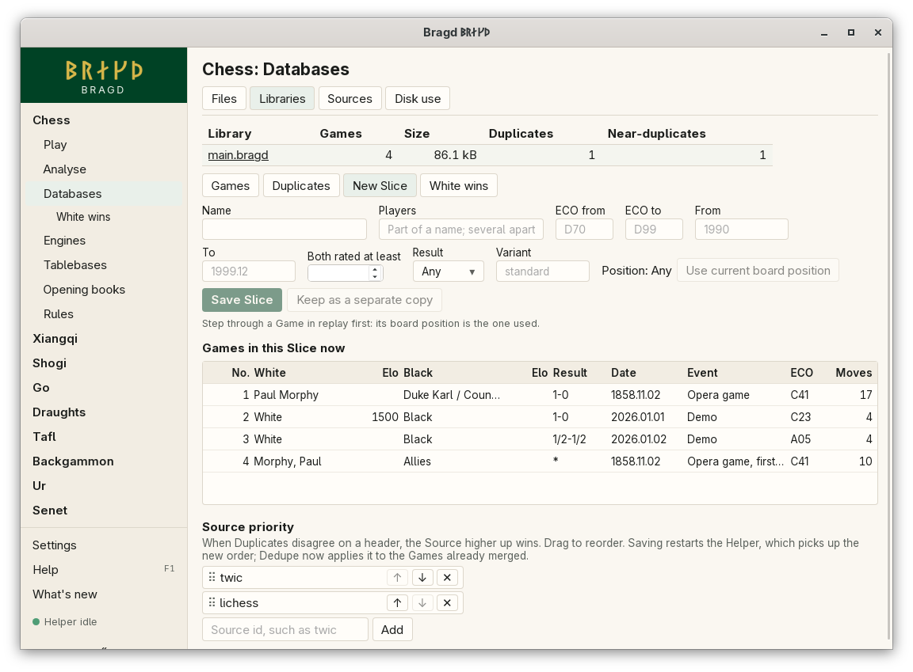

[← README](../../README.md) · [Docs index](../README.md) · [Knowledge](README.md)

# Slices

A Slice is a named query over a Library, such as "Grünfeld" or "both players 2500+". It is live: each time you open it, it shows the Library as it is then, new imports included. As an option, a Slice can be kept as a separate copy, a Library of its own that you can change apart from the first.

*Databases → Libraries → a Library → New Slice.*

## How to reach it

1. In the sidebar, open a Family and choose **Databases**, then **Libraries**.
2. Click a Library's name, then **New Slice**. A saved Slice has a button of its own beside it.
3. Fill in the fields. *Games in this Slice now* updates as you type.
4. Press **Save Slice**. The Slice is stored in the Library and shows under the Family's **Databases** in the sidebar.
5. **Keep as a separate copy** copies the Slice's Games into a new Library beside this one.

| Field | What it matches |
|---|---|
| Name | The Slice's name. Saving a new query under an old name replaces it |
| Players | Part of a name; several apart by commas |
| ECO from, ECO to | A range of ECO codes, such as `D70` to `D99` |
| From, To | A date range, as `1990` or `1999.12` |
| Both rated at least | Both players rated at least this. A Game missing a rating is left out |
| Result | `1-0`, `0-1`, `1/2-1/2` or `*` |
| Variant | The Variant as the Library stores it, such as `standard` or `chess960` |
| Position | A board position the Game passes through |

A field left empty matches every Game.

## Searching by position

1. Open a Game in replay on the Databases page (a file or a Library) and step to the position.
2. Open the Slice editor and press **Use current board position**. *Position* says *set*.
3. **Clear** removes it again.

The position is the one last shown in replay on the Databases page, not the Play board.

## What it needs

A Library with Games. Position search needs chess Games: only chess positions are keyed the same way in the Library.

## Settings and config.toml

Slices are stored inside their Library, not in `config.toml`. A kept copy is written to `<name>.bragd` in the Library folder, `knowledge.library`.

## Questions

#### Is a Slice a copy of the Games?

No. A Slice is a query. It takes no space beyond its name and fields, and it always shows the Library as it is now. Only *Keep as a separate copy* copies Games.

#### Why did my Library take a while to open once?

Bragd indexes the fields Slices search: White, Black, ECO, date and both Elos. A Library made by an older Bragd gets the indexes the first time it is opened, which reads every Game once. After that, a Slice finds its first page without reading the whole Library. A search by player name still reads every name, because it matches any part of it.

#### What happens to a kept copy when the Library changes?

Nothing. The copy is a Library of its own and does not follow the first. It is listed on the Libraries tab, and its Slice is marked ⧉.

#### Can a kept copy be written over?

No. Bragd never writes a copy over an existing file.

#### Why is *Use current board position* greyed out?

No Game has been stepped through in replay on the Databases page yet. Open one, step to the position, then come back.

#### Why does a Slice show under every Family?

A Slice with no Family shows under every Family's **Databases** in the sidebar. A new Slice takes the Family of the page you made it on.

#### Why does position search find nothing in my go or shogi Games?

Only chess positions match for now. Go has a key of its move sequence only, and the other Families key positions in a way the search does not use yet.

---
[← Previous: Duplicates](duplicates.md) · [Next: Export to Parquet →](parquet-export.md)
