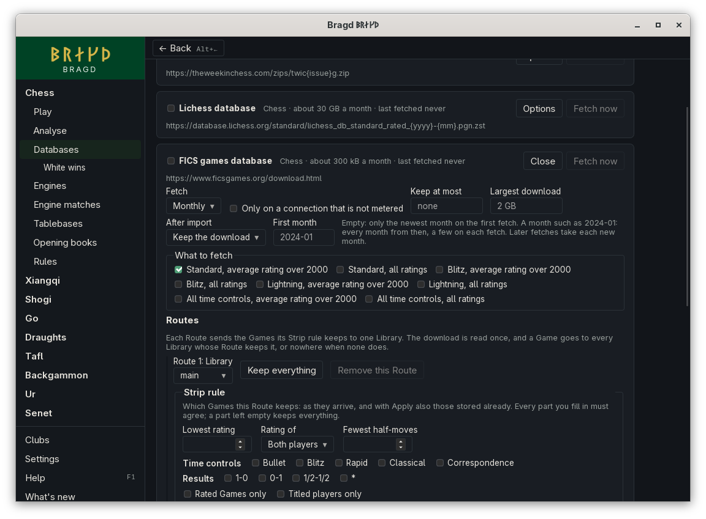

[← README](../../README.md) · [Docs index](../README.md) · [Knowledge](README.md)

# The FICS games database

The FICS games database holds the Games played on the Free Internet Chess Server since 1999, from [ficsgames.org](https://www.ficsgames.org/download.html). Bragd fetches a month at a time of the game types you choose, keeps each as it came (`.pgn.bz2`), and imports it through the Source's Routes as it reads it.

*Databases → Sources → FICS games database → Options.*

## How to reach it

1. In the sidebar, open **Chess**, then **Databases**, then **Sources**.
2. Press **Options** on *FICS games database*.
3. Under **What to fetch**, tick the game types you want. *Standard, average rating over 2000* is ticked until you choose.
4. To start from an older month, type it in **First month**, such as `2020-01`. Leave it empty to take only last month.
5. Press **Save**, then tick the Source to turn it on.

## What a fetch does

FICS makes each file when it is asked for. A month is out on the 2nd of the next month. The first fetch takes last month, or every month from *First month*. Later fetches take each month after the last one fetched, at most 12 at a time, and stop at a month that is not out yet. The files go into `<data>/bragd/helper/sources/fics/`.

Sizes of a month in 2025, packed:

| Game type | Average rating over 2000 | All ratings |
|---|---|---|
| Standard | 0.1 to 0.3 MB | about 2 MB |
| Blitz | under 1 MB | 13 to 17 MB |
| Lightning | under 0.5 MB | under 1.5 MB |
| All time controls | about 1 MB | 15 to 21 MB |

## Options

The other options are those of every Source ([Sources](sources.md#options)).

| Option | What it does |
|---|---|
| What to fetch | The game types fetched each month |
| First month | The month the first fetch starts from, as `yyyy-mm`. Empty: only last month |

## Questions

#### Why did a fetch take fewer months than I asked for?

It takes at most 12 a time, and FICS limits how much of its large archives one address downloads. When FICS gives no file for a month, the fetch stops there, and the next fetch goes on from that month.

#### Why are there no variant Games?

FICS's variant Games (wild, crazyhouse and others) are of Variants Bragd does not play, so they are not offered.

---
[← Previous: The Lichess database](source-lichess.md) · [Next: PGN Mentor →](source-pgnmentor.md)
