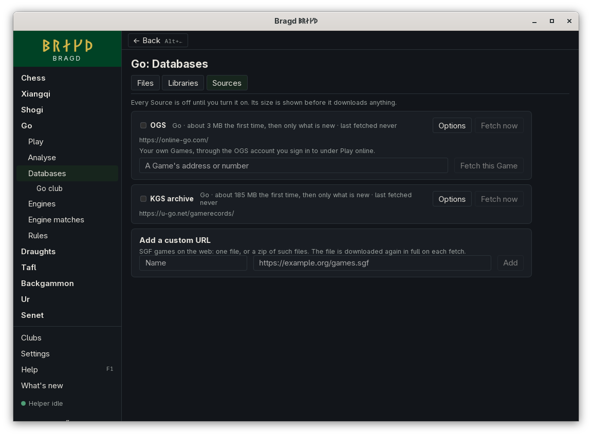

[← README](../../README.md) · [Docs index](../README.md) · [Knowledge](README.md)

# The KGS archive

The KGS archive holds the go Games of strong players on the KGS Go Server, collected at [u-go.net/gamerecords](https://u-go.net/gamerecords/). It keeps Games where one player is 7 dan or stronger, or both are 6 dan, without comments. Each zip holds a month of SGF files, or a year before 2016. Bragd fetches the zips and imports their Games through the Source's Routes. A Game in two zips is stored once ([Duplicates](duplicates.md)).

*Go → Databases → Sources.*

## How to reach it

1. In the sidebar, open **Go**, then **Databases**, then **Sources**. It is listed only while go is among your Game families.
2. Tick **KGS archive** to turn it on. **Fetch now** fetches it at once.
3. **Options** has the schedule, the limits and the Routes, as for every [Source](sources.md#options).

The install wizard's Knowledge step offers it too, unticked, when go is on.

## What a fetch does

Each fetch reads the page of zips and downloads each zip newer than the last one fetched, oldest first, one at a time. The first fetch takes the whole archive: 55 zips, about 185 MB. Later fetches take only zips added since. The zips go into `<data>/bragd/helper/sources/kgs/` as they came, such as `KGS-2019_04-19-1255-.zip`, and are imported from there.

KGS's creator, Bill Shubert, allowed the files to be published. u-go.net states no other terms. Bragd downloads only the zips the page links to, on its own server.

## Questions

#### Why does it say 185 MB the first time, and not a month?

The size is the first fetch, which takes the whole archive. Later fetches take only the zips u-go.net has added since, so the line says *about 185 MB the first time, then only what is new*. That is often nothing: the archive was last added to in April 2019.

#### Is a zip fetched again after I delete it?

No. Bragd remembers the last month fetched, so a zip deleted by *After import* or *Keep at most* is not fetched again.

#### Where are the OGS Games?

OGS publishes no archive of every Game. The OGS Source fetches your own Games, through your OGS account ([Your OGS Games](source-ogs.md)).

---
[← Previous: PGN Mentor](source-pgnmentor.md) · [Next: Your OGS Games →](source-ogs.md)
