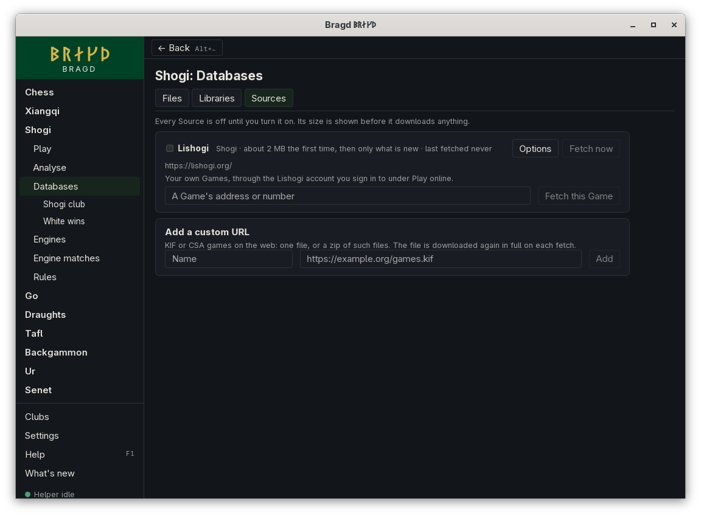

[← README](../../README.md) · [Docs index](../README.md) · [Knowledge](README.md)

# Your Lishogi Games

The Lishogi Source fetches your own shogi Games from [lishogi.org](https://lishogi.org/), through the Lishogi account you sign in to for [Playing on Lishogi](../online/lishogi.md). Each fetch takes the Games you played since the last one, as KIF, and imports them through the Source's Routes. You can also fetch one Game, yours or anyone's, by its address or its id.

*Shogi → Databases → Sources.*

## How to reach it

1. Sign in to Lishogi once: open **Shogi**, then **Play**, then **Play on Lishogi**, and press **Sign in to Lishogi** ([Playing on Lishogi](../online/lishogi.md)).
2. Open **Shogi**, then **Databases**, then **Sources**. Lishogi is listed while shogi is among your Game families.
3. Tick **Lishogi** to turn it on. **Fetch now** fetches at once; after that it fetches every day.
4. To fetch one Game, type its address, such as `https://lishogi.org/KYFlsX8h`, or its id in **A Game's address or number**, and press **Fetch this Game**.

The install wizard's Knowledge step offers it too, unticked, when shogi is on.

## What a fetch does

| Step | What happens |
|---|---|
| Account | Bragd asks Lishogi which account its token belongs to |
| List | One request for that account's finished Games since the last fetch, each with its KIF. Lishogi sends them at its own pace |
| Keep | The Games of standard shogi go into one zip, a KIF file a Game, in `<data>/bragd/helper/sources/lishogi/`. Games of Lishogi's other Variants, such as minishogi, are left out: Bragd does not play them |
| Import | Through the Routes and their Strip rules. A Game fetched twice is stored once ([Duplicates](duplicates.md)) |

The first fetch takes every Game you have played. The Source's other options (schedule, metered connections, *Keep at most*, *Largest download*, *After import* and Routes) are those of every Source ([Sources](sources.md#options)).

## What it needs

- A Lishogi account, signed in under *Play on Lishogi*. Its token stays in your system's keychain; the Helper reads it from there. The token Bragd already has for playing is enough: Lishogi asks no other permission to export your own Games.
- For one Game, no account: a finished Game on Lishogi is public. Bragd sends your account's token with it when you are signed in.

## Questions

#### Why does it say "Sign in to Lishogi under Play online first"?

The Source fetches the Games of your account, so it needs the account Bragd signed in to Lishogi with. Sign in under *Play on Lishogi* and press **Fetch now** again. Fetching one Game by its address works without an account.

#### Why does it say about 2 MB the first time?

That is a thousand Games at about 2 kB each. Your own count may be more or less. When a fetch would pass *Largest download*, it stops before it keeps anything, and you can raise the limit in Options.

#### What if Lishogi says Bragd asks too often?

Lishogi asks apps to wait a full minute after it answers *too many requests*. Bragd waits that minute and asks again, twice at most. Then it stops with a line saying so, and the next fetch goes on from where the last one stopped.

#### Why is a minishogi Game not fetched?

Bragd plays standard shogi only. A Game of another Lishogi Variant is left out of a fetch, and **Fetch this Game** says it is of a Variant Bragd does not play.

#### Where does it come from, and on what terms?

From Lishogi's API at `https://lishogi.org/api/`, as your account, under Lishogi's [terms of service](https://lishogi.org/terms-of-service).

---
[← Previous: Your OGS Games](source-ogs.md) · [Next: Strip rules →](strip-rules.md)
