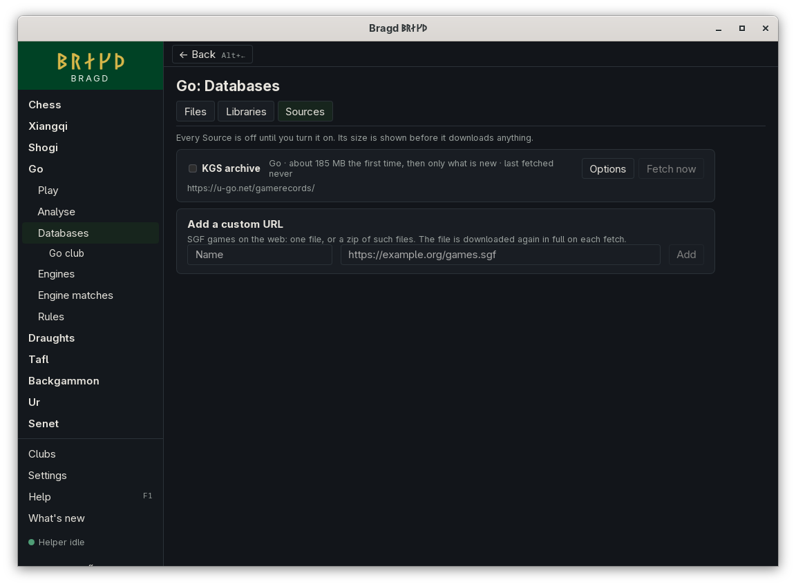

[← README](../../README.md) · [Docs index](../README.md) · [Knowledge](README.md)

# Your OGS Games

The OGS Source fetches your own go Games from [online-go.com](https://online-go.com/), through the OGS account you sign in to for [Playing on OGS](../online/ogs.md). Each Game that has ended since the last fetch is downloaded as SGF and imported through the Source's Routes. You can also fetch one Game, yours or anyone's, by its address or its number.

*Go → Databases → Sources.*

## How to reach it

1. Sign in to OGS once: open **Go**, then **Play**, then **Play on OGS**, and press **Sign in to OGS** ([Playing on OGS](../online/ogs.md)).
2. Open **Go**, then **Databases**, then **Sources**. OGS is listed while go is among your Game families.
3. Tick **OGS** to turn it on. **Fetch now** fetches at once; after that it fetches every day.
4. To fetch one Game, type its address, such as `https://online-go.com/game/88868859`, or its number in **A Game's address or number**, and press **Fetch this Game**.

The install wizard's Knowledge step offers it too, unticked, when go is on.

## What a fetch does

| Step | What happens |
|---|---|
| List | Bragd asks OGS for your account's Games, the most recently ended first, 50 to a page, until it reaches the last Game it fetched |
| Ask | When the new Games would take more than *Largest download* (about 3 kB a Game), nothing is downloaded. The Source's line shows the size with **Download it anyway** |
| Download | Each Game's SGF, oldest first, into `<data>/bragd/helper/sources/ogs/` as `ogs-<number>.sgf`. One request every 2 seconds |
| Import | Through the Routes and their Strip rules. A Game fetched twice is stored once ([Duplicates](duplicates.md)) |

A Game still being played is left until it has ended, and the next fetch takes it. The Source's other options (schedule, metered connections, *Keep at most*, *Largest download*, *After import* and Routes) are those of every Source ([Sources](sources.md#options)).

## What it needs

- An OGS account, signed in under *Play on OGS*. Its token stays in your system's keychain; the Helper reads it from there.
- For one Game, no account: an SGF on OGS is public. Bragd sends your account's token with it when you are signed in.

## Questions

#### Why does it say "Sign in to OGS under Play online first"?

The Source fetches the Games of your account, so it needs the account Bragd signed in to OGS with. Sign in under *Play on OGS* and press **Fetch now** again. Until Bragd is registered with OGS, signing in is not offered yet ([Playing on OGS](../online/ogs.md#why-can-i-not-sign-in-to-ogs)). Fetching one Game by its address works without an account.

#### Why is a first fetch slow?

Bragd asks OGS for one Game every 2 seconds, so a thousand Games take about 35 minutes. OGS serves its players from its own servers and states no rate for other apps, so Bragd goes gently. When OGS asks Bragd to slow down, it waits as long as OGS asks and goes on. Later fetches take only the Games ended since, often none.

#### Why does it say about 3 MB the first time?

That is a thousand Games at about 3 kB each. Your own count may be more or less. Before anything is downloaded, Bragd counts the new Games, and when they would pass *Largest download* it asks first.

#### Does Bragd download anyone else's Games?

Only the one Game you name under *A Game's address or number*. The Source otherwise fetches the Games of your own account and nothing else. There is no archive of every OGS Game to download.

#### Where does it come from, and on what terms?

From OGS's API at `https://online-go.com/api/v1/`, as your account, under OGS's [terms of service](https://online-go.com/terms-of-service).

---
[← Previous: The KGS archive](source-kgs.md) · [Next: Your Lishogi Games →](source-lishogi.md)
