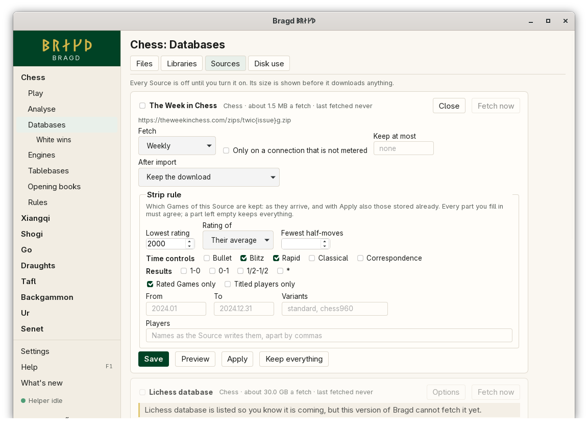
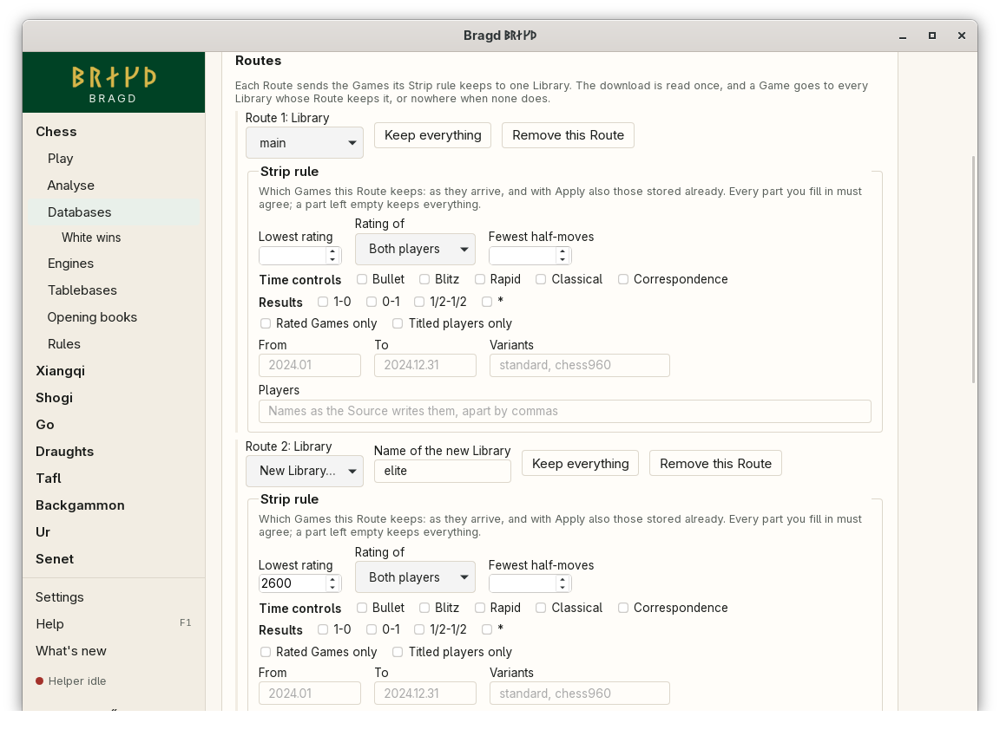
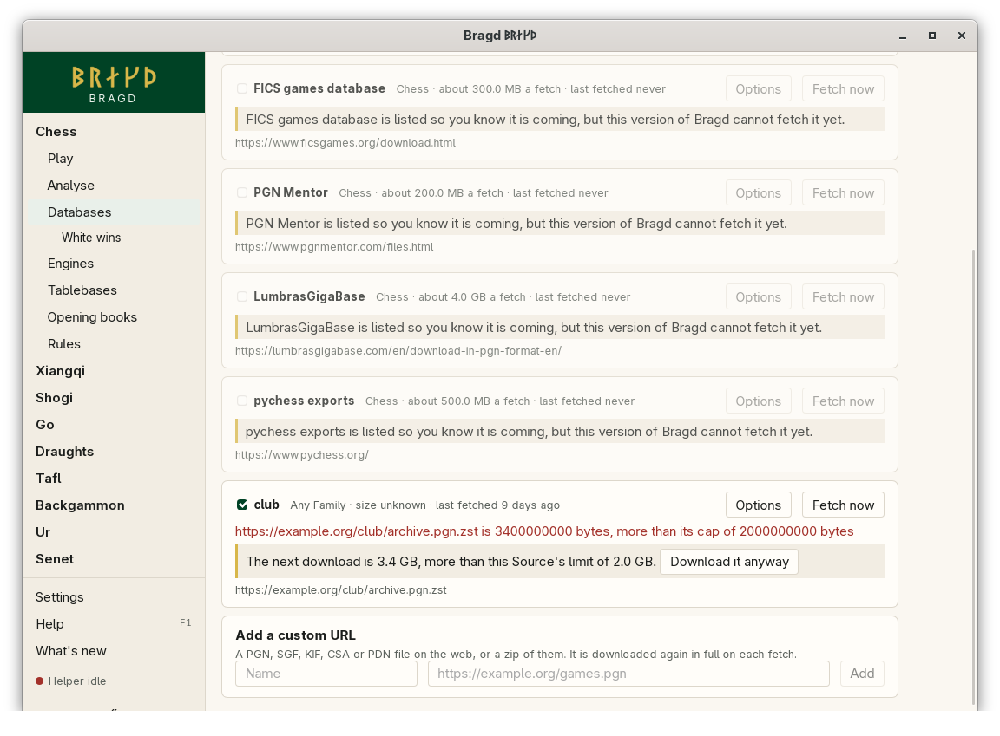

[← README](../../README.md) · [Docs index](../README.md) · [Knowledge](README.md)

# Sources

A Source is where Games come from, such as The Week in Chess. When a Source is on, the [Helper](helper.md) fetches it on its schedule and imports its Games through its Routes: into `main.bragd` unless you add others. Every Source is off until you turn it on, and its size per fetch is shown before it downloads anything. You can also add any address of a game file as a custom URL Source, and remove it again.

*Databases → Sources.*

## How to reach it

1. In the sidebar, open a Family and choose **Databases**, then **Sources**. The tab lists that Family's Sources and every custom URL one.
2. Tick a Source to turn it on. **Fetch now** fetches it at once.
3. **Options** opens its schedule, the metered rule, its disk cap, its largest download, what becomes of its downloads and its Routes. Press **Save**.
4. Under *Add a custom URL*, type a name and the address, and press **Add**.
5. A custom URL Source has **Remove** beside *Fetch now*. Press it, then **Remove** again to confirm.

The install wizard's Knowledge step offers TWIC too, ticked ([The install wizard](../getting-started/first-start.md)).

## The Sources

| Id | Source | Family | About a fetch | Default schedule | Fetched in this version |
|---|---|---|---|---|---|
| `twic` | The Week in Chess | chess | 1.5 MB | Weekly | Yes |
| `custom:<name>` | A custom URL | any | unknown | Weekly | Yes |
| `lichess-db` | Lichess database | chess | 30 GB | Monthly | Not yet |
| `fics` | FICS games database | chess | 300 MB | Monthly | Not yet |
| `pgnmentor` | PGN Mentor | chess | 200 MB | Monthly | Not yet |
| `lumbras` | LumbrasGigaBase | chess | 4 GB | Monthly | Not yet |
| `ogs` | OGS archive | go | 1 GB | Monthly | Not yet |
| `kgs` | KGS archive | go | 100 MB | Monthly | Not yet |
| `pychess` | pychess exports | chess | 500 MB | Monthly | Not yet |
| `lishogi` | Lishogi exports | shogi | 500 MB | Monthly | Not yet |
| `fide-ratings` | FIDE rating list | chess | 45 MB | Monthly | Yes |
| `dsu-ratings` | DSU rating list | chess | 0.5 MB | Monthly | Yes |
| `ecf-ratings` | ECF rating list | chess | 4.5 MB | Monthly | Yes |

The Sources marked *Not yet* are listed so you know they are coming. They are greyed out, and a notice says this version cannot fetch them.

**TWIC.** The first fetch takes only the newest issue. Each later fetch takes the new issues in order, at most 26 at a time. The zips are imported as they are, without unpacking.

**Rating lists.** FIDE, DSU and ECF are rating lists, not Games. Each fetch downloads the whole list, and its players replace the list's players from before in `rating-lists.sqlite`, where the [Clubs](../clubs/clubs.md) page finds them by name or ID. They have no Routes and no *After import*. Where each comes from and on what terms: [Rating lists](../reference/rating-lists.md).

**Custom URL.** The address must start with `http://` or `https://` and name a PGN, SGF, KIF, CSA or PDN file, or a zip of them. The whole file is downloaded again on each fetch, since it may have grown.

## Options

| Option | Choices | What it does |
|---|---|---|
| Fetch | Daily, Weekly, Monthly, Only when I ask | How often the Helper fetches it. A month is 30 days |
| Only on a connection that is not metered | on, off | Skips a fetch on a metered connection |
| Keep at most | a size such as `500 MB`, or empty | The oldest downloads go first when the Source's downloads pass this |
| Largest download | a size such as `5 GB`, or empty for `2 GB` | The most one download may take without asking. A bigger one waits for your yes |
| After import | Keep the download, Keep only what the Strip rule keeps, Delete the download | What becomes of a download once imported |
| Address | | A custom URL Source's address |

## Routes

*Databases → Sources → Options → Routes.*

A Route is a [Strip rule](strip-rules.md) paired with the Library its Games go to. Every Source starts with one Route: every Game into `main.bragd`. Add more to send Games to other Libraries. For example, TWIC could send every Game to `main` and only Games of 2600 and up to a Library called `elite`.

The download is read once. Each Game is offered to every Route and stored in each Library whose Route keeps it, so one Game can land in several Libraries. A Game that no Route keeps is stored nowhere.

| In Options | What it does |
|---|---|
| Route n: Library | The Library this Route's Games go to: one there already, or **New Library…** |
| Name of the new Library | Letters, digits, `-`, `_` and spaces. The Library file is made on the next fetch, beside `main.bragd` |
| Keep everything | Empties this Route's Strip rule |
| Remove this Route | Takes the Route away. A Source keeps at least one |
| Add a Route | A new Route, with a new Library to name |

Two Routes of one Source cannot go to the same Library. Each Library writes its Games in batches of its own, so a stop leaves each one whole up to its last batch.

## What it needs

A network connection when it fetches, and the Helper. A failed fetch is not tried again for an hour. A download cut short goes on from where it stopped next time.

## Settings and config.toml

A Source's options and what each fetch remembered live in the Helper's `state.json`, not in `config.toml`. Two keys in `config.toml` apply:

| Setting | `config.toml` key | Default | What it does |
|---|---|---|---|
| Library folder | `knowledge.library` | empty: `<data>/bragd/libraries` | Fetched Games go into `main.bragd` there |
| Source priority | `knowledge.source_priority` | `["twic", "lichess"]` | Which Source wins a header conflict between [Duplicates](duplicates.md) |
| Largest unpacking ratio | `knowledge.max_unpack_ratio` | `50` | How many times its own size a packed download may unpack to before the import stops |

## Questions

#### Why did an import stop, saying the file unpacks too far?

A packed game file (`.pgn.zst`, `.pgn.bz2`, `.pgn.gz`) is unpacked as it is read. A file of blank blocks can be 100 MB packed and terabytes unpacked, and reading it would take hours. So an import stops once a file has unpacked to more than *Largest unpacking ratio* times its packed size, 50 unless you change it. The Games already imported stay, except the last batch under way. The first 64 MB unpacked always pass. Real game files stay far below: a Lichess month of about 30 GB unpacks to about 200 GB, 7 times its size. If a file you trust stops, raise the ratio in *Settings → Knowledge* and import it again. The next import uses the new value. The same ratio holds when a packed file is opened in place as a [Foreign database](foreign-databases.md#why-does-a-packed-file-stop-saying-it-unpacks-too-far).

#### Does Bragd download anything before I turn a Source on?

No. Every Source starts off. Nothing is fetched until you tick it, or tick it in the install wizard and press Done.

#### Why is a Source greyed out?

This version lists it so you know it is coming, but cannot fetch it yet. Its notice says so.

#### What does "metered" mean here?

A connection NetworkManager marks as metered, such as a phone hotspot. On systems without NetworkManager every connection counts as not metered, so this option never blocks a fetch there.

#### Where do the downloads go?

Into the Helper's folder, `<data>/bragd/helper/sources/<source>/`, one folder per Source, named by its id. Letters, digits and `-` stay as they are, and any other character is written `_` and its hex code, so `custom:club.a` is `custom_3aclub_2ea`. Two Sources never share a folder. The downloads are kept unless *After import* says otherwise or *Keep at most* is passed.

#### Why does a Source ask before a big download?

Each download may take at most 2 GB, or what you set as *Largest download*. When the server says a file is bigger, nothing is downloaded. The Source's line then says how big it is, with **Download it anyway**, and a notice says so. Your yes covers that one download, and the limit applies again after it. When the server does not say how big a file is, the download stops as it passes the limit. Raise *Largest download* to take it.

#### Why was a Source not fetched on time?

It may be paused because the disk is over your limits ([Disk watch](disk-watch.md)), the machine may be on battery, the connection may be metered, or the last try failed less than an hour ago. Its line shows the last error.

#### Does a fetch need a window open?

No, when the Helper is running. It stays ten minutes after the last window closes, or all the time with *Start with my session* ([The Helper](helper.md)).

#### Can one Game be in two Libraries?

Yes, when two of its Source's Routes keep it. Each Library has its own copy, merged with its own [Duplicates](duplicates.md). Removing it from one Library leaves the other.

#### What became of the Strip rule a Source had before Routes?

It became the Source's one Route, to `main.bragd`, with that rule. Nothing else changed.

#### Can I remove a custom URL Source?

Yes. Press **Remove** beside *Fetch now*, then **Remove** again. Its options and its downloads are deleted. The Games it brought stay in your Libraries. A Source with a fetch or a Strip job queued or running cannot be removed until the job ends. The built-in Sources cannot be removed: untick one to turn it off.

---
[← Previous: Export to Parquet](parquet-export.md) · [Next: Strip rules →](strip-rules.md)
