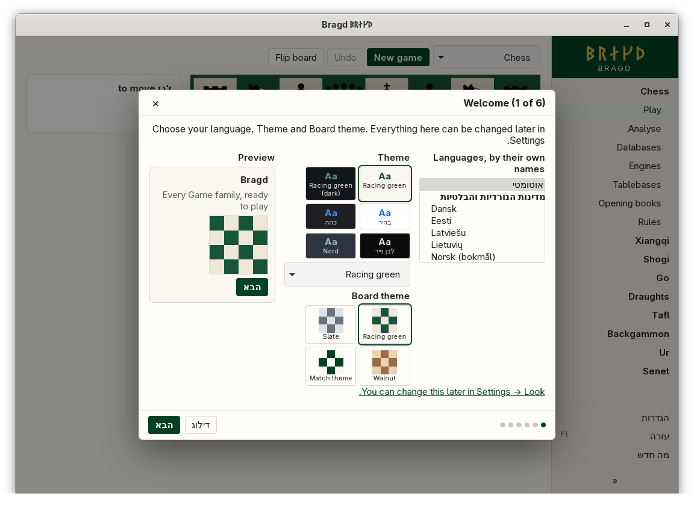

[← README](../../README.md) · [Docs index](../README.md) · [Look](README.md)

# Languages

Bragd speaks 55 languages and regional forms, each listed by its own name and grouped by region. *Automatic*, the default, follows your system's language, or the nearest one Bragd has. Hebrew and Persian run right to left: the sidebar moves to the right and the text runs from the right.

*The Welcome step in Hebrew, right to left.*

*Settings → Look → Language.*

| Region | Languages |
|---|---|
| Nordic and Baltic | 8 |
| Western Europe | 13 |
| Central and Eastern Europe | 3 |
| Eastern Mediterranean | 1 |
| The Middle East | 2, both right to left |
| The Caucasus | 2 |
| The Americas | 20 |
| Asia and the Pacific | 6 |

A regional form, such as Deutsch (Schweiz) or English (Canada), takes the texts of its language and changes only what differs, such as spelling or quotation marks.

## How to reach it

- *Settings → Look → Language*: *Automatic*, then every language under its region. The window changes language at once.
- Step 1 of the [install wizard](../getting-started/first-start.md) lists them the same way.
- Or write `language = "da"` at the top of `config.toml`, above the first `[table]`.

## What it needs

Nothing. Every text is in the app, in every language.

## Settings and config.toml

| Setting | `config.toml` key | Default | What it does |
|---|---|---|---|
| Language (`language`) | `language` | `"auto"` | `auto`, or a code such as `da`, `de-CH`, `en-AU` or `es-AR` |

## Mending a translation

*Settings → Overview → Suggest a better translation* opens a new GitHub issue in your browser, with your language and Bragd's version filled in. Type the text to mend, as it shows on screen, before you press it: Bragd finds its key and adds the key and the current text to the issue. Bragd itself sends nothing; you send the issue from the browser.

## Questions

#### How does Automatic choose?

It takes your system's languages in order and uses the first one Bragd has, in any region. English from the United States gets English (Canada), the nearest in spelling. A language Bragd does not have gets the nearest relative, or else British English.

#### Why are some texts in English in my language?

Texts added recently are in English in every language until they are translated. *Suggest a better translation* is the quickest way to send one.

#### Why does the board not mirror in Hebrew?

A board is the game's own drawing, so it stays as the rules lay it out. The sidebar, the menus and the text follow the reading direction.

#### Does Persian use its own digits?

In counts, such as the number of jobs, yes: Persian writes ۰ to ۹. Paths, keys and values from `config.toml` keep the digits they have.

#### Is the language the same for the Helper?

The Helper's notices, such as those of Disk watch, are sent as a key with its values, and each window shows them in its own language.

---
[← Previous: Board themes](board-themes.md) · [Next: Online →](../online/README.md)
