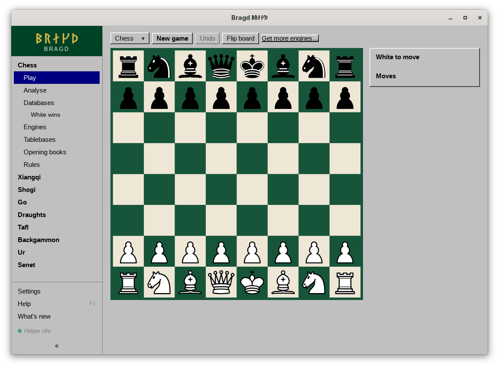

[← README](../../README.md) · [Docs index](../README.md) · [Look](README.md)

# Looks

A Look is the chrome laid over a Theme's colours: corners, bevels, title bars, scroll bars and, for some, the font of their era. Every [Theme](themes.md) brings its own Look. You can lay another one over it, such as Windows 95's bevels over the Nord colours. The board is never changed by a Look.

*The Windows 95 Look.*

## How to reach it

- *Settings → Look → Look*: *The Theme's own* (the default), or one of the Looks below. It changes at once and is saved.
- Or write `look = "win95"` under `[look]` in `config.toml`.
- A Theme of your own picks its Look with its own `look` key ([Themes](themes.md#your-own-theme)).

## The Looks

| Id | Shown as | What it brings | Font it asks for |
|---|---|---|---|
| `modern` | Modern | Rounded corners and soft shadows: the plain one | The system's |
| `crt` | CRT tube | A terminal: monospace everywhere, square corners, capitals in the headings | Your monospaced font |
| `win31` | Windows 3.11 | Square, with a navy title bar on dialogs | MS Sans Serif |
| `win95` | Windows 95 | Grey bevels in and out, square corners, navy title bars | MS Sans Serif, Tahoma |
| `winxp` | Windows XP | Luna: blue title bars, a blue gradient down the sidebar | Tahoma |
| `win7` | Windows 7 | Aero: a pale blue page, glassy title bars, gradient buttons | Segoe UI |
| `win10` | Windows 10 | Flat grey buttons, the blue primary button, square | Segoe UI |
| `win11` | Windows 11 | Mica: rounded, with a short accent stroke on the selected item | Segoe UI Variable |
| `system7` | Mac System 7 | Square, with the striped title bar | Chicago |
| `platinum` | Mac OS 9 | Platinum grey bevels | Charcoal |
| `aqua` | Mac OS X Aqua | Pinstripes and glossy buttons | Lucida Grande |
| `macos` | macOS | Today's macOS | The system's (SF Pro) |
| `next` | NeXTSTEP | The four greys of the NeXT display, square | Helvetica |
| `beos` | BeOS | The yellow window tab, ribbed scroll bars | Swiss 721 |
| `workbench` | Amiga Workbench | Workbench 1.3's blue, white, black and orange, its gadgets, square | Topaz |
| `gem` | Atari GEM | White windows with thin black frames, the mover bar, square | The Atari ST system font |

When a font is not installed, the Look falls back to a common one, then to the system's.

## What it needs

Nothing. The fonts are optional.

## Settings and config.toml

| Setting | `config.toml` key | Default | What it does |
|---|---|---|---|
| Look (`look`) | `look.look` | `""` | Empty: the Theme's own Look. One of the ids above: that Look over any Theme |

## Questions

#### What is the difference between a Theme and a Look?

The Theme is the colours. The Look is the shapes: corners, bevels, title bars and the font. Each Theme brings a Look, and *Look* in Settings lets you swap it.

#### Why are there no scanlines when I pick CRT tube?

The scanlines and the glow belong to the Theme, not the Look. The phosphor Themes (Amber, Paper white) and the home computers have them. The `crt` Look alone gives the terminal's shapes and font, and a Theme of your own gets the tube with `crt = true`.

#### Does a Look change the board?

No. The board's colours come from the [Board theme](board-themes.md), and its shape from the Game family.

#### I set a Look name that does not exist. What happens?

It is ignored, and the Theme's own Look shows.

#### Why does the Windows 95 Look use a different font on my machine?

It asks for MS Sans Serif, then Microsoft Sans Serif, Tahoma and Arial. It takes the first one installed.

---
[← Previous: Themes](themes.md) · [Next: Board themes →](board-themes.md)
