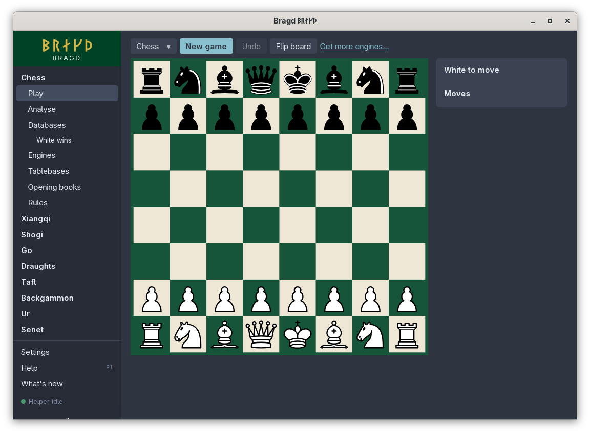

[← README](../../README.md) · [Docs index](../README.md) · [Look](README.md)

# Themes

A Theme is the app's named appearance: sixteen colours, and the [Look](looks.md) it brings. Thirty come built in, listed in five groups, and your own `[themes.<name>]` tables follow under *Your own*. **Racing green** is the default, built on the colours of Bragd's icon. In F1 this is the `themes` entry.

The brand colours (`#00301b` `#004225` `#0b5c39` `#4f9d76` `#e9f0ea`) stay the same in every Theme: the wordmark, the icon and the splash keep them. A Theme never changes how a board is coloured unless you pick the *Match theme* [Board theme](board-themes.md).


*Settings → Look.*

<!-- screenshot: play-chess-nord-1100.png: chess Play in the Nord Theme, the bar's button reading Play on Lichess -->

*Play in the Nord Theme. The board keeps its own colours.*

## How to reach it

- *Settings → Look → Theme*: pick one from the list. The window repaints at once and the choice is saved.
- Step 1 of the [install wizard](../getting-started/first-start.md) shows six as swatches (Racing green, Racing green (dark), Light, Dark, Paper white, Nord) and all of them in the list below.
- Or write `theme = "nord"` under `[look]` in `config.toml`, and start Bragd again.

## The built-in Themes

| Id | Shown as | Group | Look |
|---|---|---|---|
| `racing-green` | Racing green (the default) | Bragd's own | `modern` |
| `racing-green-dark` | Racing green (dark) | Bragd's own | `modern` |
| `dark` | Dark | Bragd's own | `modern` |
| `light` | Light | Bragd's own | `modern` |
| `midnight` | Tokyo Night | Bragd's own | `modern` |
| `nord` | Nord | Bragd's own | `modern` |
| `amber` | Amber | Bragd's own | `crt`, with the tube |
| `paper` | Paper white | Bragd's own | `crt`, with the tube |
| `win31` | Windows 3.11 | Windows | `win31` |
| `win95` | Windows 95 | Windows | `win95` |
| `winxp` | Windows XP | Windows | `winxp` |
| `win7` | Windows 7 | Windows | `win7` |
| `win10` | Windows 10 | Windows | `win10` |
| `win11` | Windows 11 | Windows | `win11` |
| `win11-dark` | Windows 11 (dark) | Windows | `win11` |
| `system7` | Mac System 7 | Mac | `system7` |
| `platinum` | Mac OS 9 | Mac | `platinum` |
| `aqua` | Mac OS X Aqua | Mac | `aqua` |
| `macos` | macOS | Mac | `macos` |
| `macos-dark` | macOS (dark) | Mac | `macos` |
| `next` | NeXTSTEP | Other desktops | `next` |
| `beos` | BeOS | Other desktops | `beos` |
| `os2` | OS/2 Warp | Other desktops | `win95` |
| `workbench` | Amiga Workbench 1.3 | Other desktops | `workbench` |
| `atarist` | Atari ST | Other desktops | `gem` |
| `c64` | Commodore 64 | Home computers | `crt`, with the tube |
| `spectrum` | ZX Spectrum | Home computers | `crt`, with the tube |
| `cpc` | Amstrad CPC | Home computers | `crt`, with the tube |
| `msx` | MSX | Home computers | `crt`, with the tube |
| `bbc` | BBC Micro | Home computers | `crt`, with the tube |

"With the tube" means scanlines and a glow on the text, over the Look's shapes.

## Your own Theme

A `[themes.<name>]` table in `config.toml` adds a Theme under *Your own*. Each colour you leave out is Racing green's. A table named like a built-in Theme replaces it.

```toml
[look]
theme = "harbour"

[themes.harbour]
look = "modern"
bg = "#f4f7f9"
fg = "#14202b"
accent = "#1f5f8b"
sel_bg = "#dbe7f0"
```

| Key | What it colours |
|---|---|
| `look` | The [Look](looks.md) it brings; an unknown one is `modern` |
| `crt` | `true` adds the tube's scanlines and glow |
| `bg` | The page |
| `alt` | The sidebar and bars |
| `raised` | Dialogs, cards and menus |
| `fg` | Text |
| `dim` | Quiet text |
| `border` | Lines and frames |
| `accent`, `accent_fg` | Buttons that lead, and the text on them |
| `sel_bg`, `sel_fg` | The selected row, and its text |
| `red`, `green`, `yellow`, `blue`, `magenta`, `orange` | Signal colours; `yellow` is also *Match theme*'s highlight |

## What it needs

Nothing. Some Looks ask for their era's font and fall back to a common one when it is not installed.

## Settings and config.toml

| Setting | `config.toml` key | Default | What it does |
|---|---|---|---|
| Theme (`theme`) | `look.theme` | `"racing-green"` | The Theme by its id |
| Look (`look`) | `look.look` | `""` | Lays another Look over the Theme ([Looks](looks.md)) |
| Your own Themes | `themes` | none | `[themes.<name>]` tables |

## Questions

#### Does a dark Theme turn the board dark?

No. A Board theme never inverts with a dark Theme: the light squares stay the lighter ones. Only *Match theme* takes colours from the Theme, and even then its light square is the lighter of the page and the text.

#### How does Bragd know a Theme is dark?

When its page is darker than its text. Your own Theme follows the same rule.

#### What colour values can I use in my own Theme?

`#rrggbb` and `#rgb` are best. `rgb(…)` and other CSS colours work too, but Bragd cannot tell how light they are, so it counts them as mid grey when it decides whether the Theme is dark. A value with anything else in it is replaced with Racing green's.

#### Why are there 30 Themes and not more?

Each one is drawn and checked by hand, with its own Look. Your own `[themes.<name>]` tables add as many more as you like.

#### Does the Theme change the runes in the sidebar?

No. The wordmark, the icon and the splash keep Bragd's own colours in every Theme.

#### I typed a Theme name wrongly in config.toml. What happens?

Bragd shows Racing green until the name matches a built-in Theme or one of your own tables.

---
[← Previous: Look](README.md) · [Next: Looks →](looks.md)
