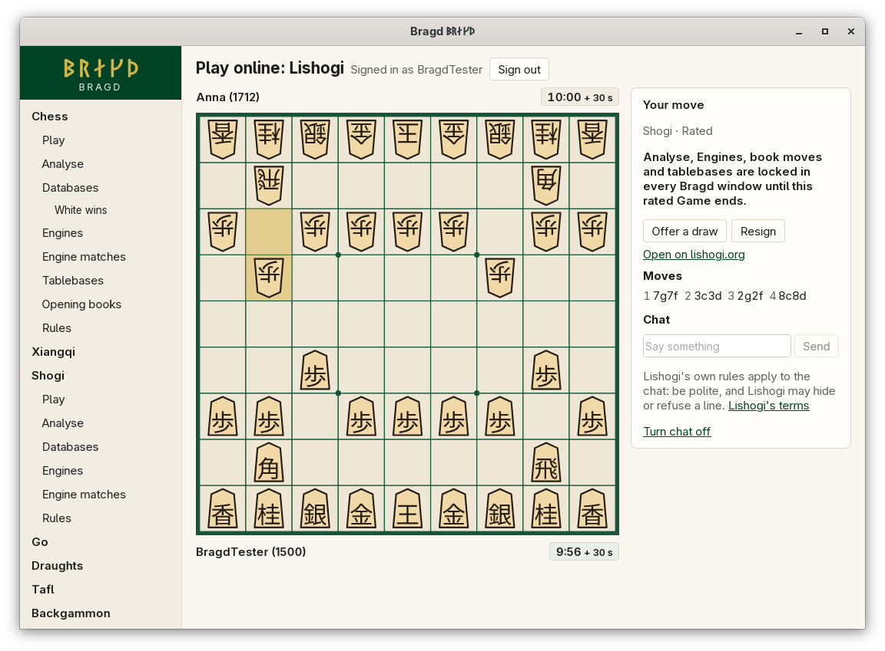
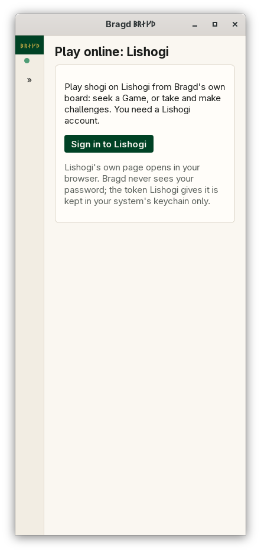

[← README](../../README.md) · [Docs index](../README.md) · [Online](README.md)

# Playing on Lishogi

Play shogi on Lishogi from Bragd's own board. Lishogi is a fork of Lichess, so it works as [Playing online](playing-online.md) describes: you sign in once in your browser, then seek a Game or take and make challenges. In F1 this is the `lishogi` entry. It shows only while shogi is on.

*A Game on Lishogi.*

## How to reach it

*Play on Lishogi before signing in, 390 px wide.*

Open shogi's **Play** and press **Play on Lishogi**. Press **Sign in to Lishogi**: Lishogi's own page opens in your browser. Sign in there and allow Bragd. The buttons are those of [Playing online](playing-online.md#how-to-reach-it).

### Playing

Click a piece, then its square, or drag it. To drop a piece, click it in your hand above or below the board, then its square. Bragd's shogi rules check each move before it is sent, in USI (`7g7f`, `P*5e`). You play sente when you move first.

| Time | What it means |
|---|---|
| 10 min, then 30 s byoyomi | 10 minutes for the Game, then 30 seconds for each move |
| 15 min, then 30 s byoyomi | |
| 30 min, then 30 s byoyomi | |
| 30 min, then 60 s byoyomi | |

Lishogi plays only Games of 15 minutes or more by its own estimate through its Board API when they are rated: the times on offer all qualify. The byoyomi shows beside each clock.

### What Lishogi does not offer here

| Thing | Why |
|---|---|
| Takebacks | Lishogi takes no takeback from another app. There is no button for it |
| Cancelling your own challenge | Lishogi cancels only on its website. A challenge you made runs out there if nobody takes it |
| Minishogi, chushogi, annanshogi, kyotoshogi, checkshogi, dobutsu | Bragd has rules only for standard shogi. A challenge in one of them can be declined here and played on lishogi.org |

### Fair play and chat

The lock and the chat work as on Lichess: [Fair play](playing-online.md#fair-play) and [Chat](playing-online.md#chat).

## What it needs

- A Lishogi account, and a browser for the sign-in.
- Your system's keychain for the token, under the service `bragd-online` with `https://lishogi.org` as the account.
- A connection to `lishogi.org`. With `BRAGD_OFFLINE` set nothing is sent.

For testing, `BRAGD_LISHOGI_URL` and `BRAGD_LISHOGI_TOKEN` work as Lichess's pair does (`cargo run -p bragd-online --features fake --example fake-online -- lishogi`).

## Questions

#### Does Bragd see my Lishogi password?

No. You sign in on Lishogi's own page in your browser. Lishogi hands Bragd a token for a year, which goes into your system's keychain. Bragd asks for three permissions only: playing Games through the Board API, and reading and making challenges.

#### Why does a Game end with *Impasse*?

Both kings have entered the enemy camp and the 27-point rule decided it. Lishogi applies it; Bragd shows the result Lishogi sends.

#### Why does Lishogi refuse a Game I accepted?

Lishogi's Board API plays a casual Game of at least five minutes and a rated one of at least 15, counting 25 moves of byoyomi. A shorter challenge can be played on lishogi.org.

---
[← Previous: Playing online](playing-online.md) · [Next: Playing on OGS →](ogs.md)
