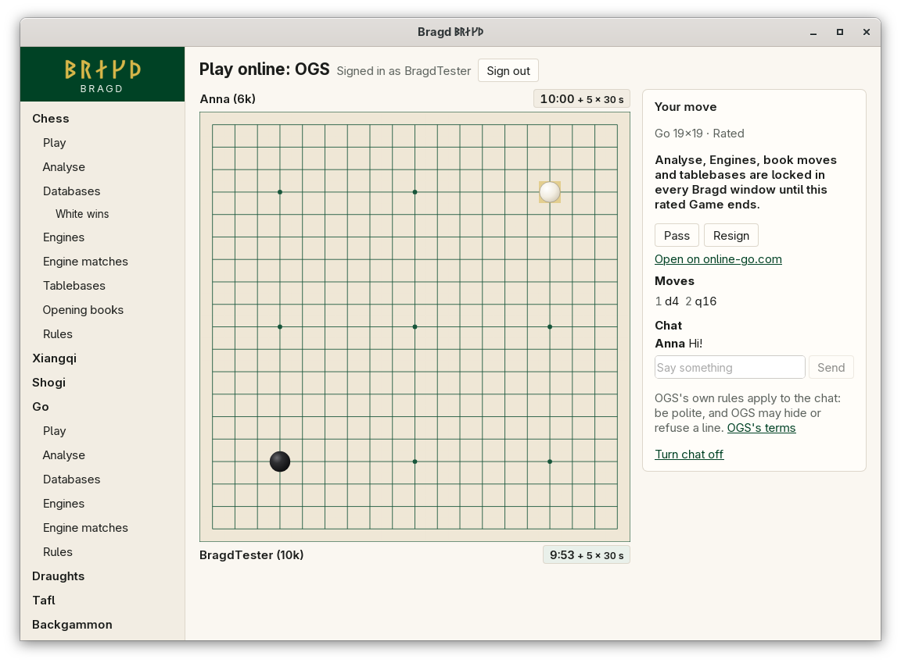
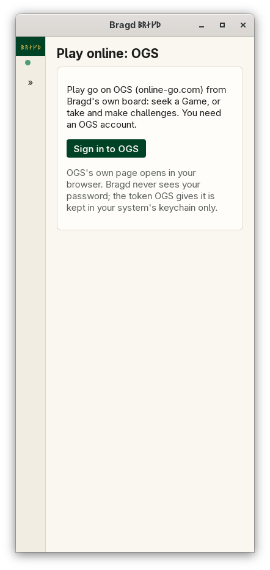

[← README](../../README.md) · [Docs index](../README.md) · [Online](README.md)

# Playing on OGS

Play go on OGS (online-go.com) from Bragd's own board. You sign in once in your browser, then seek a Game or take and make challenges, pass, and accept the score OGS counts. In F1 this is the `ogs` entry. It shows only while go is on.

*A Game on OGS.*

## How to reach it

*Play on OGS before signing in, 390 px wide.*

Open go's **Play** and press **Play on OGS**. Press **Sign in to OGS**: OGS's own page opens in your browser. Sign in there and allow Bragd.

OGS knows each app that signs in beforehand. Until Bragd is registered with OGS, the page says so instead of offering the sign-in, and links online-go.com.

| Button | What it does |
|---|---|
| **Sign in to OGS** | Opens OGS's sign-in page in your browser. Bragd waits up to five minutes for it |
| **Sign out** | OGS takes the token back, and it is removed from your keychain |
| **Seek a Game** | Opens a challenge anyone may take, on the board size, time and *Rated* chosen. **Cancel** takes it away |
| **Challenge** | Challenges the OGS player named, with the colour chosen |
| **Accept** / **Decline** | Answers a challenge made to you |
| **Cancel** | Takes back a challenge you made |

### Playing

Click a point to play a stone there. Bragd's go rules check each move before it is sent. Black moves first.

| Button | What it does |
|---|---|
| **Pass** | Passes. After both pass, the score is counted |
| **Accept the score** | Agrees to the stones OGS marks dead. The Game ends when both agree |
| **Abort** | Ends the Game before both sides have played |
| **Resign** | Gives up the Game |
| **Open on online-go.com** | Opens the Game on OGS, for instance to mark dead stones yourself |

There are no draw offers or takebacks: OGS has none for go played from another app.

### Rules, sizes and times

A seek or a challenge from Bragd asks for Chinese rules, as Bragd's go keeps, on 9×9, 13×13 or 19×19, with no handicap and OGS's own komi. A challenge made to you under Japanese, AGA or other rules can be accepted: Bragd still checks each move, and OGS counts the score by its rules.

| Time | What it means |
|---|---|
| 5 min, then 5 × 30 s byoyomi | 5 minutes, then five periods of 30 seconds |
| 10 min, then 5 × 30 s byoyomi | |
| 20 min, then 5 × 30 s byoyomi | |
| 30 min, then 5 × 30 s byoyomi | |

A challenge made to you shows its own time system: byoyomi, Fischer, Canadian (moves in a period), simple (seconds a move), absolute or no clock.

### Fair play and chat

The lock and the chat work as on Lichess: [Fair play](playing-online.md#fair-play) and [Chat](playing-online.md#chat). A ranked Game against a person locks; one against an OGS bot does not.

## What it needs

- An OGS account, and a browser for the sign-in.
- Your system's keychain for the token, under the service `bragd-online` with `https://online-go.com` as the account. OGS's token lasts 30 days; then Bragd asks you to sign in again.
- A connection to `online-go.com`, over HTTPS and its realtime socket. With `BRAGD_OFFLINE` set nothing is sent.
- Port 47265 on `127.0.0.1` free while you sign in: OGS sends the browser back to that port only.

For testing, `BRAGD_OGS_URL` and `BRAGD_OGS_TOKEN` work as Lichess's pair does (`cargo run -p bragd-online --features fake --example fake-online -- ogs`).

## Questions

#### Why does OGS's score differ from Bragd's count?

OGS counts by the Game's own rules, which may be Japanese (territory) or Chinese (area). Bragd shows the score OGS sends.

#### Why can I not sign in to OGS?

Either Bragd is not registered with OGS yet, and the page says so, or another program is using port 47265 on this machine. Close it and try again.

#### Why is my handicap Game shown only as a link?

Bragd's go starts from an empty board with Black to move. A handicap Game places stones first, which Bragd cannot replay yet: play it on online-go.com.

---
[← Previous: Playing on Lishogi](lishogi.md) · [Next: pychess.org →](pychess.md)
