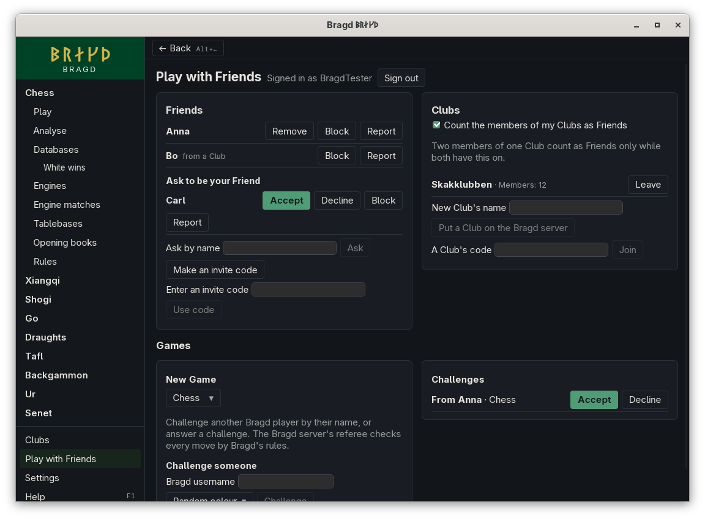
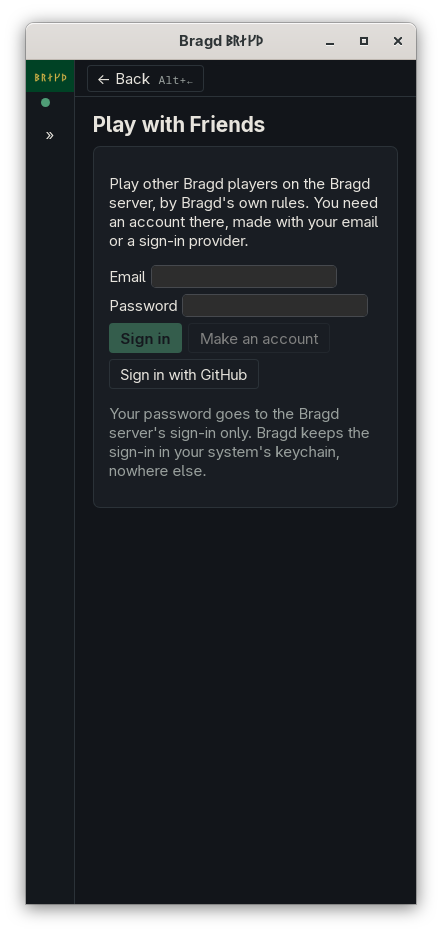
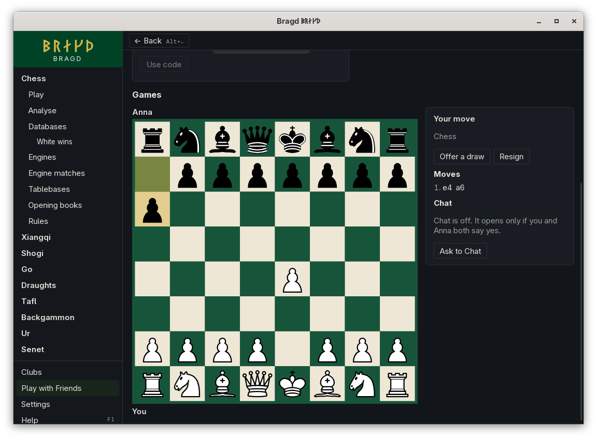
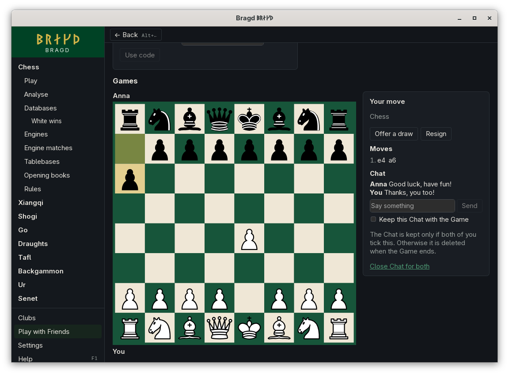
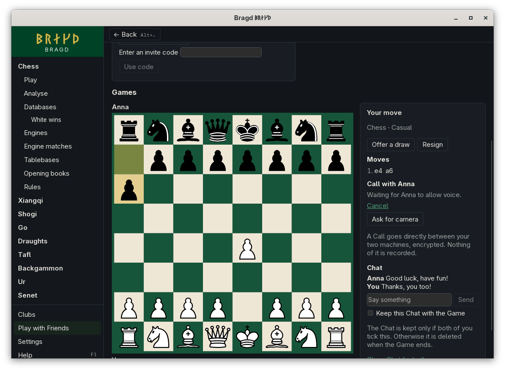
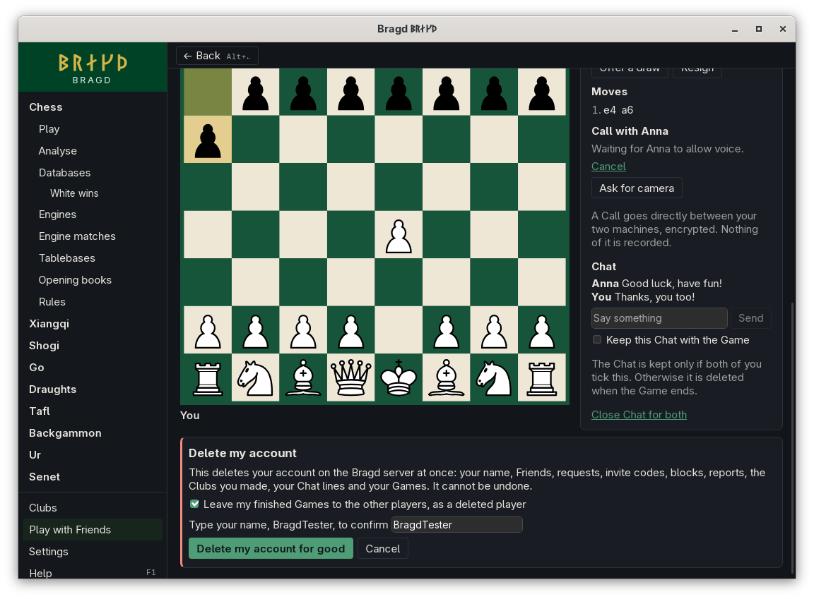

[← README](../../README.md) · [Docs index](../README.md) · [Online](README.md)

# Play with Friends

Play other Bragd players on the Bragd server. You make an account there, become Friends with the players you know, put your Club on the server, and play Games that the server's referee checks by Bragd's own rules. In F1 this is the `friends` entry.

*Play with Friends, signed in.*

## Contents

- [How to reach it](#how-to-reach-it)
- [Friends](#friends)
- [Games](#games): [Chat](#chat), [Calls](#calls)
- [Deleting your account](#deleting-your-account)
- [What it needs](#what-it-needs)
- [Questions](#questions)

## How to reach it

*Play with Friends* is in the sidebar, below Clubs, once a Bragd server address is set in **Settings → Online → Bragd server address**. Until then the page is hidden and Bragd sends nothing to any Bragd server. F1, What's new, the tour cards and Tips leave out *Play with Friends*, *Chat* and *Calls* too, and Settings → Online shows only the address, not the Chat, filter, voice and camera choices. The address is empty until the Bragd server is up; this page will say when it is.

It also shows only while one of the Families the Bragd server plays is on: chess, xiangqi, shogi, go, draughts or tafl.

*Signing in, 390 px wide.*

| Button | What it does |
|---|---|
| **Sign in** | Signs in with your email and password |
| **Make an account** | Makes an account with that email and password. The Bragd server may first send you an email with a link to confirm it |
| **Sign in with …** | Signs in with a provider the Bragd server offers, such as GitHub, on its page in your browser. Bragd waits up to five minutes |
| **Sign out** | Ends the session on the Bragd server and removes it from your keychain |

After the first sign-in you choose a name. Other players find you by it, and it is all they see of your account.

## Friends

A Friend is another player you both accepted.

| Button | What it does |
|---|---|
| **Ask** | Asks the player with that name to be your Friend. If they asked you first, you are Friends at once |
| **Accept** / **Decline** | Answers a player who asks you |
| **Take back** | Withdraws your own request |
| **Make an invite code** | Shows a code to give someone outside Bragd. Whoever enters it becomes your Friend. It works once |
| **Use code** | Enters an invite code you were given |
| **Remove** | Ends a friendship |
| **Block** | Ends the friendship, cancels open challenges between you, and hides you from each other. Their requests and challenges are refused. **Unblock** lifts it |
| **Report** | Sends what happened to the Bragd server's operator. The player is not told, and no player can read a report |

### Clubs

A Club on the Bragd server has a name and a code. Whoever puts it there sees the code and hands it to the members, who join with it.

With **Count the members of my Clubs as Friends** on, a member of one of your Clubs counts as a Friend, as long as they have it on too. A block still wins.

| Button | What it does |
|---|---|
| **Put a Club on the Bragd server** | Makes a Club with the name typed, and shows its code |
| **Join** | Joins the Club whose code you typed |
| **Leave** | Leaves the Club |

The Club on the Bragd server is not your Club file: its members, roles and ratings stay on your machine ([Clubs](../clubs/clubs.md)).

## Games

*A Game on the Bragd server.*

Challenge a player by their name, with the Variant and the Side you want, or answer a challenge. Anyone with a name can be challenged, not only Friends. The Game is played on Bragd's board as on [Lichess](playing-online.md), and the Bragd server's referee checks every move by Bragd's rules: a move that is illegal, out of turn or made after the Game moved on is refused.

| Button | What it does |
|---|---|
| **Challenge** | Challenges the player named, in the Variant chosen |
| **Accept** / **Decline** | Answers a challenge made to you |
| **Cancel** | Takes back a challenge you made |
| **Offer a draw** | Offers a draw; the other player accepts or declines |
| **Resign** | Gives up the Game |
| **Back to the lobby** | Leaves a Game that is over |

### Chat

A Game's Chat is off. It opens only when both players say yes, and either closes it for both. In F1 this is the `chat` entry.

*Chat in a Game.*

| Button | What it does |
|---|---|
| **Ask to Chat** | Asks the other player. They see "… would like to Chat" with **Allow** and **Not now** |
| **Allow** / **Not now** | Answers the other player's request. **Not now** keeps it closed |
| **Send** | Says a line, up to 500 characters |
| **Keep this Chat with the Game** | The Chat is kept with the Game only when both players tick it. Otherwise its lines are deleted when the Game ends |
| **Close Chat for both** | Closes it. Opening it again takes both players' yes again |

You can Chat with a player who is not your Friend. Their lines then pass a word filter: a word on its list shows as asterisks. The filter runs on your machine, and **Settings → Online → Filter a stranger's Chat** turns it off. A Friend's lines are never filtered.

**Settings → Online → When a Bragd player asks to Chat**: *Ask me* (the default) shows a request; *Off* refuses it without showing it.

### Calls

During a Game with a Friend you can talk, and see each other. In F1 this is the `calls` entry. A Call is only ever between Friends: with a stranger the Call's buttons do not show.

*Asking a Friend for voice.*

Voice and camera are separate channels. Each opens only when both of you say yes, and either of you closes it for both.

| Button | What it does |
|---|---|
| **Ask for voice** / **Ask for camera** | Asks the other player. They see "… would like voice" with **Allow** and **Not now** |
| **Allow** / **Not now** | Answers the other player's request |
| **Stop voice for both** / **Stop camera for both** | Closes that channel. Opening it again takes both players' yes again |

While your microphone or camera is live, a red line beside the board says *Your microphone is on* or *Your camera is on*. The Call ends with the Game, and when either of you stops being the other's Friend.

**Settings → Online → When a Friend asks for voice** and **… for the camera**: *Ask me* (the default) shows a request; *Off* refuses it without showing it.

The sound and picture go directly between your two machines, encrypted end to end (WebRTC). When no direct path exists, the Bragd server's TURN relay passes the encrypted packets on without being able to read them. The Bragd server only brings the two machines together. Nothing of a Call is recorded, by Bragd or by the server.

The Bragd server has no clocks, ratings or seeks yet, and does not play backgammon, Ur or senet: their dice would have to be thrown by the server.

## Deleting your account

**Delete my account**, below the Games (or below *Choose the name other players find you by*, if you have not chosen one), deletes your account on the Bragd server and everything with it, at once: your name, Friends, requests, invite codes, blocks, reports, the Clubs you made, your Chat lines and your Games ([Privacy](../reference/privacy.md#the-bragd-server) lists it all). It cannot be undone.

*Deleting the account.*

| Control | What it does |
|---|---|
| **Delete my account** | Opens the form. Nothing is deleted yet |
| **Leave my finished Games to the other players, as a deleted player** | Off: your Games go too. On: Games that ended stay with the other player, who sees *Deleted player* as their opponent. A Game under way ends as your resignation |
| **Type your name** | Your name on the Bragd server, as it is. An account without a name types the word the form shows instead, such as *delete*. The button works only when it matches |
| **Delete my account for good** | Deletes the account, signs out, and removes the sign-in from your keychain |

You can make a new account afterwards with the same email; it starts empty.

## What it needs

- The Bragd server's address in Settings, and a connection to it over HTTPS.
- An account on the Bragd server, and your system's keychain for the sign-in, under the service `bragd-online` with the server's address as the account.
- For a provider's sign-in, a browser.
- For Calls on Linux, GStreamer's WebRTC plugins (`webrtcbin` from plugins-bad, and libnice's `nice`). The Flatpak's runtime has them, the `.deb` and `.rpm` depend on them, and the AppImage carries them. Built from source, install `gstreamer1.0-plugins-bad` and `gstreamer1.0-nice` (Debian, Ubuntu) or `gstreamer1-plugins-bad-free` and `libnice-gstreamer1` (Fedora). On Flatpak, Bragd may use the camera and PulseAudio for Calls.

The Bragd server is Supabase, hosted in the EU, plus Bragd's own game service ([Privacy](../reference/privacy.md)). For testing, `BRAGD_FRIENDS_URL` names another address and `BRAGD_FRIENDS_TOKEN` stands in for the keychain, for a server on this machine only (`cargo run -p bragd-online --features fake --example fake-online -- bragd`).

## Questions

#### Does Bragd see my password?

Your email and password go to the Bragd server's sign-in, Supabase Auth, and nowhere else. Bragd keeps only the sign-in it is given, in your system's keychain.

#### What can other players see of me?

Your name. Your Friends see that you are Friends; the two players of a Game see its moves. Nobody sees whom you blocked or reported.

#### Why is Play with Friends not in my sidebar?

No Bragd server address is set yet, or none of the Families it plays is on. Without an address, F1 and What's new do not offer it either.

#### Who can read a Chat?

The two players of the Game, and nobody else. Its lines are on the Bragd server while the Game is on, and deleted when it ends unless both of you ticked **Keep**.

#### Why can I not call this player?

A Call is only between Friends. Ask them to be your Friend, or share a Club with Club Friends turned on.

#### Why does my operating system ask about the camera?

Windows and macOS ask once whether Bragd may use the camera and the microphone. Bragd opens them only while a channel is open for both of you; on Linux it refuses the webview any other time.

#### How do I delete my account, and how long does it take?

Press **Delete my account** below the Games, type your name (or, without a name, the word the form shows) and press **Delete my account for good**. It is deleted on the Bragd server at once. The server's backups hold it until they expire ([Privacy](../reference/privacy.md#the-bragd-server)).

#### Can a stranger challenge me?

Yes, by your name. Block them to refuse their challenges.

---
[← Previous: Playing on OGS](ogs.md) · [Next: pychess.org →](pychess.md)
