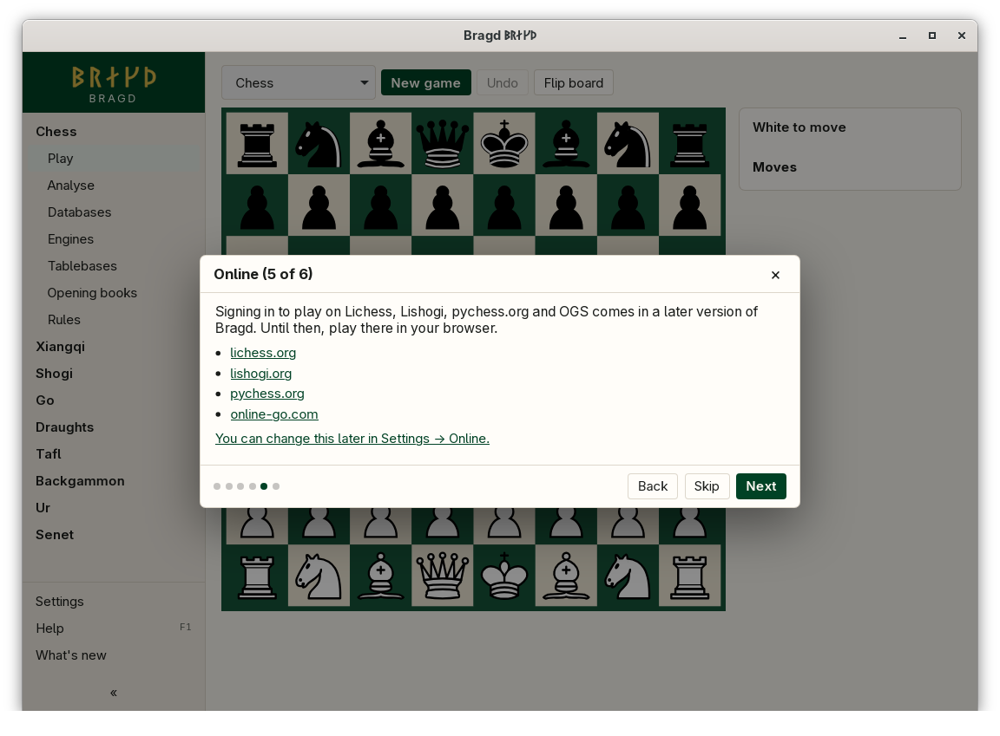

[← README](../../README.md) · [Docs index](../README.md) · [Online](README.md)

# Playing online

**Not yet available.** This version of Bragd cannot sign in to a server or play a Game online. Until it can, play on these servers in your browser. This page says what is planned, in two phases, and what the app shows now.

*Step 5 of the install wizard: links to the servers, nothing to sign in to yet.*

## What is planned

### Phase 1: other servers

| Server | Game families |
|---|---|
| Lichess | Chess and its Variants |
| Lishogi | Shogi |
| pychess.org | Xiangqi, janggi, shogi and the fairy chess Variants |
| OGS (online-go.com) | Go |

- Sign-in is per server, over OAuth, in your browser. Bragd never sees your password.
- The token a server gives Bragd is kept in your system's keychain only, never in `config.toml` or a file of Bragd's.
- While a rated Game against a person is live, Analyse, book moves and tablebase lookups are locked in every window. They come back when the Game ends. The lock is already in the code, with no online Games to apply it to yet.

### Phase 2: Bragd's own server

A game server written in Rust, run as a container on Bragd's own host, for the Families no other server hosts, such as tafl, Ur and senet. It brings ratings and tournaments. Bragd's rules crates decide what is legal on it, the same as in the app.

## How to reach it

There is nothing to reach yet.

- Step 5 of the [install wizard](../getting-started/first-start.md) links to the four servers.
- *Settings → Online* holds *Ask Lichess for tablebase positions*, the one setting that talks to a server today. No sign-in is there yet.
- The sidebar has no online item yet.

## What it needs

Nothing yet. Phase 1 will need a browser for the sign-in, and your system's keychain for the token.

## Settings and config.toml

| Setting | `config.toml` key | Default | What it does |
|---|---|---|---|
| Ask Lichess for tablebase positions (`tablebases_online`) | `tablebases.online` | `true` | Sends a chess position your own tables do not cover to the Lichess tablebase API ([Tablebases](../engines/tablebases.md)) |

## Questions

#### Can I play online now?

No. Play on lichess.org, lishogi.org, pychess.org or online-go.com in your browser. The wizard's Online step links to them.

#### Will my password go through Bragd?

No. Sign-in will happen on the server's own page in your browser. Bragd only gets a token, which goes into your system's keychain.

#### Why will Analyse be locked during an online Game?

Engine help in a rated Game against a person is cheating on every server. The lock covers Analyse, book moves and tablebases, in every Bragd window, until the Game ends.

#### Why does Settings → Online have a tablebase switch?

It is the one setting that sends something to a server today: a chess position your tables do not cover goes to the Lichess tablebase. Turn it off to keep every lookup on your machine.

#### When does Bragd's own server come?

After phase 1. It has no date yet.

---
[← Previous: Online](README.md) · [Next: Reference →](../reference/README.md)
