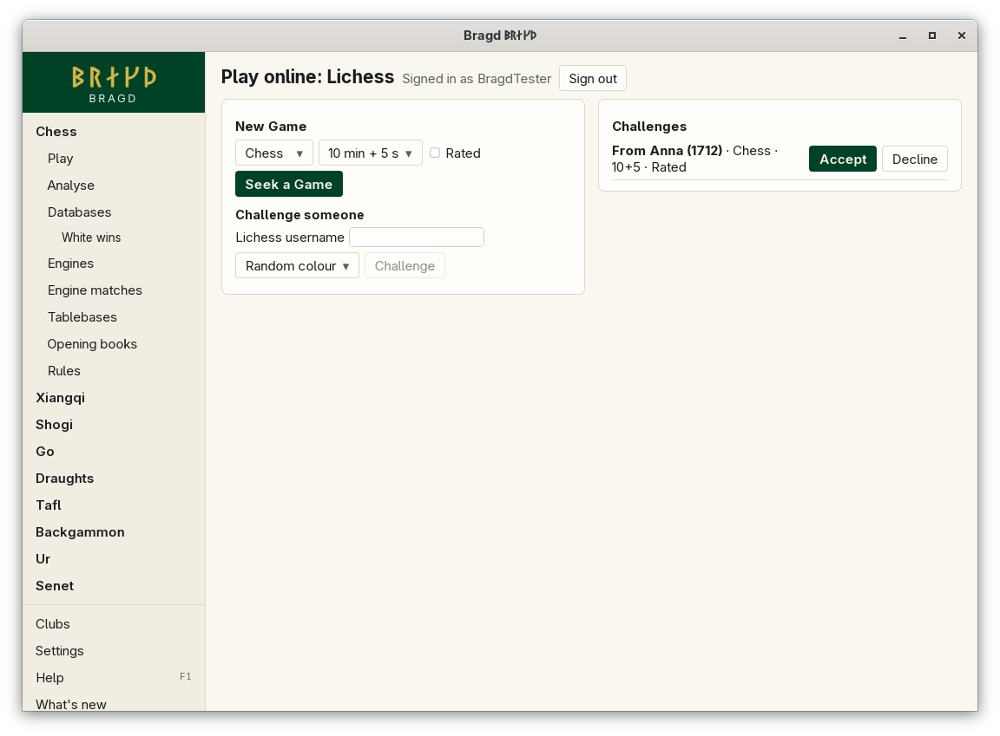
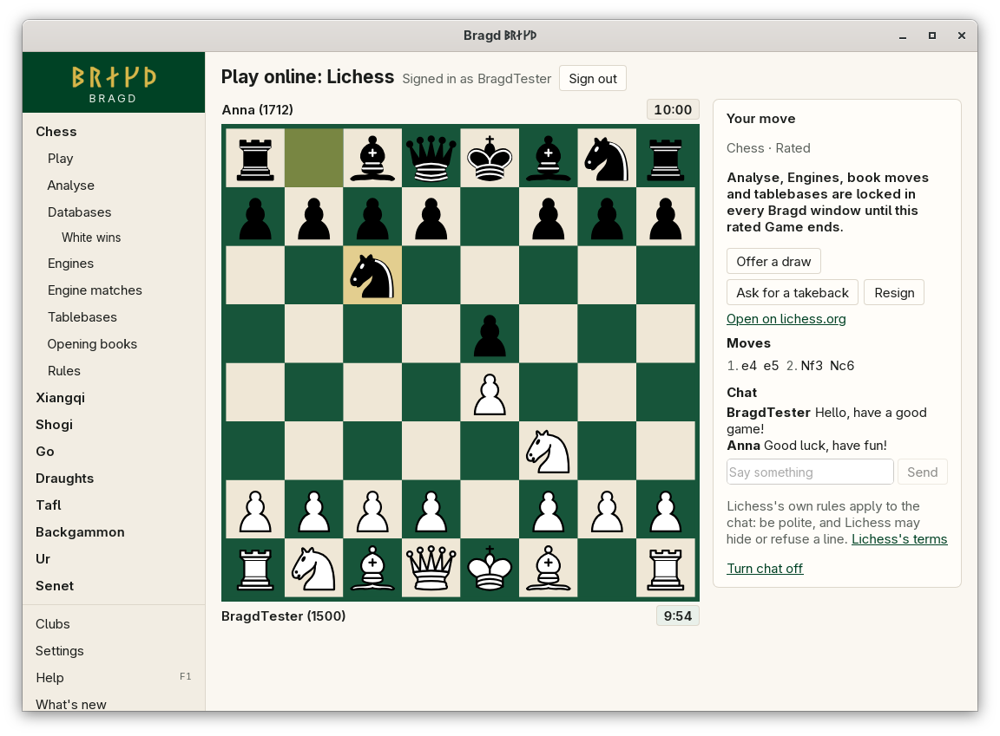
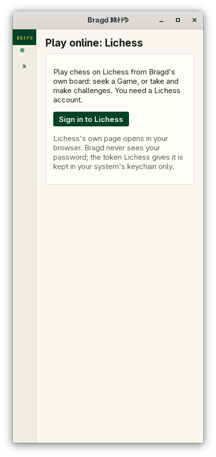

[← README](../../README.md) · [Docs index](../README.md) · [Online](README.md)

# Playing online

Bragd plays on three servers from its own board: chess on Lichess (this page), shogi on [Lishogi](lishogi.md) and go on [OGS](ogs.md). Each shows only while its Game family is on. Signing in, the fair-play lock and chat work the same on all three. pychess.org cannot be played from Bragd: [why](pychess.md).

Play chess on Lichess from Bragd's own board. You sign in once in your browser, then seek a Game or take and make challenges, and play with Lichess's clocks, draw offers and takebacks. A Game's chat can be read and written in Bragd once you turn it on. In F1 this is the `online` entry. It shows only while chess is on.

*Play online: the lobby.*

*A Game under way, with chat turned on.*

## How to reach it

*Play online before signing in, 390 px wide.*

Open chess's **Play** and press **Play on Lichess**. The first time, press **Sign in to Lichess**: Lichess's own sign-in page opens in your browser. Sign in there and allow Bragd. The browser then says you can close the tab, and Bragd shows *Signed in as* your name. Step 5 of the [install wizard](../getting-started/first-start.md) offers the same sign-in, for each server that plays one of your Families.

| Button | What it does |
|---|---|
| **Sign in to Lichess** | Opens Lichess's sign-in page in your browser. Bragd waits up to five minutes for it |
| **Sign out** | Lichess takes the token back, and it is removed from your keychain |
| **Seek a Game** | Asks Lichess for an opponent with the Variant, time and *Rated* chosen. **Cancel** stops waiting |
| **Challenge** | Challenges the Lichess user named, with the same Variant and time, and the colour chosen |
| **Accept** / **Decline** | Answers a challenge made to you |
| **Cancel** | Takes back a challenge you made |
| **Reconnect** | Opens the connection again after it was lost |

### Playing

Click a piece, then its square, or drag it. Bragd's rules check the move before it is sent; Lichess decides the rest. The clocks count down for the side to move once both sides have moved.

| Button | What it does |
|---|---|
| **Abort** | Ends the Game before both sides have moved, with no result |
| **Offer a draw** | Offers a draw; when your opponent offers one, **Accept** or **Decline** it |
| **Ask for a takeback** | Asks to take back your last move; answer theirs with **Accept** or **Decline** |
| **Resign** | Gives up the Game |
| **Open on lichess.org** | Opens the Game on Lichess in your browser |
| **Back to the lobby** | Leaves a Game that is over |

### Variants

Bragd plays the Lichess Variants it has rules for. A Variant you turned off in Settings is not offered.

| Lichess | Bragd |
|---|---|
| Standard, From position | Chess |
| Chess960 | Chess960 |
| King of the Hill | King of the Hill |
| Racing Kings | Racing Kings |

A challenge in another Variant, such as crazyhouse or atomic, can be declined but not accepted here. Play it on lichess.org.

Real-time Games on Lichess's Board API are rapid or classical: the times offered run from 10 minutes to 30 minutes plus 20 seconds.

### Fair play

Lichess's terms forbid help from an Engine in a rated Game against a person, and so do Lishogi's and OGS's. While such a Game is on in any Bragd window, every Bragd window on the machine locks Analyse, game reviews, Engine moves, book moves, tablebase lookups and the Position store's hints, and the Game says so. They come back when the Game ends: at once in its own window, and within five seconds in the others. A casual Game, or one against the server's AI or a bot account, locks nothing.

The windows share the lock through the [Helper](../knowledge/helper.md). Each window tells it every few seconds whether its Game is on. A window that crashed stops telling, and its lock ends 15 seconds after its last word. While the Helper cannot be reached, each window locks only for its own Game.

### Chat

Chat is off by default. With it off, Bragd does not fetch or show a line, and sends none. Press **Turn chat on** beside the board, or turn on *Chat in online Games* in *Settings → Online*. The setting is the same for every server. Then the Game's chat so far is fetched, and new lines come as they are said. A line is at most 140 characters.

Lichess's own rules apply to the chat, and Lichess may hide or refuse a line. Lichess Games have no Call: your opponent may not be using Bragd.

## What it needs

- A Lichess account, and a browser for the sign-in.
- Your system's keychain for the token: the Secret Service on Linux and the BSDs (GNOME Keyring or KWallet), the Keychain on macOS, the Credential Manager on Windows.
- A connection to `lichess.org`. With `BRAGD_OFFLINE` set nothing is sent.

## Settings and config.toml

| Setting | `config.toml` key | Default | What it does |
|---|---|---|---|
| Chat in online Games (`online_chat`) | `online.chat` | `false` | Reads and writes an online Game's chat in Bragd, on every server |
| Ask Lichess for tablebase positions (`tablebases_online`) | `tablebases.online` | `true` | Sends a chess position your own tables do not cover to the Lichess tablebase API ([Tablebases](../engines/tablebases.md)) |

The token is not in `config.toml` or any file of Bragd's: it is in your system's keychain, under the service `bragd-online`.

For testing, `BRAGD_LICHESS_URL` points Bragd at another server, such as the fake one on this machine (`cargo run -p bragd-online --features fake --example fake-online -- lichess`). `BRAGD_LICHESS_TOKEN` stands in for the keychain only when that address is on this machine. Lishogi and OGS have their own pair ([Command line](../reference/command-line.md#environment-variables)).

## Other servers

| Server | Game families | Page |
|---|---|---|
| Lishogi | Shogi | [Playing on Lishogi](lishogi.md) |
| OGS (online-go.com) | Go | [Playing on OGS](ogs.md) |
| pychess.org | Xiangqi, janggi, shogi and the fairy chess Variants | [Why pychess.org is not played from Bragd](pychess.md) |

The install wizard links pychess.org for those Families. After these comes Bragd's own server, for the Families no other server hosts, such as tafl, Ur and senet. Bragd's rules crates decide what is legal on it.

## Questions

#### Does Bragd see my Lichess password?

No. You sign in on Lichess's own page in your browser. Lichess hands Bragd a token, which goes into your system's keychain. Bragd asks for three permissions only: playing Games through the Board API, and reading and making challenges.

#### Why are Analyse and Engines locked during a Game?

Lichess's terms forbid engine help in rated Games against people, and so does every other server. The lock covers every kind of help Bragd has, in every Bragd window, and ends with the Game.

#### Why is Analyse locked in a window that is not playing?

Another Bragd window on this machine is playing a rated Game against a person. A second window would otherwise be an easy way round the lock. It ends within five seconds of that Game's end, or 15 seconds after that window closed or crashed.

#### Why does sign-in say Lichess no longer accepts it?

The token was taken back on Lichess (*Preferences → API access tokens*), or it ran out. Sign in again.

#### Why can't I seek a 3-minute Game?

Lichess's Board API, which Bragd plays through, is for rapid and classical Games. Faster Games are played on lichess.org.

#### Can I play a Game I started on lichess.org?

Yes. A Game under way on your account comes into Play online when you open it, and goes on from where it stands.

#### Why is the chat empty?

Chat is off until you turn it on. When it is on, Lichess may still hide lines under its own rules, or keep the chat closed, for example on a kid-mode account.

---
[← Previous: Online](README.md) · [Next: Playing on Lishogi →](lishogi.md)
