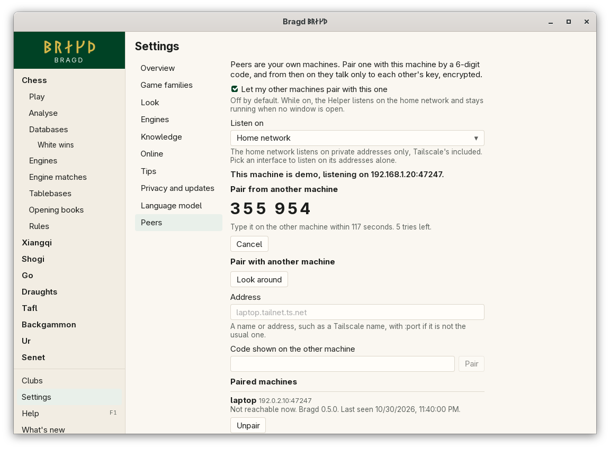

[← README](../../README.md) · [Docs index](../README.md) · [Peers](README.md)

# Pairing your machines

Peers are your own machines. You pair two of them once: one shows a 6-digit code, and you type it on the other. Each keeps the other's key, and from then on their Helpers talk only to each other, encrypted. In F1 this is the `peers` entry.

*Settings → Peers.*

## How to reach it

Open *Settings → Peers* on both machines.

1. Tick **Let my other machines pair with this one** on both. The line under it says which addresses the Helper listens on.
2. On the first machine, press **Show a code**. Six digits appear, with the seconds and tries left.
3. On the second machine, press **Look around**. Bragd lists the other Helpers on your home network. Press **Use** beside the first machine, or type its address under *Address*.
4. Type the code under *Code shown on the other machine* and press **Pair**.

Both machines now list each other under *Paired machines*. The code is used up.

| Button | What it does |
|---|---|
| **Show a code** | Shows a new 6-digit code, good for two minutes and five tries |
| **Cancel** | Takes the code away at once |
| **Look around** | Listens for three seconds for other Helpers on the home network (mDNS) |
| **Use** | Puts a machine found into *Address* |
| **Pair** | Pairs with the machine at *Address* that shows the code typed |
| **Check again** | Asks every paired machine whether it is there, with its name and version |
| **Unpair** | Forgets that machine here and tells it to forget this one |

## Finding a machine

On the same home network, **Look around** finds every Helper that has Peers on: they announce themselves by mDNS as `_bragd._tcp`. A paired machine found at a new address is remembered there.

Away from home, or on a network that blocks mDNS, type the other machine's address. A name works, such as its Tailscale name (`laptop.tailnet.ts.net`), as does an IP address. Bragd uses port 47247. Add `:port` only if the other machine is reached on another port, for example through a forwarded port.

## Unpairing

Press **Unpair** beside a machine, on either side. This machine forgets the other's key at once and closes any connection with it. Bragd also tells the other machine, which forgets this one too. If the other machine cannot be reached, it keeps the key until you unpair there, but this machine refuses it in the TLS handshake from now on.

To pair again, show a new code.

## What it needs

Two machines with Bragd, both with Peers on, that can reach each other: the same home network, or a VPN such as Tailscale. While Peers are on, the Helper stays running when no window is open, so the other machine can reach it. Turn on *Start with my session* in *Settings → Knowledge* if it should also listen after a restart without opening Bragd ([The Helper](../knowledge/helper.md)).

A firewall must let TCP port 47247 in, and UDP port 5353 for mDNS.

This machine's key and the machines it is paired with are kept in `peers/` in the Helper's folder ([Files on disk](../reference/files.md)).

## Settings and config.toml

| Setting | `config.toml` key | Default | What it does |
|---|---|---|---|
| Let my other machines pair with this one (`peers_on`) | `peers.on` | `false` | The Helper listens for Peers and announces itself on the home network |
| Listen on (`peers_interface`) | `peers.interface` | empty: the home network | Empty: the private addresses of every interface. An interface's name: all its addresses, and nothing else |

The home network means private addresses only: `10.0.0.0/8`, `172.16.0.0/12`, `192.168.0.0/16`, link-local `169.254.0.0/16`, the `100.64.0.0/10` range Tailscale uses, and IPv6 unique local addresses. A public address is listened on only when you pick its interface.

## Questions

#### Is a 6-digit code safe?

Yes. A code lasts two minutes and five tries, and works once. The machines turn it into a key with SPAKE2, so someone who listens to the pairing learns nothing they could test guesses against later. Someone guessing gets five tries in a million. Details are in [How Peers talk](protocol.md).

#### Does anything leave my home network?

Only what goes to the machines you paired, and only encrypted. Bragd runs no server of its own for Peers. When you type an address on the internet, the connection goes there, to that machine alone ([Privacy](../reference/privacy.md)).

#### Why does Pair say the other machine shows no code?

The code ran out after two minutes, was used, or its five tries are gone. Press **Show a code** there again.

#### Why does Look around find nothing?

The other machine has Peers off, is on another network, or a firewall or the router blocks mDNS. Type its address instead.

#### What do Peers share?

In this version, their names, Bragd versions and whether they are reachable. Sharing the Position store and the background queue builds on this pairing. Libraries, Slices and Settings always stay on each machine.

---
[← Previous: Peers](README.md) · [Next: How Peers talk →](protocol.md)
