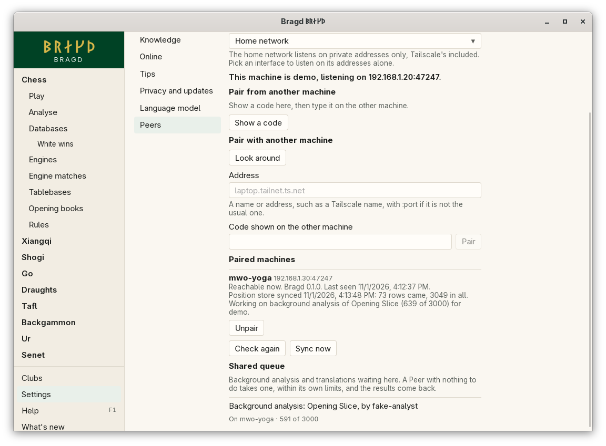

[← README](../../README.md) · [Docs index](../README.md) · [Peers](README.md)

# Sharing between Peers

Paired machines share two things: what is new in their [Position stores](../knowledge/position-store.md), and their queues of [background analysis](../engines/background-analysis.md) and translations. A machine with nothing to do takes a job the other has waiting, inside its own limits. Libraries, Slices and Settings stay on each machine. In F1 this is the `sharing` entry.

*Settings → Peers, with a paired machine sharing.*

## How to reach it

[Pair your machines](peers.md) first. Sharing then starts by itself while *Let my other machines pair with this one* is on, on both. *Settings → Peers* shows how it stands.

| Line or button | What it shows or does |
|---|---|
| *Position store synced …* | Under each paired machine: when its rows last came, how many came then, and how many in all |
| *Sync failed …* | The last sync did not get through, and why. The next one comes within a minute |
| *Working on …* / *Idle* | What that machine runs now, and for whom |
| *Has a language model* | That machine can translate for this one |
| **Sync now** | Takes what is new from every paired machine now, rather than at the next minute |
| *Shared queue* | This machine's background analysis and translations waiting or running, and where: *Waiting*, *On laptop*, *Here*, or *Here, for laptop* |

A job of the shared queue also shows on the [Jobs page](../knowledge/helper.md), where it can be cancelled.

## The Position store's sync

Every minute, the Helper asks each paired machine for the rows that changed in its store since the last time, and merges them by the store's rule: for one position and one Edition, the deeper row wins. The order rows arrive in makes no difference, so merging never conflicts. Each machine asks the other, so rows go both ways, and a row passes on: with three machines, A and C each paired only with B, all three end with the same store.

Only what changed since the last sync goes over: each row carries a change number, and each machine keeps how far it got with each Peer. A sync takes at most 50 batches of 2,000 rows from one Peer; a big store comes over in several minutes. Delete the Position store on one machine, and it takes everything again from its Peers.

## The shared queue

A machine takes a job from a Peer when it has none of its own waiting, and only inside its own limits:

- background analysis inside the hours and the battery rule of *Settings → Knowledge* (`[analysis]` in `config.toml`), with the Engine the job names in an Edition at least as new as the job asks;
- a translation only with a [language model](../knowledge/language-model.md) ready.

The job carries its positions, so the other machine needs neither the Library nor the Slice. It runs there into that machine's own Position store, and its results come back with the next sync. The machine that queued it marks it done as soon as it is given back, and takes the results at once.

A job is lent for ten minutes, and renewed every minute while it runs. If the other machine goes away, the lease runs out and the job goes back to the queue: here, or to another Peer. Positions already analysed are not analysed again. A machine that cannot do a job, for want of the Engine, too old an Edition, or because it failed there, gives it back, and is not offered that job again.

Container Engines run the same Edition on every machine, pinned by image digest, so they suit shared jobs best ([Engine container images](../engines/container-images.md)).

### Model jobs

With no language model set up here, **Translate** under a comment shows when a paired machine has a model ready. The comment goes to that machine through the shared queue, its model translates it, and the translation comes back and is kept here only. If no Peer answers within two minutes, Bragd says so and the job is cancelled.

## What it needs

Two paired machines with Peers on, which can reach each other ([Pairing your machines](peers.md#what-it-needs)). A machine away for a while catches up at its next sync.

## Questions

#### Does another machine see my Libraries?

No. It gets Position store rows, and the positions of a job it takes. Game records, players, Libraries, Slices and Settings never leave the machine.

#### Will my laptop analyse on its battery for my desktop?

Only if you allowed background analysis on the battery on the laptop. It takes jobs within its own limits, not the desktop's.

#### Why does a job show *On laptop* but nothing happens there?

The laptop took it and has not renewed it since. Either it is still on a long position, or it went away; after ten minutes without a word the job comes back here.

#### Why is a job never taken?

No paired machine can do it: none has the Engine, or an Edition new enough, or they are all busy or outside their hours. It runs here once this machine's own limits allow.

#### Are translations shared?

No. A translation is kept by the machine that asked for it. Another machine translates only when this one asks it to.

---
[← Previous: Pairing your machines](peers.md) · [Next: How Peers talk →](protocol.md)
