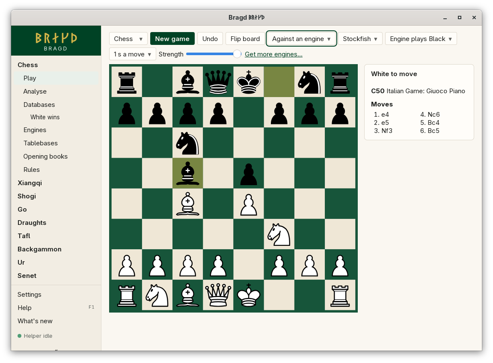

[← README](../../README.md) · [Docs index](../README.md) · [Play](README.md)

# Playing against an Engine

An Engine plays one Side and you play the other. You choose the Engine, its Side, how long it thinks and how strong it plays. In chess, the opening's name and the moves of your opening books show under the turn line.

<!-- screenshot: play-engine-chess-1100.png: chess Play against an Engine, the bar's button reading Play on Lichess -->

*Chess against an Engine, with the opening's name and book moves.*

## How to reach it

1. In the sidebar, choose a Family, then **Play**.
2. In the bar, set *Opponent* to *Against an engine*.
3. Choose the Engine, its Side (*Engine plays Black*), the thinking time and the strength.

When the Engine's Side is to move, *The engine is thinking…* shows and the Engine answers. If it is set to play the first Side, it moves at once.

| Control | Choices | What it does |
|---|---|---|
| Opponent | *Against yourself*, *Against an engine* | Who plays the other Side |
| Engine | The Engines that play this Variant | Not ready ones say *(not ready)* and cannot start |
| The engine's side | *Engine plays …* for each Side | Second Side by default |
| Thinking time | 0.1 s, 1 s, 3 s or 10 s a move | The Engine's time for each move. 1 s by default |
| Strength | A slider, 0 to 20 | Sent as the Engine's `Skill Level` option when it has one (Stockfish, Fairy-Stockfish). Other Engines ignore it and only the time counts |

## What it needs

An Engine for the Variant that is ready: installed on your machine, added by its path, or run from its container image ([The Engines page](../engines/engines.md)). The Engine list offers only ready Engines. Without one, the *Opponent* list does not show; when the Variant has Engines that are not ready yet, **Get more engines…** opens the Engines page.

| Game family | Engines |
|---|---|
| Chess and its Variants | Stockfish, Fairy-Stockfish |
| Xiangqi, janggi | Fairy-Stockfish, Pikafish, ElephantEye (xiangqi only) |
| Shogi | Fairy-Stockfish, YaneuraOu |
| Go | KataGo, GNU Go |
| Draughts | Scan, International draughts only |
| Backgammon | GNU Backgammon |
| Tafl, Ur, senet | None. Built-in Bots for them are not built yet |

An Engine that is not installed plays from Bragd's sealed container image, once you pull it from its card on the Engines page ([Engine container images](../engines/container-images.md)).

## Settings and config.toml

| Setting | `config.toml` key | Default | What it does |
|---|---|---|---|
| Default Engine per Variant | `engines.default` | None: the first that is installed | The Engine chosen when Play opens. Set it on the Engines page |
| Engine programs | `engines.paths` | Empty | Engine name → the program to run instead of the one found |
| Opening books | `engines.books` | Empty | Polyglot `.bin` files whose moves show in chess ([Opening books](../engines/opening-books.md)) |

The Engine, Side, time and strength chosen in the bar are not saved. They go back to their defaults when Play opens again.

## Questions

#### Why is there no Opponent list?

The Variant has no Engine Bragd knows of. This is the case for tafl, Ur, senet, English, Brazilian and Russian draughts. Their built-in Bots are not built yet.

#### Why does Undo take back two moves?

Against an Engine, Undo takes back the Engine's reply as well as your move, so it is your turn again. Against yourself it takes back one.

#### What does Strength do?

It sets the Engine's `Skill Level` option, from 0 (weakest) to 20 (full strength), before each move. Only Engines that offer that option use it. For the others, a shorter thinking time is the way to make them weaker.

#### The Engine says it cannot start. Why?

The message names the Engine and the reason. Most often the program is not installed, or it does not play this Variant: an Engine added by its path must offer `UCI_Variant` for chess Variants and janggi, or speak USI for shogi.

#### What are the buttons under the turn line in chess?

In standard chess, the opening's ECO code and name, and the moves your opening books hold for the position, each with its share. Click one to play it. They show against yourself too.

#### Does the Engine double in backgammon?

No. An Engine Side always takes a double offered to it and never offers one.

---
[← Previous: Playing against yourself](against-yourself.md) · [Next: Chess and its Variants →](chess.md)
