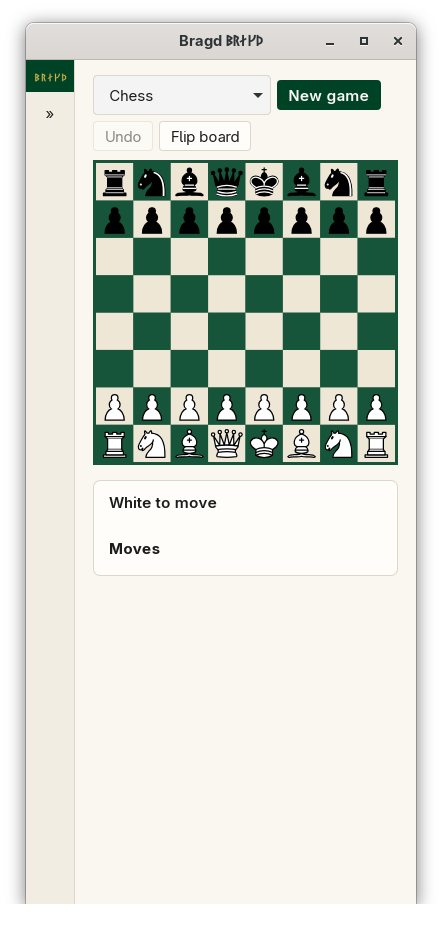

[← README](../../README.md) · [Docs index](../README.md) · [Play](README.md)

# Playing against yourself

You play both Sides of a Game on one board. It is how Bragd opens: the first Family that is on, at **Play**, with its first Variant set up. Use it to try a Variant, to follow a Game from a book, or to play someone sitting beside you. Its entry in F1 → Features is `play`.

<picture><source media="(prefers-reduced-motion: reduce)" srcset="../screenshots/play-chess-self.png"></picture>

*A few moves of chess, both Sides played by hand.*

*In a narrow window the move list goes under the board.*

## How to reach it

| Where | What |
|---|---|
| Sidebar | A Family, then **Play**. With one Family on, **Play** is at the top of the sidebar |
| At start | Bragd opens on **Play** of the first Family that is on |
| Opponent list | *Against yourself* is the default. The list shows only when the Variant has an Engine ([Playing against an Engine](against-an-engine.md)) |

## What it needs

Nothing. Every Variant can be played against yourself, with no Engine and no download.

## How a Game goes

1. Choose the Variant in the first list of the bar. A new Game of it starts.
2. Click a piece of the Side to move. The cells it can go to are marked.
3. Click one of them, or drag the piece there. When several moves end on that cell (a promotion, a draughts capture by two paths), choose one under *Which move?*.
4. Repeat for the other Side. The move list grows with each move. Chess, xiangqi and draughts number full moves, `1. e4 e5`; the other Families number each move, as their own records do.
5. When the Game ends, a banner over the board names the winner, or says *Draw*, with the rules' result text. **New game** starts again.

The families with dice or sticks have a **Throw** button first ([Backgammon](backgammon.md), [Ur](ur.md), [Senet](senet.md)). Go has **Pass** and a scoring step ([Go](go.md)).

## Settings and config.toml

| Setting | `config.toml` key | Default | What it does |
|---|---|---|---|
| A Family on or off | `families.family` | All on | A Family that is off has no Play page |
| A Variant on or off | `families.variant` | All on | A Variant that is off is not in the Variant list |
| Board theme | `look.board_theme` | `racing` | The board's four colours ([Board themes](../look/board-themes.md)) |

## Questions

#### Can I make an illegal move?

No. The board offers only the moves the rules crate returns for the position. A click on any other cell does nothing, or selects another piece of yours.

#### How far back does Undo go?

To the start of the Game. Each press drops the last entry of the record and replays the rest in Rust. A throw of the dice counts as an entry, so in the race Families one press takes back the throw.

#### Is the Game kept when I leave the page?

No. Coming back to Play starts a new Game. Until then, the Game you played last in each Family is kept while the window is open, and Analyse takes it up with *From the current game* ([Analyse](../engines/analyse.md)). Bragd does not save Games played here to a Library yet.

#### Can I start from a position of my own?

Not on the Play page. Analyse has *Position*: paste a FEN (or the Variant's own position text) and play on from there ([Analyse](../engines/analyse.md)).

#### Is there a clock?

Not yet. Games against yourself have no time limit.

#### Why does the turn line say "Sente" and not "Black"?

Each Variant names its own Sides, and Bragd uses those names: Sente and Gote in shogi, Red and Black in xiangqi, Attackers and Defenders in tafl.

---
[← Previous: Play](README.md) · [Next: Playing against an Engine →](against-an-engine.md)
