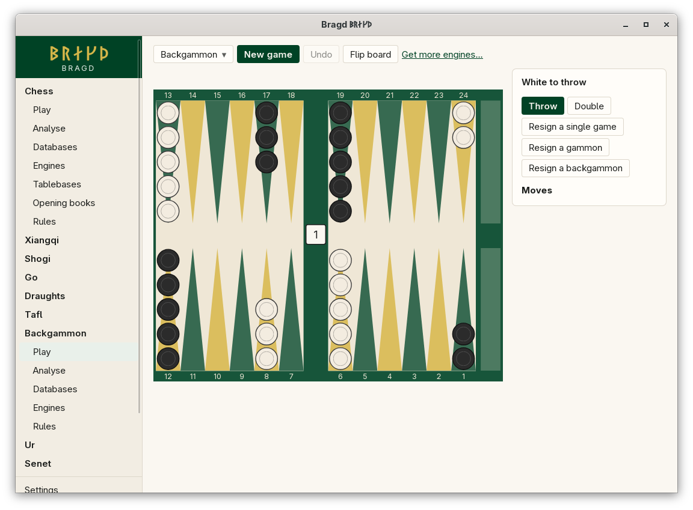

[← README](../../README.md) · [Docs index](../README.md) · [Play](README.md)

# Backgammon

Backgammon with two dice and a doubling cube. Each Side races its fifteen checkers round the 24 points and bears them off. A lone checker hit by the other Side goes to the bar and must come in again. Bragd throws the dice for you; the throw is an entry in the record, so a Game replays to the same position.

*Backgammon: the board, the dice and the cube.*

| Variant | Key | Sides |
|---|---|---|
| Backgammon | `backgammon` | White, Black |

## How to reach it

Sidebar → **Backgammon** → **Play**. Backgammon has Play, Analyse, Databases, Engines and Rules in the sidebar.

## What it needs

Nothing to play against yourself. Against an Engine: GNU Backgammon installed ([Playing against an Engine](against-an-engine.md)).

## Controls

| What you want | What you do |
|---|---|
| Throw the dice | **Throw**, under the turn line. The opening throw is never a double: the rules refuse it, and Bragd throws again |
| Double | **Double**, before you throw. It shows only when you may double |
| Answer a double | **Take** keeps playing at twice the stake. **Drop** gives up the Game at the stake before the double |
| Play a turn | Click a checker's point, then where its first checker goes (a point, or *off*). *Which move?* lists every whole turn that starts that way, such as `8/5 6/5` |
| Or pick the whole turn | Click it under *Legal moves*. Every legal turn for the dice is listed |
| Come in from the bar | Click the bar, then the point to enter on |
| Bear off | Click the checker, then the tray at the right of the board. White bears off into the lower tray, Black into the upper one |

A turn is played whole: you choose all the dice's moves at once, never one die at a time. Points are numbered from White's side, 1 to 24. Board colours: [Board themes](../look/board-themes.md).

## Settings and config.toml

| Setting | `config.toml` key | Default | What it does |
|---|---|---|---|
| The Family on or off | `families.family` | On | `backgammon = false` under `[families.family]` hides it |
| Default Engine | `engines.default` | First installed | `backgammon = "gnubg"` |

## Questions

#### Why can I not move one die at a time?

What is legal depends on both dice together: you must use as many as any sequence allows. Playing one die first could leave the other unplayable. So Bragd offers only whole turns, which the rules crate has already checked. See [Backgammon](../rules/backgammon.md).

#### Why is there no Throw button after I press Double?

The other Side owes an answer first: **Take** or **Drop**. Then the doubler throws.

#### How many points is a win?

One for a single game, two for a gammon, three for a backgammon, each times the cube. The banner says how many, such as *2 points*.

#### Are the dice fair?

Yes. Each die comes from the operating system's random source, one byte at a time. A byte from the top four values (252 to 255) is thrown away and another taken, so every face is exactly as likely as the others. Ur's dice and Senet's sticks come from the same source.

#### Does the Engine double?

No. GNU Backgammon as an Engine Side always takes a double and never offers one. Backgammon has no Game review yet.

#### Can I resign?

Yes, on your turn. The buttons under the turn line resign a single game, a gammon or a backgammon. You lose one, two or three points, times the cube. The Game ends at once, and the banner shows the points.

---
[← Previous: Tafl](tafl.md) · [Next: Ur →](ur.md)
