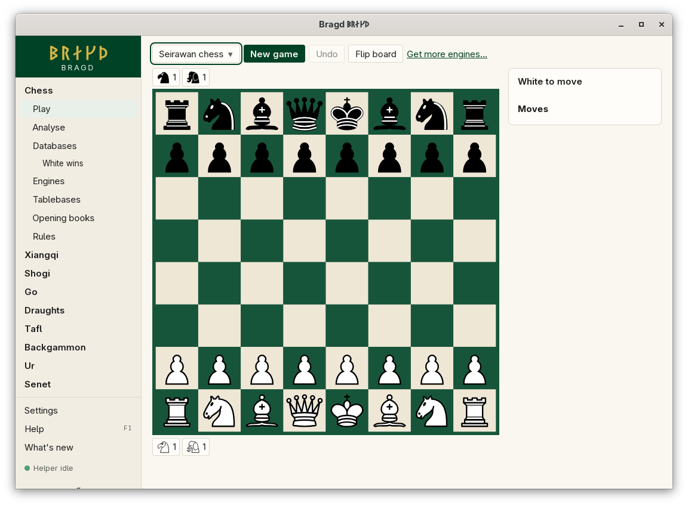
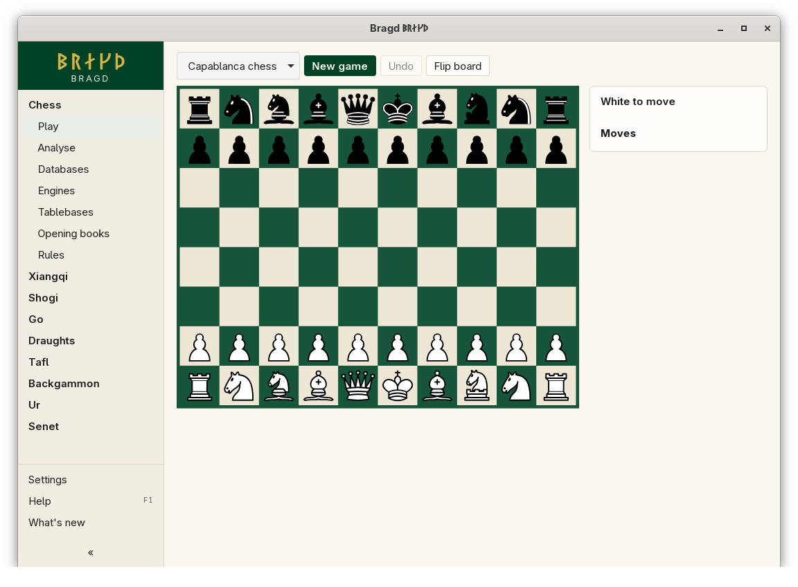
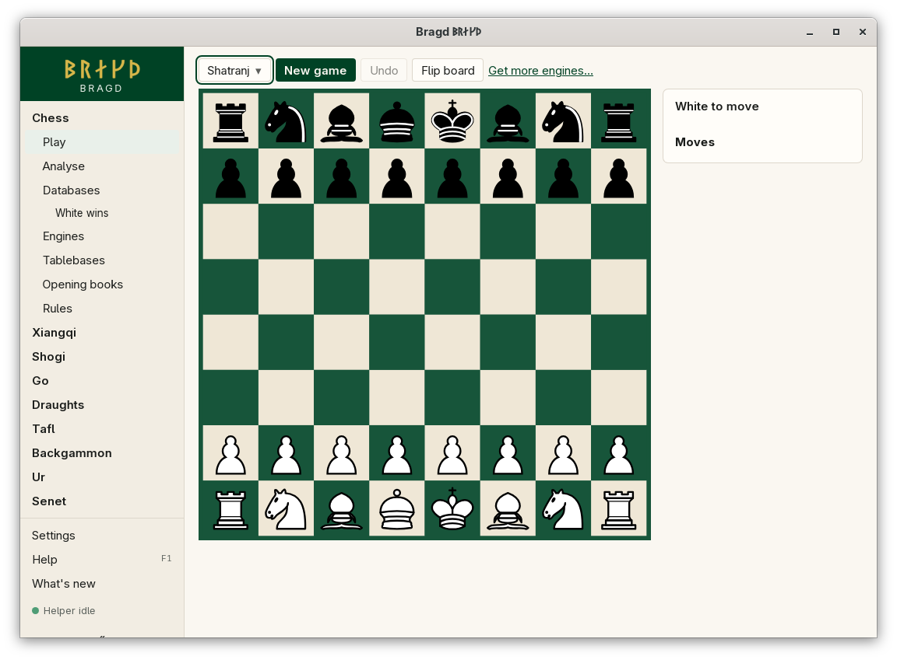

[← README](../../README.md) · [Docs index](../README.md) · [Play](README.md)

# Chess and its Variants

The chess Family has eight Variants on one sidebar item. All use the Cburnett pieces; the fairy pieces (ferz, alfil, hawk, elephant, archbishop, chancellor) are drawn in the same style. The rules and how each was built are on the [Rules](../rules/README.md) pages.

*Chess, the start position.*

| Variant | Key | Board | What is different |
|---|---|---|---|
| Chess | `chess` | 8×8 | The standard game |
| Chess960 | `chess960` | 8×8 | Castling works from any starting array |
| Shatranj | `shatranj` | 8×8 | Ferz and alfil; stalemate wins, a bared king loses |
| Chaturanga | `chaturanga` | 8×8 | A named reconstruction; being stalemated wins |
| King of the Hill | `kingofthehill` | 8×8 | A king on one of the four centre squares wins |
| Racing Kings | `racingkings` | 8×8 | No pawns, no checks; the first king on rank 8 wins |
| Seirawan chess | `seirawan` | 8×8 | A hawk and an elephant in hand, gated in on a vacated back-rank square |
| Capablanca chess | `capablanca` | 10×8 | Archbishop and chancellor; the king castles three squares |

*Seirawan chess: the pieces in hand sit in the trays.*

*Capablanca chess, 10×8.*

*Shatranj.*

## How to reach it

Sidebar → **Chess** → **Play**, then choose the Variant in the first list of the bar. Chess also has **Analyse**, **Databases**, **Engines**, **Tablebases**, **Opening books** and **Rules** in the sidebar.

## What it needs

Nothing to play against yourself. Against an Engine: Stockfish or Fairy-Stockfish installed. Fairy-Stockfish plays every Variant here; Stockfish plays chess and Chess960 ([Playing against an Engine](against-an-engine.md)).

## Controls

| What you want | What you do |
|---|---|
| Move | Click the piece, then the target; or drag it |
| Castle | Move the king two squares towards the rook. In Chess960, move the king onto its own rook. In Capablanca chess, move the king to the square it lands on (three squares) |
| Promote | Move the pawn to the last rank, then choose the piece under *Which move?* (`e8=Q`, `e8=N` …). In shatranj and chaturanga there is one choice, so it happens at once |
| Gate a hawk or elephant (Seirawan) | Click the hawk or elephant in your tray, then move a piece off a back-rank square it has not left before. Without the tray, *Which move?* lists the plain move and the gating ones, such as `Nc3/H` and `Nc3/E` |
| Use a book move | Click it under the turn line (standard chess, with a book set; [Opening books](../engines/opening-books.md)) |

The last move and a king in check are marked on the board. Board colours: [Board themes](../look/board-themes.md).

## Settings and config.toml

| Setting | `config.toml` key | Default | What it does |
|---|---|---|---|
| A Variant on or off | `families.variant` | All on | `chess960 = false` under `[families.variant]` hides Chess960 |
| Opening books | `engines.books` | Empty | Polyglot books whose moves show in standard chess |
| Default Engine | `engines.default` | First installed | Per Variant key, such as `seirawan = "fairy-stockfish"` |

## Questions

#### How do I castle?

Move the king two squares towards the rook: click the king, then g1 or c1 (or drag it there). In Chess960, move the king onto its own rook instead, because there the king may land on a square it can also step to, or not move at all. The move list writes a castle `O-O` or `O-O-O`. In Capablanca chess the king moves to its landing square, three squares.

#### Which Chess960 array does New game set up?

One of the 960 arrays, picked at random, each as likely as the others. Its number, 0 to 959, shows under the turn line as *Chess960 array 123*. Number 518 is ordinary chess's array. To play a particular array, open **Analyse**, paste its FEN under *Position* and play on from there ([Analyse](../engines/analyse.md)).

#### Why does the move list show `Nc3/H`?

That is Seirawan gating: the knight left its square and the hawk came in behind it. `/E` is the elephant. A castle names the square too, `O-O/Hh1` or `O-O/He1`, because castling empties two squares. See [Seirawan chess](../rules/seirawan.md).

#### Can a Seirawan pawn promote to a hawk?

Yes. A pawn promotes six ways: queen, rook, bishop, knight, hawk or elephant. It is not taken from the hand, so you can have two hawks.

#### Why did the Game end with no checkmate?

The Variant has its own ending. A king on d4, d5, e4 or e5 wins King of the Hill. In Racing Kings the first king on rank 8 wins. In shatranj, a bared king loses and stalemate wins; in chaturanga, the stalemated Side wins. See [The cheap chess variants](../rules/chess-variants.md).

#### Why are there no Three-check, Atomic or Crazyhouse?

They are not built. [The cheap chess variants](../rules/chess-variants.md) lists what each would cost.

---
[← Previous: Playing against an Engine](against-an-engine.md) · [Next: Xiangqi and janggi →](xiangqi.md)
