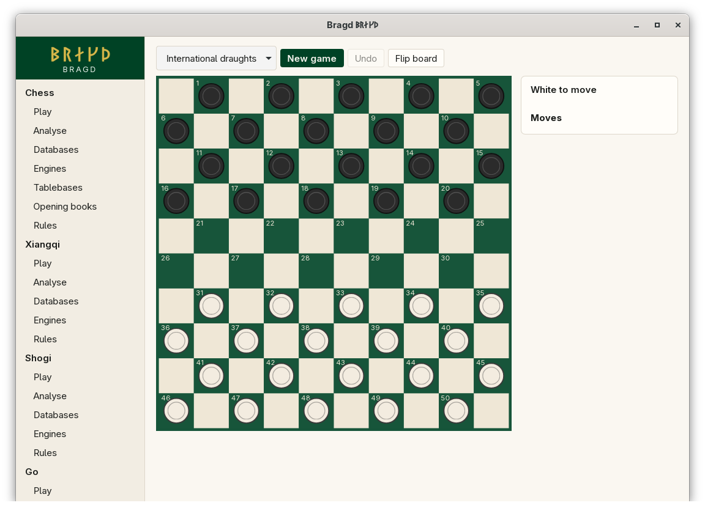
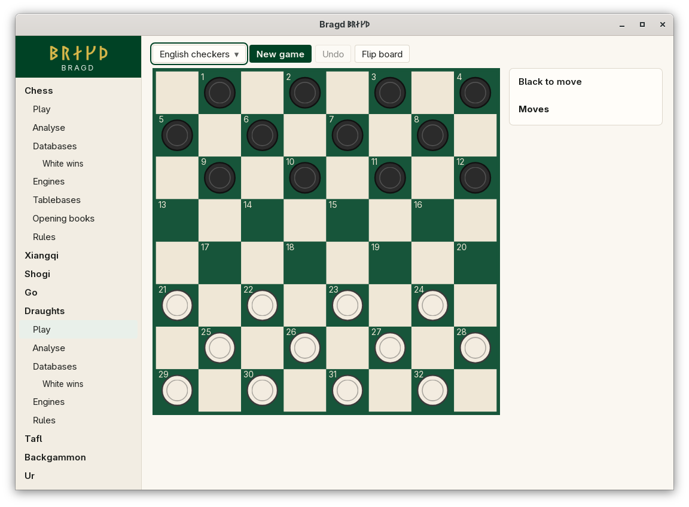

[← README](../../README.md) · [Docs index](../README.md) · [Play](README.md)

# Draughts

Four draughts rulesets, each a Variant of its own. They share men, kings and the dark squares, and differ in how men capture, how far kings fly, whether you must take the most, and when a man is crowned. Black moves first in English checkers, as its rules say; White moves first in the other three.

*International draughts, 10×10.*

*English checkers, 8×8.*

| Variant | Key | Board | Men capture backwards | Flying kings | Must take the most | Crowned |
|---|---|---|---|---|---|---|
| English checkers | `checkers` | 8×8 | No | No | No | When the move ends there |
| International draughts | `draughts` | 10×10 | Yes | Yes | Yes | When the move ends there |
| Brazilian draughts | `draughts-brazilian` | 8×8 | Yes | Yes | Yes | When the move ends there |
| Russian draughts | `draughts-russian` | 8×8 | Yes | Yes | No | Mid-jump, and it goes on jumping as a king |

## How to reach it

Sidebar → **Draughts** → **Play**, then choose the ruleset in the first list of the bar.

## What it needs

Nothing to play against yourself. Against an Engine: Scan, installed or from its image, for International draughts only. English, Brazilian and Russian draughts have no Engine, so the *Opponent* list does not show for them ([Playing against an Engine](against-an-engine.md)).

## Controls

| What you want | What you do |
|---|---|
| Move or capture | Click the man or king, then the square it ends on; or drag it. A capture is one move, however many pieces it takes |
| Choose the route | When two captures end on the same square but take different pieces, *Which move?* lists both. Each names the squares it takes, such as `23x14 (18, 9)` and `23x14 (19, 10)` |
| Choose where a king stops | A flying king's capture can end on several squares beyond the last piece taken. Each is a target of its own |

Captures are compulsory: when one exists, only captures are offered. The move list writes a quiet move `31-27` and a capture by its two ends, `31x22`. The record keeps every square taken as well (`31x22:27`), so the route is never lost. Board colours: [Board themes](../look/board-themes.md).

## Settings and config.toml

| Setting | `config.toml` key | Default | What it does |
|---|---|---|---|
| The Family on or off | `families.family` | On | `draughts = false` under `[families.family]` hides all four |
| A ruleset on or off | `families.variant` | All on | `draughts-russian = false` under `[families.variant]` hides Russian draughts |
| Default Engine | `engines.default` | First installed | `draughts = "scan"` |

## Questions

#### Why does Black move first in English checkers?

Its rules say so. Black's men stand on squares 1 to 12, at the top of the board, so a Game opens with a move such as `11-15`. International, Brazilian and Russian draughts start with White.

#### Why can I not make the capture I want?

In International and Brazilian draughts you must take the most pieces you can. A capture of fewer pieces is not offered. A king counts the same as a man.

#### Why did my man become a king in the middle of a capture?

That is the Russian rule: a man that reaches the far rank mid-jump is crowned at once and goes on capturing as a king.

#### How does a Game end?

A Side with no legal move loses, whether all its pieces are gone or all are blocked. There is no stalemate draw. A position that occurs three times is drawn, and so are 100 plies without a capture or a man moving. That last number is Bragd's policy; each federation has its own rule. See [Draughts](../rules/draughts.md).

#### Is International draughts a bigger English checkers?

No. They differ in three of the four rules in the table, so they play as different games.

---
[← Previous: Go](go.md) · [Next: Tafl →](tafl.md)
